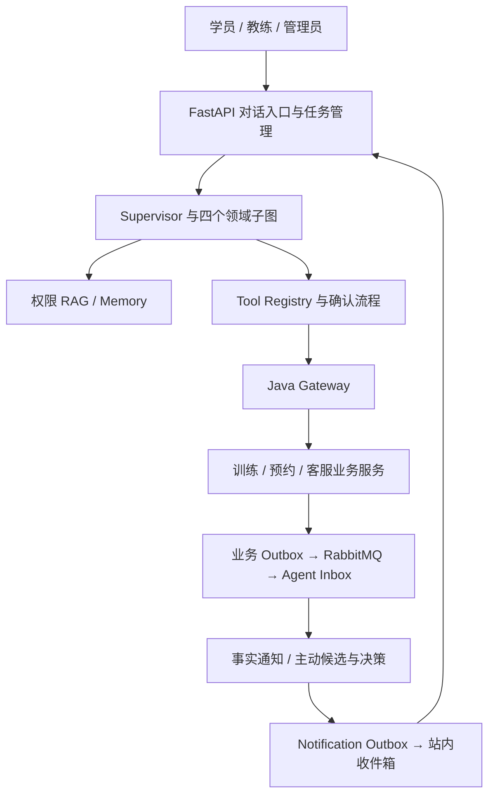

# AI 健身平台：简历 25 项项目职责逐条精讲与面试问答

核对日期：2026-10-08。讲解对象为最新版简历中的四个核心子项目，共 25 条职责。依据为当前工作区源码，包括未提交的修改；这里的“当前”不是仅指 Git HEAD。

本文适合一边打开代码、一边准备项目面试。每一条都解释业务目的、实际调用链、关键状态、设计取舍、异常处理和面试追问。示例中的用户、日期和业务数值均为教学例子，面试话术中的个人分工应按你的实际参与情况调整。

## 阅读依据与版本关系

已找到并参考的资料：

- [第一章至第十一章：源码对照修订版](/Users/a1-6/Desktop/fitness-backend/AI健身平台项目精讲_第一章至第十一章.md)。主体核对时间为 2026-09-26，开头有 2026-10-06 的补充入口；其中展开后的“改前原文”是历史实现。
- [修订前原文备份](/Users/a1-6/Desktop/fitness-backend/AI健身平台项目精讲_第一章至第十一章_修订前备份_20260926.md)。用于理解设计演进，不将旧问题、旧测试数量或旧默认值当作当前结论。
- [企业级运行时升级说明](/Users/a1-6/Desktop/fitness-backend/docs/enterprise-runtime-upgrade-20261006.md)、[认证、请求体绑定与 SAE 交接](/Users/a1-6/Desktop/fitness-backend/docs/auth-key-rotation-and-sae-handoff.md)、[性能证据说明](/Users/a1-6/Desktop/fitness-backend/docs/性能召回并发与续费效果实测_20261006.md)、[RAG 问题研究指南](/Users/a1-6/Desktop/fitness-backend/docs/rag-question-study-guide.md)。

目前没有找到你所说的标题带“ 2”的 Markdown，因此不声称已经阅读该文件，也不把修订前备份擅自认作它。本文先以现有资料和实际代码完成全部职责讲解。

旧精讲与当前代码冲突时，以当前代码为准。特别注意：现在已经有用户取消协议、完成轮次凭据、候选摘要随完成事务发布，以及确认 Token 的实际 HTTP 请求体绑定；旧文里“主要非流式”“取消尚未实现”“参数 Hash 绑定尚不完整”等表述要结合具体阶段阅读。源码存在对应功能，不代表真实部署已启用，也不代表本轮重新运行了相关测试。本文引用历史报告和现有测试文件，不新增收费模型调用或生产压测。

## 四个项目之间的关系

| 子项目 | 职责编号 | 面试要讲清的中心问题 |
| --- | --- | --- |
| 多 Agent 编排与安全运行平台 | 1.1-1.6 | 怎样把不确定的模型行为接入受控、可恢复、可观测的执行系统 |
| 权限隔离 RAG 与个性化训练系统 | 2.1-2.8 | 怎样让模型读取正确且有权限的知识，生成可追溯、可审核的训练草案 |
| 智能课程预约与可靠业务执行系统 | 3.1-3.5 | 怎样把自然语言意图变成经过确认、并发安全、可以核查结果的业务事务 |
| 经营分析、智能客服与主动服务系统 | 4.1-4.6 | 怎样依据真实业务事实提供分析与主动服务，并控制自动行动的边界 |

四个简历项目是同一个平台下的能力域。LangGraph 的四个领域子图是健身指导、预约、经营、客服，和这四个简历项目不是一一对应关系：RAG 与运行安全被多个领域共同使用；主动服务也有独立后台处理链。

先记住三类事实：模型可以提出意图和建议；知识库提供静态证据；业务服务决定合同、课时、预约和发布状态。再记住三类状态：对话任务状态、授权确认状态、业务执行状态，它们各自回答不同问题。

## 建议学习顺序

先读 1.1、1.2、3.1、3.2，掌握一次请求的基础链路；再读 3.3-3.5，理解可靠写入；接着读 2.1-2.8，理解知识与训练；最后读 1.3-1.6、4.1-4.6，补齐恢复、运维、评测和主动服务。完整阅读后，用文末的场景练习检查自己是否能跨模块解释。

---

# 项目一：多 Agent 编排与安全运行平台

## 1.1 Supervisor、混合意图路由与四个领域子图

### 简历职责原文

> 基于 FastAPI、LangGraph StateGraph 构建 Supervisor 编排层，将请求路由至健身指导、预约、经营分析和客服四个领域子图；结合确定性规则、模型辅助判断及低置信度澄清处理用户意图，为各领域配置工具白名单，共用父图 Checkpointer 管理会话状态。

### 业务上到底解决什么

“取消明天下午的课”和“取消课程有什么规则”都出现“取消”，前者申请业务写入，后者查询静态规则；“上周预约少了多少”属于经营，“我还有几节课”属于个人合同。只按词匹配，容易把咨询变成执行；把所有工具一次性交给模型，又会增加选错工具、参数混用和额外 Token。

本项目先确定受控领域与意图，再给模型相应上下文和工具。领域解决“进入哪类业务”，意图进一步解决“本轮允许做什么”。例如预约领域可含查课、查预约、创建、改约、取消，不能因为进入预约领域就同时开放所有写工具。

### 一次请求如何执行

FastAPI 解析消息并验签，构造 `SupervisorRequest`。`Supervisor._invoke()` 在会话保护范围内读取历史，父图的 `supervisor_router` 再结合本轮消息、最近历史和上一领域作判断。新图的 `graph_version=3`；路由结果形成 `route_plan`，通过 `prepare_domain` 进入对应领域子图。每个子图有 `enter → model → tools/confirmation/结束` 的结构，完成后回到父图的 `domain_complete`。

`HybridIntentRouter` 支持 `rules`、`shadow`、`hybrid`。在 hybrid 下，明确写意图、明确多意图和高置信规则可直达；其余调用结构化模型分类。模型结果还要经过 Pydantic 和服务端领域/意图校验，不能创建新的领域。超时、非法 JSON 或配置错误时按规则、有限上下文继承或澄清回退。低于阈值则询问用户；构造器的阈值默认 0.8、超时默认 3 秒，实际装配由配置决定。

最多两个意图按顺序执行，不是无限规划。例如“解释取消规则，再帮我取消预约”，可以先解释再形成确认；涉及写入时会暂停等待批准。顺序编排让状态、结果和确认点清楚，但两段耗时会叠加。

### 为什么共用父图 Checkpointer

父图保存统一会话事实和父子图执行位置，子图不另建互相独立的持久化历史。否则一次确认可能在一个子图暂停，而父图已记录另一结果，恢复时难以一致定位。当前保留旧 `model/tools/confirmation` 节点，是为了恢复历史暂停任务，不是新请求仍走旧拓扑。带敏感旧 `request` 状态的 checkpoint 会被拒绝，兼容不是无条件继续使用。

### 技术取舍与故障

规则可解释且不增加模型调用，覆盖复杂口语有限；模型能理解模糊表达，增加延迟、成本和不确定性。shadow 可观察模型和规则的差异而沿用规则执行，用于迁移评估。模型自报 confidence 不是经过校准的实际正确概率，阈值只能作为保守分流信号，仍需数据验证。

路由不承担资源授权；即使分类正确，也不代表用户有权取消指定预约。多意图目前也没有自动完成任意跨系统事务的能力。

### 面试可以这样讲

> 我把对话编排拆成父图的意图调度和领域子图的执行循环。明确需求走规则，模糊表达用受限结构化分类，低置信先澄清。进入领域后再按意图收窄工具，最多顺序处理两个意图。父图共用持久化检查点，因此确认中断和多轮恢复都围绕同一份会话事实进行。

### 面试追问与回答

**为什么不全部交给一个 Agent？** 当前领域的工具、规则和风险不同，分域可以减少工具选择空间，并独立测试各类行为；基础代码和事实服务仍可共享。

**这是真多 Agent 还是多个 Prompt？** 代码中有独立编译的领域子图、领域规格和执行拓扑；它们共享运行进程、模型网关及 State，没有四个独立远程模型服务，也没有无界协商机制。

**规则判断错了怎么办？** 查看 `route_source/reason_code` 和固定路由案例，补充困难表达；危险操作还有确认和业务校验。确认不能弥补所有路由错误，例如纯查询被错误拒绝仍影响体验。

**一个问题有三个意图怎么办？** 当前有界策略不会自动无限执行，应澄清或分步处理；扩展前要引入全请求 deadline、总 Token、工具总次数及中断恢复策略。

**子图上下文完全隔离吗？** 系统会重建本领域临时规则和检索上下文，但历史仍按共享会话管理；不能声称各子图拥有完全独立的数据隔离。

### 代码与复习入口

[请求入口](/Users/a1-6/Desktop/fitness-backend/fitness-agent-service/app/api/routes/agent.py)、[Supervisor](/Users/a1-6/Desktop/fitness-backend/fitness-agent-service/app/agent/supervisor.py)、[领域子图](/Users/a1-6/Desktop/fitness-backend/fitness-agent-service/app/agent/domain_subgraphs.py)、[混合路由](/Users/a1-6/Desktop/fitness-backend/fitness-agent-service/app/agent/routing.py)。关注 `_build_graph()`、`_supervisor_router_node()`、`HybridIntentRouter.decide()`；参考旧精讲第二章及[路由测试](/Users/a1-6/Desktop/fitness-backend/fitness-agent-service/tests/test_intent_routing.py)。能自己画出“路由 → 准备领域 → 子图 → 完成/确认”，才算掌握。

## 1.2 Tool Registry、参数契约与多层权限

### 简历职责原文

> 设计统一 Tool Registry，基于 Pydantic、JSON Schema 管理工具参数、角色要求和确认策略；结合签名 AgentContext 与 Java Gateway 二次校验，将用户身份、机构范围和资源归属绑定到服务端执行上下文，阻止模型自行扩展权限。

### 业务例子与三个不同问题

学员说“查询机构 B 另一个人的合同”，模型可能理解得很准确，但该请求仍没有授权。这里必须分别判断：工具是否存在、参数是否合法、用户是否有权访问。这三个判断不能由一个 Prompt 代替。

`ToolDefinition` 定义稳定 `tool_id`、描述、Pydantic 输入模型、handler、允许角色、只读标记、确认要求与固定确认策略。内部 ID 如 `fitness.booking...v1` 携带命名空间和版本；发给兼容供应商时转换成带下划线的名称，审计和确认仍使用内部 ID，避免别名污染协议。

### 注册与执行的实际保障

注册时要求版本化 ID、非空描述、至少一种角色、唯一工具及唯一模型名称。写工具必须要求确认并声明确认策略，新增工具若漏安全元数据，在注册时失败。

模型看到的是 JSON Schema 和描述，不能看到 Python handler，更不能通过工具名称动态导入任意函数。执行时 `ToolRegistry._invoke()` 查精确注册工具，复核角色，要求写操作凭证，绑定可信字段，再做 `model_validate()`，最后调用 handler。参数类型、长度、范围及额外字段的限制来自各工具的 Pydantic 模型，业务含义还要下游验证。

### 身份从哪里来

`AgentContextVerifier` 验证签名、配置算法与 key id、时间字段、TTL、主体、机构、角色及扩展能力等契约。这里的 AgentContext 是项目自定义签名载荷协议，不能只因用了 RS256 就把它笼统说成标准三段 JWT。RS256 时验证方使用公钥；兼容 HMAC 路径由配置控制。

验签后的 `AgentIdentity` 进入 `SupervisorRuntimeContext` 和 `ToolContext`。签名令牌、确认凭证与 Gateway 对象不放进可持久化 State；用户聊天文本仍会进入会话历史，不能说 checkpoint 完全没有用户内容。

`bind_context_input()` 对唯一机构上下文绑定机构；纯 STUDENT 身份将学员等字段绑定当前主体。多机构不能让模型猜机构，应先获得明确的受控范围。教练/管理员可能代学员操作，不强行改成自己，而由 Gateway 和业务服务验证成员与教练关系。角色许可只说明有权使用某类工具，不代表能访问所有该类资源。

### 为什么 Gateway 还要再验

Python 层防模型和纯 Python 工具越权；Gateway 是 Java 业务入口，还需验证内部服务身份、原签名上下文及资源权限。独立业务服务再验证机构、对象归属和确认动作，形成多个可信边界。Python 已验签不代表网络中的所有调用都必定来自正确流程。

例如创建工单时，管理员未填服务对象，Agent 将其归一化为当前主体，保证确认资源与真正落库对象一致；不能确认时用 `current-user`，执行时却换成管理员 ID 或另一个学员。

### 面试讲法

> 模型只负责提出工具和业务参数。工具必须预注册，参数经过严格 Schema，角色与确认策略在执行入口再次检查；身份和机构来自验签上下文。跨用户资源由 Gateway 和业务服务复核关系，因此模型即使生成正确格式的越权参数，也不能直接获得授权。

### 面试追问与回答

**JSON Schema 能防越权吗？** 只能约束参数形状和部分范围；身份与资源授权需要可信上下文及业务查询。

**为什么不把用户 ID 作为普通参数让模型填写？** 模型可提出业务目标对象，但执行主体与授权范围必须由服务端绑定；用户文本“我是管理员”没有授权价值。

**不暴露工具是否就安全？** 不够，模型或其他调用方仍可能提出隐藏工具名称，因此执行入口还要校验。

**签名正确但成员已离职怎么办？** 签名证明签发来源，不证明成员关系永远有效；短 TTL、刷新/撤销及业务成员复核要配合。实际认证提供方的撤销行为还需要接入验收。

**新加工具需要改哪些地方？** 输入模型、注册定义、确认策略、领域与意图白名单、handler、Gateway 契约、业务权限、审计和失败案例要一起检查，不能只添加一个函数。

### 代码与复习入口

[Tool Registry](/Users/a1-6/Desktop/fitness-backend/fitness-agent-service/app/agent/tool_registry.py)、[AgentContext](/Users/a1-6/Desktop/fitness-backend/fitness-agent-service/app/infrastructure/agent_context.py)、[Gateway 拦截器](/Users/a1-6/Desktop/fitness-backend/fitness-core-gateway/src/main/java/com/shuyiwa/fitness/gateway/security/AgentContextInterceptor.java)、[Gateway 验签](/Users/a1-6/Desktop/fitness-backend/fitness-core-gateway/src/main/java/com/shuyiwa/fitness/gateway/security/AgentContextVerifier.java)。对应旧精讲第二、八章；练习说明“角色权限”和“对象归属”为什么要分别验证。

## 1.3 会话恢复、运行任务、取消与完整轮次提交

### 简历职责原文

> 基于 PostgreSQL Checkpointer、Redis 会话锁及持久化任务状态机实现多轮恢复、重复请求识别和执行状态查询；补充用户取消、取消确认超时及完整轮次提交机制，避免未完成对话污染后续历史，保留执行结果未知时的核查入口。

### 先分清四种对象

`conversation_id` 是前端会话标识；`thread_id` 由主体及机构/角色等身份范围和会话派生，避免相同会话名跨身份读到历史。`run_id` 标识一次可查询的流式执行，重复发送同一任务应复用它；`request_id` 用于请求关联以及特定下游操作语义。它们不能互相替代。

Checkpointer 保存图状态和执行位置，任务表保存本轮是否 RUNNING、COMPLETED、取消或 UNKNOWN。持久化图状态不等于本轮已经向用户正式交付。

### 多轮与重复请求如何恢复

Supervisor 先读取旧 checkpoint，再追加新 user message；框架不会自动为你完成正确的业务历史拼接。Redis 会话锁使同一 thread 的“读历史—路由—执行—写状态”不互相覆盖，PostgreSQL fencing 用单调代次拒绝过期执行者继续写 checkpoint。租约过期后旧进程恢复，光靠 Redis 锁不足以保证它不写旧结果。

`ChatRunRepository.claim()` 保存 owner hash、请求摘要、会话范围和执行期限。同一 run、同一 owner、同一摘要复用任务；换内容复用 ID 则冲突；同会话已有执行或停止中的任务也不应开始新 run。查询时仍要验签和检查 owner，不凭知道 run_id 就开放结果。结果加密保存并有保留期。

### 停止、断线与未知状态

浏览器断线只是取消订阅，后台可继续完成；用户点击停止通过取消接口写 `CANCEL_REQUESTED`。执行者经 PG 轮询及节点取消检查停止后才写 `CANCELLED`。取消确认期限到达仍未确认，进入 `UNKNOWN/CANCEL_ACK_TIMEOUT`，不能向用户保证已停止。

完成和取消通过任务行条件更新竞争：完成先提交则保留 COMPLETED；取消先提交则迟到完成不能覆盖它。工具、RAG 分支和模型流要传播取消、释放资源并等待子任务退出。Python 取消不能神奇终止已在其他进程或业务事务中提交的操作；本地线程推理也不能因为 await 取消就保证计算立即结束。

### 为什么新增完整轮次提交

图执行中可能已经写入半轮消息，之后取消或完成结果提交失败。如果下一次只看 checkpoint 的最新 messages，就会把半截答案和未完成工具过程当成事实。

当前用独立 `agent_chat_history_commits` 完成凭据，和 run 的 COMPLETED 更新同一个 PG 事务提交；摘要先生成候选，只有同次完成事务成功才发布正式摘要。Supervisor 下轮读取 `turn_run_id`，若无匹配完成凭据，则回退到 `turn_base_messages`。摘要失败可保留上一版；摘要版本冲突或数据库提交失败不能假报完成。

完成凭据生命周期跟随历史，不能随短期结果过期一起删除，否则旧轮次会从“已完成”变成“无法证明”。这套受管 run 机制主要针对流式任务；普通 JSON 兼容入口不是同等的任务登记、取消协议。

### 面试讲法与追问

> 我区分图恢复和对话交付：图有 checkpoint，单次任务有持久化状态。会话互斥配合 fencing 防过期写入，run ID 和请求摘要控制重复执行。取消必须由执行者确认；本轮只有完成结果、历史凭据和候选摘要同事务提交后，才成为后续可用历史。

**任务完成但结果查询过期，会丢历史吗？** 完成凭据独立保留，历史判断不依赖短期结果查询接口。

**停止意味着预约取消吗？** 不意味着。已执行业务要查询预约/操作结果，撤销需新业务操作及确认。

**进程崩溃后自动重跑吗？** 当前失联任务可标记 UNKNOWN并查询结果，没有任意任务自动重新执行的耐久队列承诺；盲目重跑会增加副作用风险。

**已经展示部分文字怎么办？** 前端保留并标记停止或结果待核实；后端不会将未提交轮次作为完整历史。

**Redis 锁和 fencing 是重复设计吗？** 前者减少竞争，后者在最终写入边界拒绝旧持有者，解决不同故障。

### 代码与复习入口

[任务表](/Users/a1-6/Desktop/fitness-backend/fitness-agent-service/app/streaming/repository.py)、[任务管理器](/Users/a1-6/Desktop/fitness-backend/fitness-agent-service/app/streaming/service.py)、[取消控制](/Users/a1-6/Desktop/fitness-backend/fitness-agent-service/app/streaming/control.py)、[完成与摘要发布](/Users/a1-6/Desktop/fitness-backend/fitness-agent-service/app/streaming/completion.py)、[fencing](/Users/a1-6/Desktop/fitness-backend/fitness-agent-service/app/infrastructure/database.py)、[取消测试](/Users/a1-6/Desktop/fitness-backend/fitness-agent-service/tests/test_chat_run_cancellation.py)。重点画出取消和完成谁先写任务行的两种结果。

## 1.4 SSE、LangGraph 自定义事件与安全答案展示

### 简历职责原文

> 基于 SSE 与 LangGraph 自定义事件实现阶段进度、允许公开的答案增量、确认请求和任务终态推送，配合前端流解析与结果恢复改善交互体验；对携带工具的模型回合采用内容缓冲，避免未经核验的成功声明提前展示。

### 为什么要流式，以及流什么

一次回答可能经历路由、检索、查合同、生成、确认。完整 JSON 返回期间用户看不到进展，容易重复点击。SSE 提供阶段信息和可公开文本，同时让确认卡、失败或完成通过同一事件协议展示。

SSE 是服务端通过 HTTP 持续发送事件，本项目使用 POST，因为要携带消息和 run_id；前端使用 fetch 的 ReadableStream，并非原生 EventSource 的普通 GET 订阅方案。服务器内部按 LangGraph `custom` 和 `values` 流模式读取父子图事件，不是直接照搬简历中的 `astream_events/on_chat_model_stream`。

### 实际链路与协议

流式入口先验签、登记 run，然后执行同一个 Supervisor 内核。领域节点发 `stage.changed`；模型网关在适合公开的回合发 `answer.delta`；确认结果发 `confirmation.required`；任务状态提交后发 `run.completed` 或其他终态。每个封装携带 run_id、事件类型、data 和序号；心跳是 SSE 注释，不应算首字延迟。

网络分片不是完整事件：一段 UTF-8 字符或一个 JSON 可能跨多个 read，前端要保留缓冲、按事件边界解析，再按 event 分发。初始和持久化终态快照可用 sequence=0，不能把它当乱序后提前断流。具体 JSON 形状以 `_sse()` 与前端解析器为准。

### 为什么有些回合先缓冲

`ModelGateway._stream_completion()` 根据本次请求有没有 `tools` 判断能否展示，工具调用参数逐段聚合，直到结束再交给 Registry。模型可能一边写“已预约”，一边还在形成工具参数；提前显示会把未执行的建议包装成成功。因此即使某个带工具 Schema 的回合最终没有调用工具，当前仍先缓冲。

无工具回合经过 `AnswerFilter` 再发送文本。经营查询成功后的解释回合会移除工具 Schema，可流式解释；其他领域仍可能保留自主工具循环，所以不能讲“所有回答已经 Token 级实时输出”。过滤器只能减少特定内容泄漏，不能证明逐字文本绝对没有幻觉。

### 断线恢复与性能解释

增量订阅主要在执行实例内，当前不是无限期持久化逐 Token 回放。刷新或断流后可查询持久化 run 终态；订阅失去部分事件时可能 reset，最终回答以持久化结果为准。前端保存原 run ID 和取消请求 ID等恢复元数据，查询失败不会直接当取消成功，也不会任意发起新任务。

TTFT 应计时到用户可见有效文本，不计心跳、进度或模型内部首 Token。流式可能让内容更早可见，但不一定减少检索、模型生成或总返回时间。项目的裸模型小样本与完整 Agent 请求不是同一性能口径。

### 面试讲法与追问

> 流式层负责交付事件，执行内核仍是原 Supervisor、确认和检查点。阶段信息让用户知道系统在做什么；只有无工具回合的公开文本才逐段发送，工具回合先缓冲。断流后查询原任务结果，因此不会因为浏览器刷新再执行一遍业务。

**为什么用 SSE 不用 WebSocket？** 当前主要是服务端单向推送，POST 发起、HTTP 取消/查询已够用。若需要双向实时语音或大量交互控制，再评估 WebSocket。

**用 ReadableStream 就能逐 Token 吗？** 它只处理字节流；展示粒度还取决于供应商、过滤器、服务端事件及是否允许公开。

**客户端断开会不会取消？** 默认不等于用户取消；停止接口表达明确取消意图。

**生产代理要注意什么？** 关闭响应缓冲、允许足够读超时和心跳、设置适当连接数，结合负载均衡验证；代码完成不能替代实际代理验收。

**流式和非流式状态能一致吗？** 它们共享图、工具和确认规则；流式额外登记任务及取消状态，不能说外层协议完全一样。

### 代码与复习入口

[事件与过滤](/Users/a1-6/Desktop/fitness-backend/fitness-agent-service/app/streaming/events.py)、[模型流](/Users/a1-6/Desktop/fitness-backend/fitness-agent-service/app/infrastructure/model_gateway.py)、[前端 API](/Users/a1-6/Desktop/fitness-backend/fitness-web/src/api.ts)、[恢复控制](/Users/a1-6/Desktop/fitness-backend/fitness-web/src/chatRun.ts)、[真实 SDK 流测试](/Users/a1-6/Desktop/fitness-backend/fitness-agent-service/tests/test_runtime_sdk_stream.py)。练习解释“供应商首字”“用户首字”“阶段进度”的区别。

## 1.5 配额、并发保护、熔断、就绪与独立运行单元

### 简历职责原文

> 基于 Redis 实现用户及机构配额、共享模型并发租约和有界等待，结合超时重试、熔断、就绪检查与 Worker 优雅退出控制异常传播；通过 Docker 拆分 API、后台 Worker 和 Java 业务服务运行单元，补齐容器构建及部署配置。

### 三种“限制”为什么同时存在

某用户一秒点击几十次、某机构多个用户持续大量调用、供应商只允许有限并发，分别需要突发限制、机构/用户时间窗口配额和模型并发槽。每分钟请求数不代表瞬时在途数，一个长请求可能占槽一分钟。

`enforce_chat_quota()` 根据已验证主体和机构消耗 Redis 固定窗口，包含用户分钟、用户秒级突发和机构分钟范围。超额返回 429及 Retry-After；Redis 异常返回503，不能绕过配额继续计费。固定窗口实现简单，但窗口边界可能出现突发，秒级限制用于进一步约束；各范围依次消耗并非一笔原子总配额事务，后续范围拒绝时此前计数可能已消耗，应承认其保守计数取舍。

### 模型并发和有界等待

进程内 Semaphore 限制本实例；获取许可有等待超时，避免请求无限占内存。共享 `RedisModelLease` 用 Lua、Redis 服务端时间和 sorted set 清理过期槽，再判断数量并写入唯一 owner 的有限租约。所有模型尝试及重试共用一次逻辑调用的槽，释放失败靠租约到期回收。

多副本各自有 Semaphore 仍可能把总并发放大，所以需要 Redis 共享限制。当前共享槽不足会明确拒绝，不是建设了无限的跨实例排队系统。租约长度要覆盖逻辑调用 deadline；增加超时/重试配置时应同步检查。

### 重试和熔断各解决什么

ModelGateway 对可恢复供应商故障做有界重试、退避和 Retry-After处理，每次尝试单独记用量。已开始流式输出的失败不能随意重试并叠加另一份答案。参数、认证错误和主动取消不应计为供应商连续故障。

`CircuitBreaker` 是实例内连续故障计数，达到阈值打开，冷却后只允许一个半开探测；成功关闭，探测失败重开。它不是所有实例共享的全局熔断，也不保证每次失败都返回模板。主动服务有独立确定性降级，聊天入口可返回稳定失败语义。

### 就绪和退出

readiness 用于决定是否接流量，包含相关依赖、迁移或本地模型预热条件；liveness 更关注进程存活。Worker收到SIGTERM先停止领取新批次，等待在途处理，超过宽限期再取消，由事务回滚和租约恢复收敛。强杀仍可能中断，不能声称所有在途请求绝不丢失。

Docker 拆分的是运行单元：Agent API、不同 Worker 入口，以及 Gateway、训练、预约、客服和 Web。领域子图仍在同一 Agent 服务中；独立部署不等于强行把每个函数变成微服务。云发布清单、依赖拓扑和镜像已具备相应材料，实际 SAE环境、资源与发布验收另需接入。

### 面试讲法与追问

> 我分别限制用户请求、机构总量和在途模型调用，使用 Redis 共享额度保证多副本不叠加超额。等待、重试和租约都有截止时间，熔断减少持续故障放大。API和后台 Worker独立运行，Worker更新时先停领再排空，未完成任务依赖事务和租约恢复。

**为什么不用 SlowAPI？** 当前实现需要可信用户/机构和跨实例模型租约，现有Redis逻辑可直接表达；SlowAPI可用于接口配额，但不会自动解决模型槽和业务幂等。

**扩成十个副本会增加十倍LLM并发吗？** 共享Redis槽仍控制总量，只有进程内限制会叠加。

**Redis挂了是否影响查询结果恢复？** 具体接口边界不同；新昂贵对话不能绕过保护，结果查询不应复用同一昂贵请求限流；仍需按实际依赖测试。

**能写已经部署阿里云吗？** 只有配置与镜像不证明上线，应能提供实际应用、镜像摘要、变更结果和ready验证。

**限制的数值怎么设？** 结合供应商额度、平均/长尾模型耗时、CPU模型能力和成本预算压测；不是照抄10次/分钟就算合理。

### 代码与复习入口

[对话配额](/Users/a1-6/Desktop/fitness-backend/fitness-agent-service/app/api/chat_protection.py)、[模型保护](/Users/a1-6/Desktop/fitness-backend/fitness-agent-service/app/infrastructure/model_protection.py)、[Worker退出](/Users/a1-6/Desktop/fitness-backend/fitness-agent-service/app/core/worker_runtime.py)、[应用Compose](/Users/a1-6/Desktop/fitness-backend/deployment/docker-compose.app.yml)、[运行保护测试](/Users/a1-6/Desktop/fitness-backend/fitness-agent-service/tests/test_runtime_protection.py)。对应旧精讲第十、十一章。

## 1.6 OpenTelemetry、TruLens、Prometheus、用量和 Prompt 回归

### 简历职责原文

> 基于 OpenTelemetry、TruLens 与 Prometheus 关联 Supervisor 调度、RAG 检索、模型生成和工具执行，支持语义 Span 导出至独立评测库；结合模型用量台账记录 Token、缓存命中、耗时与错误状态，关联 Prompt、知识库及发布版本；建设 Prompt 快照与同集回归工具，通过版本化价格配置支持成本估算。

### 为什么不是只打耗时日志

“回答慢”可能慢在路由模型、Embedding、数据库、Reranker、下游HTTP、供应商排队或多轮工具；“回答错”可能是证据错误、Prompt变化、工具选择错误或知识版本漂移。单个请求耗时无法定位，日志也不适合直接统计全局P95或逐个回答质量。

本项目使用三个互补层：OTEL Trace表达一次请求的父子关系和版本；Prometheus聚合延迟、错误和Worker结果；TruLens识别请求、检索、生成、工具等语义，并支持评测。详细成本另有不依赖Trace采样的数据库台账。

### TruLens在这里实际怎么接入

`TruLensTelemetry`复用进程现有OTEL provider，创建根请求、retrieval、generation、tool、reranking Span，使用官方语义常量，而不是另开第二套追踪系统。`core/telemetry.py`通过官方`TruLensOtelSpanExporter`写独立评测库；导出成功/失败被监控。配置启用但依赖或库不可用会在初始化暴露错误；这不等于后台每次导出永远成功。

采集可关闭、仅元数据或评测内容；评测内容经过长度限制和常见PII/令牌脱敏，标识可用HMAC摘要。正则脱敏不是所有自由文本敏感信息都可自动识别，仍应限制数据用途和访问。在线语义导出与离线Judge是两条链路，不意味着每个用户请求同步调用第二个模型打分。

### 用量为什么独立保存

`agent_model_usage`按真实网络尝试保存call_id、request/run、模型、调用种类、attempt、状态、Token、缓存命中、耗时及价格版本。先写STARTED再请求供应商，成功SUCCEEDED，失败FAILED，取消或无法确认则UNKNOWN。迟到STARTED不会覆盖终态。台账异常不能静默跳过计量继续收费调用。

`request_usage`汇总本轮尝试；旧响应中的Token字段可能是会话累计，不能拿来当单次成本。失败若供应商没返回用量，记录null而非0；不同attempt可有多次真实消耗。

费用用Decimal和每百万Token配置计算：未命中输入×输入价+命中输入×缓存价+输出×输出价，再除以百万。模型、价格版本和必要用量不全时未知；不包含服务器、数据库、远程Embedding等所有账单。供应商缓存字段只能证明该API返回的缓存命中，不证明我们自行管理了GPU KV Cache。

### Prompt快照和同集回归

`prompt_regression.py`从Router和各领域意图的运行时模板及工具Schema导出快照，绑定版本和摘要。离线契约只验证案例结构，不算模型质量；真实对比固定案例、模型与预算，比较新旧Prompt提出的工具和答案，不执行真实写工具。发布门禁还要求有真实差异、完整报告和人工复核，不能换个文件名自比较。

### 面试讲法与追问

> 我将运行追踪、质量评测和费用计量分别处理。Trace连接各节点与版本，Metrics观察整体趋势，TruLens导出语义记录供离线评测；每次供应商尝试另写台账，所以采样减少不会漏掉计费尝试。Prompt比较用同集和版本摘要，避免把模型或知识变化误算为Prompt收益。

**MetricsContext和我们有什么区别？** 我们用OTEL上下文及ContextVar关联用量，达到类似请求链路关联目的；具体类名不是MetricsContext。

**所有Token都一定有吗？** 供应商失败、断流或不提供字段可能未知；账本有尝试事实，但不能捏造精确消耗。

**为什么独立评测库？** 降低评测写入、内容访问和业务运行状态之间的耦合；还需独立账号、容量及保留策略。

**为什么不把user_id放Metrics标签？** 高基数会增加时序数量与隐私暴露；具体请求通过Trace/台账关联。

**Prefix Cache能让首字下降60%吗？** 当前没有这种证据。稳定前缀可增加命中机会，真实收益必须同条件测量，不能从命中Token直接推出端到端秒数。

### 代码与复习入口

[语义追踪](/Users/a1-6/Desktop/fitness-backend/fitness-agent-service/app/evaluation/telemetry.py)、[导出器](/Users/a1-6/Desktop/fitness-backend/fitness-agent-service/app/core/telemetry.py)、[用量与价格](/Users/a1-6/Desktop/fitness-backend/fitness-agent-service/app/infrastructure/model_usage.py)、[Prompt回归](/Users/a1-6/Desktop/fitness-backend/fitness-agent-service/app/evaluation/prompt_regression.py)、[发布门禁](/Users/a1-6/Desktop/fitness-backend/fitness-agent-service/scripts/prompt_release_gate.py)。对应旧精讲第六、十章；Judge细节继续看2.8。

---

# 项目二：权限隔离 RAG 与个性化训练系统

## 2.1 PostgreSQL、pgvector、BGE-M3 与召回前权限过滤

### 简历职责原文

> 基于 PostgreSQL、pgvector、BGE-M3 构建带机构、角色及用户私有范围过滤的 RAG 检索服务，在 SQL 召回阶段校验文档发布状态、生效时间和访问权限，确保未授权内容不进入 Reranker 与模型上下文。

### 业务问题与技术分工

全国通用热身资料可以共享，机构取消规则只适用于该机构，个人训练偏好或资料只给本人，某些教练内部材料不能给学员。检索除了“是否相关”，还要判断“该用户现在能不能看”。先搜全部再让模型拒绝，资料已经进入模型；先搜全部再后过滤，也可能让无权资料挤占Top-K，既泄漏又损害召回。

BGE-M3将问题与分块编码为向量；pgvector在PostgreSQL中存储向量并计算距离；PostgreSQL同时保存发布、版本、ACL等关系数据。本项目使用BGE-M3的向量能力，不应因为模型名字包含M3就声称已经使用它的所有稀疏、多向量能力。模型维度需与表及检索配置一致，当前相关实测使用1024维。

### 当前SQL怎么限制范围

验签身份生成`RetrievalScope(subject, organization_ids, roles)`。`KnowledgeRepository.search_candidates()`连接chunk、document和parent，在排序/limit之前限制文档PUBLISHED、非空向量、chunk/document可见性一致及chunk生效时间，然后应用三种可见范围：GLOBAL、签名机构内的ORGANIZATION、owner为当前主体的PRIVATE。角色列表为空代表不额外限制，否则需与身份角色相交。scope缺机构或角色会返回空候选，不自动升级为公共管理员。

检索采用余弦距离`<=>`排序；返回的是已授权正文及引用元数据。关键词分支也使用相应发布、生效与ACL条件，不能只保护向量分支。父节点通过文档关系关联，避免拿另一份文档的父正文扩展上下文。

具体SQL对PRIVATE的关键条件是owner匹配，并非可随口概括成所有私有资料都必须附带完全相同机构条件；权限模式要按契约解释和测试。

### 隔离方式与取舍

目前是共享表中的逻辑隔离，没有给每个机构创建独立向量Collection，也没有用VikingDB。优点是权限、发布和向量在同一数据体系，修改和事务管理方便；风险是每条检索入口都要坚持过滤，新查询漏条件会产生越权。

物理库/Collection隔离可进一步缩小事故范围，但增加资源、迁移、跨域检索和运维复杂度。是否升级取决于数据规模、租户合规和团队运维要求，不取决于简历里哪个产品名更显高级。

### 面试讲法与追问

> RAG权限来自验签身份，SQL先约束发布状态、有效期、可见范围与角色，再做向量排序和候选截取。这样未授权正文不会进入重排和生成。当前租户使用PostgreSQL共享表逻辑隔离，权限不是写在Prompt中的提示。

**身份是教练就能看全部学员私有资料吗？** 不能从角色直接推出私有资源授权；个人Memory跨主体另有Gateway关系核验及白名单上下文接口。

**没有相关资料和没有权限资料有什么区别？** 对模型都没有可用证据；对外不必暴露被拒资料的存在，运维可用安全元数据定位。

**RAG会不会把合同剩余课时当知识？** 动态课时查业务工具，静态知识解释规则。检索准确也不能把过时业务快照变成实时事实。

**索引越大，过滤越多会怎样？** ANN索引与过滤可能影响候选数量和查询计划，应检查EXPLAIN、过滤后召回及适当索引/分区；不能凭小样本说规模化无影响。

**撤销权限后已生成答案怎么办？** 新检索应失去权限；历史、缓存和导出是派生副本，需独立生命周期和访问策略，删除文档不能自动清掉所有副本。

### 代码与复习入口

[RAG仓储SQL](/Users/a1-6/Desktop/fitness-backend/fitness-agent-service/app/rag/repository.py)、[范围模型](/Users/a1-6/Desktop/fitness-backend/fitness-agent-service/app/rag/models.py)、[检索服务](/Users/a1-6/Desktop/fitness-backend/fitness-agent-service/app/rag/service.py)、[安全评测入口](/Users/a1-6/Desktop/fitness-backend/fitness-agent-service/app/rag/security_cli.py)。对应旧精讲第四、七、八章。你应能逐一解释GLOBAL、ORGANIZATION、PRIVATE，而不是只说“按tenant_id过滤”。

## 2.2 多格式解析、父子分块、混合召回、RRF与重排

### 简历职责原文

> 实现多格式文档解析、清洗、父子分块及来源元数据管理，结合向量检索、PostgreSQL 全文检索、pg_trgm、RRF 和 Cross-Encoder Reranker 完成候选召回与排序；保留文档版本、章节及引用信息，支持知识更新后的证据追溯。

### 从业务材料到可检索证据

健身材料可能是Markdown文章、PDF规章、Word教练手册或Excel课程规则。PDF可能同时有文字、表格和扫描页；把所有内容按固定长度随意切，容易把“适用条件”和“例外”拆开，或使表格行失去列标题。

`DocumentParserRegistry`将格式解析为统一`ParsedBlock/ParsedDocument`，保留章节、页码、sheet、表格及坐标类元数据。`DocumentIngestionService`清洗、分块、生成父子节点、Embedding后发布。需要OCR或专业视觉审核的内容在发布门禁中受控，不能把尚未审核的图示自动当训练处方证据。

内容checksum判断正文是否变化，publication fingerprint区分ACL/有效期等发布属性变化。正文没变、权限变了也要更新元数据；不能只按文本hash跳过全部更新。旧版本原子归档，新父子节点及向量原子发布，避免看到一半新索引一半旧规则。

### 为什么父子分块

子块短，向量更聚焦；父章节提供语义背景。例如命中“提前24小时”，父章节可以补“课程取消”和例外条件。父内容按预算扩展而非总是完整发送。引用保留source_uri、title、version、heading/page/table等信息，方便回答复核和知识修订。

### 检索流程与三类模型的区别

`RagService._search()`先Embedding问题，再并行执行向量和关键词召回；两路候选按chunk ID合并。关键词使用PostgreSQL全文查询及三元组相似度等现有逻辑。`_fuse_candidates()`按排名做加权RRF，再用Cross-Encoder对“问题+候选正文”重新评分，选Top-K。

Bi-Encoder分别编码问题和文档，文档向量可预计算，适合大范围召回；Cross-Encoder把两者一起输入，语义交互更强但每个候选要计算，只适合小候选集。RRF用`weight/(k+rank)`融合排名，避免直接把余弦分数和关键词分数相加；默认k=60等参数以配置为准，不能把它说成理论最优值。

重排返回索引还要检查越界和重复，映射回本次授权候选。当前存在候选时要求真实Reranker成功，不静默以向量排序替代；依赖故障明确失败，保证不同环境质量策略不暗变。若将来增加降级，必须标记模式、回归和监控。

### 当前不足为什么要能讲出来

SQL的`simple`全文解析不是完整中文分词方案，trigram也不能保证中文长句有效命中。已完成的研究里关键词覆盖较弱，重排也曾把相关证据挤出Top-K。因此混合检索是一种架构，不是必然提升的结论。复杂表格、OCR噪声、跨页内容和冲突版本仍需单独评测。

### 面试讲法与追问

> 我采用小子块召回、父章节补上下文，并保留来源和版本。检索并行跑向量与关键词，用RRF解决两种分数尺度不同的问题，再对有限候选做Cross-Encoder重排。解析与权限更新分别版本化，重排输出只能映射回已授权证据。

**为什么不是全文都发给模型？** 上下文有限、成本高、无关信息干扰，权限和来源也难以控制。

**RRF与Reranker重复吗？** 前者融合已有名次，不读问题/正文语义；后者重新比较二者相关性，解决不同问题。

**重排能找到没召回的资料吗？** 不能，相关块不在候选中就无从排序；先看候选召回率再看Top-K重排。

**子块多大最合适？** 当前有字符上限和重叠默认值，但需结合标题、表格、问题长度和测评选择；不能只有固定字符经验。

**知识更新怎么避免引用漂移？** 绑定文档版本和稳定证据ID，必要时重新建索引/标注，不能让同一个引用ID无记录替换成别的正文。

### 代码与复习入口

[解析器](/Users/a1-6/Desktop/fitness-backend/fitness-agent-service/app/rag/formats.py)、[入库分块](/Users/a1-6/Desktop/fitness-backend/fitness-agent-service/app/rag/ingestion.py)、[RRF及重排](/Users/a1-6/Desktop/fitness-backend/fitness-agent-service/app/rag/service.py)、[Reranker适配](/Users/a1-6/Desktop/fitness-backend/fitness-agent-service/app/infrastructure/reranker.py)。对应旧精讲第四、七章；复习时用一张“取消规则表”解释为什么表头要进入每个相关分块。

## 2.3 上下文预算：13,298 Token降至5,300 Token

### 简历职责原文

> 设计 RAG 上下文预算与父章节截取策略，围绕命中片段保留必要上下文，并限制单条证据及整体输入长度；在固定长上下文的 4 组真实模型配对测试中，将模型输入由 13,298 Token 减少至 5,300 Token，降低 60.14%。

### 原来的浪费在哪里

命中子块只有几百字，却将整段很长父章节放进Prompt。五条候选可能引入大量背景及重复内容，增加输入，也使关键证据稀释。优化对象是证据渲染，并非删权限、跳重排或换模型。

`RagSearchResult.as_prompt_context()`先扣除引用和标题等固定开销，再为证据分配有界正文预算，同时控制单条上限和父节点重复。`_bounded_evidence_context()`优先围绕命中chunk截取父内容；只截父章节开头会丢掉位于后半段的真正答案。

父内容与子块不能精确对齐时，先尝试短探针；仍无法匹配则回退命中子块，不发送可能无关的章节开头。子块自身超限也要受预算限制。字符预算是应用的保守控制，最终Token数由供应商报告，不冒充模型的精确Tokenizer预算。

### 全请求预算与RAG预算不同

RAG控制证据；ModelGateway的`_bounded_request()`还控制全部序列化请求，包含工具Schema和历史。需要缩减时删除完整旧user轮次及关联assistant/tool结果，保留当前问题和System规则；仍超限则失败，不随机切半段工具JSON。SessionSummary长期压缩和本次RAG截取也不是同一种优化。

### 数字到底如何得到

历史对照是有明确Git来源的旧`as_prompt_context()`纯渲染行为，不是把整个旧后端重新部署。固定五份合成长章节、相同问题、模型和输出配置，旧证据23,789字符，新证据9,450字符，交替做4组配对即8次真实模型调用。供应商报告输入13,298与5,300 Token，差7,998：`7,998 / 13,298 ≈ 60.14%`。

这组数字说明固定场景输入减少。回答中保留了一些目标事实，但不是大样本生成正确性评测。不能说每个问题均下降60%，也不能由它推出全平台成本下降60%。

同一报告的TTFT均值0.662→0.643秒，仅差约0.019秒；区间跨0。两种输入后续都有缓存命中，因此这组实验不能隔离KV缓存收益。输入Token下降很清楚，速度收益未得到稳定证明。

### 需要考虑的风险

截取窗口可能丢掉否定、适用对象或表格表头。应把证据覆盖、引用完整性和回答支持度加入回归，必要时让结构化块保留条件再压缩。预算不是越小越好；Top-K减小、候选变少也不能与渲染优化混成一个原因。

### 面试讲法与追问

> 我发现长父章节把输入放大，于是保留检索与权限不变，仅优化证据渲染：扣除固定开销、限制总量和单条长度，围绕命中片段截取父上下文。固定场景8次真实模型调用中，输入从13,298减少到5,300 Token，下降60.14%；这组小样本没有证明首字延迟同比下降。

**为什么不直接对子块做摘要？** 可能需要额外模型成本并引入信息变形；当前先用确定性截取，摘要方案另需质量评估。

**字符数和Token数为什么比例不同？** 模型分词受语言、符号和结构影响；字符预算是控制手段，Token结果是实际计量。

**费用降低多少？** 缓存价、输出用量及价格配置不全，当前这组没有精确费用下降证据。

**如何证明没有丢关键条件？** 选含否定、例外、表格和长章节尾部答案的固定集，对比证据完整性及回答支持；本次结果只覆盖该测试范围。

**这算Prefix Caching优化吗？** 主要是上下文压缩；稳定工具Schema/相邻System合并另有利于前缀稳定，不能把两者与托管模型内部KV实现混为一谈。

### 代码与证据入口

[上下文渲染](/Users/a1-6/Desktop/fitness-backend/fitness-agent-service/app/rag/service.py)、[全请求预算](/Users/a1-6/Desktop/fitness-backend/fitness-agent-service/app/infrastructure/model_gateway.py)、[原始长上下文测试报告](/Users/a1-6/Desktop/fitness-backend/docs/evidence/20261006-project-evidence-run02.json)、[指标解读](/Users/a1-6/Desktop/fitness-backend/docs/性能召回并发与续费效果实测_20261006.md)。面试应先说减少输入，再说耗时证据边界。

## 2.4 模型预热：首次RAG从2.663秒到0.390秒

### 简历职责原文

> 将本地 Embedding 与 Reranker 初始化前移至服务就绪阶段，结合启动预热和 readiness 控制避免首请求承担模型加载开销；在 3 组首请求对照测试中，就绪后首次 RAG 检索平均耗时由 2.663 秒降至 0.390 秒，下降约 85.34%，将初始化成本转移至启动准备阶段。

### 慢的是哪一段

懒加载时进程已启动，但第一次Embedding/Reranker调用才加载本地权重并进行首次计算，首位用户承担这段等待。后续请求复用模型，不能用它们和首请求直接比较。优化是服务达到ready前完成必要初始化与一次预热。

`main.py`在`local_model_warmup_enabled`时调用`warmup_local_embedding()`和`reranker.warmup_local_model()`，各自有超时。模型加载在相关异步封装中转到线程，避免直接占事件循环；CPU/GPU计算资源仍被使用，不意味着推理无开销。远端后端相关本地预热可能no-op，不能说它预热了供应商LLM。

预热失败应暴露就绪失败，启动探针给足模型加载时间。自动扩容时如果新实例尚未预热就接流量，仍会出现首请求长尾。

### 配对测试怎样做

同一问题、数据库、权限、权重和候选设置；每组创建新模型对象，一边不预热直接搜索，另一边先预热再搜。3组共6次首请求，保留全样本而非选最快。

| 配对 | 懒加载首检索 | 预热后首检索 | 预热准备耗时 |
| --- | ---: | ---: | ---: |
| 1 | 4.050秒 | 0.384秒 | 2.138秒 |
| 2 | 1.961秒 | 0.410秒 | 1.772秒 |
| 3 | 1.977秒 | 0.377秒 | 1.757秒 |
| 平均 | 2.663秒 | 0.390秒 | 1.889秒 |

按原始精度汇总，少等待约2.272秒、85.34%。表格舍入后直接相减可能差0.001秒，应以原报告计算为准。六次Top-5相同，收益没有通过删ACL或跳过重排获得。

### 面试要解释代价

加载成本没有消失，平均准备时间约1.889秒；“预热+首请求”约2.279秒。它改善ready后首请求体验，增加启动时间及内存常驻；不能写稳态每次检索快85%、完整问答2.663→0.390秒或所有云冷启动都同样提速。样本是新模型对象，不是六次从零重启操作系统，文件缓存和模块导入也可能已热。

配置也很关键：实现开关不等于当前部署已开启。相关示例配置有预热配置，真实运行必须核对实际开关、权重、资源和readiness。

### 面试讲法与追问

> 首次检索瓶颈主要来自本地模型初始化，我把加载与试运行放到readiness之前。三组配对中，ready后的首次RAG均值2.663降到0.390秒，代价是启动准备约1.889秒和模型常驻内存。这个结果限定于首次检索，不是每轮问答的普遍提速。

**为什么不把模型放在全局变量就行？** 全局对象可能仍是懒加载，是否实际加载和完成首次计算要验证；多进程还可能各自一份权重。

**多个Uvicorn Worker会怎样？** 每个进程可能加载模型增加内存与预热时间，需按实际进程模型配置资源；不能认为共享Python对象跨进程。

**CPU高并发还会快吗？** 不一定，Embedding和Reranker竞争CPU会增加长尾，已有测试4到8并发收益有限。

**Serverless缩容到零适合吗？** 要把启动、权重大小和ready时间纳入评估，必要时保留最小实例或独立模型服务。

**首请求与TTFT有什么区别？** RAG结束后还要模型生成、工具和传输；RAG耗时只是一段，不等于用户首字。

### 代码与证据入口

[启动装配](/Users/a1-6/Desktop/fitness-backend/fitness-agent-service/app/main.py)、[模型网关预热](/Users/a1-6/Desktop/fitness-backend/fitness-agent-service/app/infrastructure/model_gateway.py)、[重排预热](/Users/a1-6/Desktop/fitness-backend/fitness-agent-service/app/infrastructure/reranker.py)、[三组原始报告](/Users/a1-6/Desktop/fitness-backend/docs/evidence/20261006-rag-startup.json)。对应旧精讲第十、十一章的运行准备思路。

## 2.5 长期Memory、结构化训练草案、教练审核与执行反馈

### 简历职责原文

> 基于结构化输出校验、长期 Memory 与 Spring Boot 训练服务，结合用户目标、训练偏好和授权业务事实生成计划草案；实现记忆候选确认、撤销与保留期管理，以及训练计划草稿、提交审核、审核发布和执行记录流程，避免未经审核的 AI 内容直接成为生效计划。

### 业务例子与数据边界

学员希望每周练3天、每次40分钟、偏好徒手。一次聊天中的“今天没时间”不一定是长期偏好；模型总结出的偏好也不一定准确。因此先产生记忆候选，用户批准后形成ACTIVE Memory，后续可更正、撤销、过期及按保留策略清理正文。

Memory是用户确认的偏好、目标等上下文，不能当实时合同、预约或医疗诊断。本人计划可读本人授权Memory；教练代学员生成需先经Gateway验证机构及教练关系，再读取允许的训练上下文，不直接取另一个人的完整私人记忆。

### 训练生成实际步骤

`TrainingPlanGenerationService.generate()`校验输入目标、训练日数、时长、器材等，按身份进行知识检索；没有已授权证据则拒绝生成。读取相应Memory及受控业务上下文后，要求模型输出受限JSON，模型只生成内容，归属ID和审核状态由服务端填。

Pydantic约束动作名、组数、RPE、休息等；语义规则检查训练日连续且数量匹配、动作顺序、重复动作、总组数、估算时长、器材和危险措辞。每个动作声明的evidence_ids需属于本次授权检索，但“引用ID存在”还不等于该证据充分支持每个动作。默认最多一次带错误反馈的修复，避免无限循环；失败返回明确错误，不产生计划写入。

生成返回DRAFT_PREVIEW及需要确认/审核的标记。用户确认后才经create_draft工具、Gateway、训练服务进入MySQL。Java继续验证学员成员、教练绑定和训练内容，包含动作策略目录等确定性约束，不信任Python已经检查过。

### 两种同意和训练状态

用户确认保存草稿，回答“是否执行这次写入”；教练审核，回答“训练内容是否适合发布”。二者不能合并。业务状态依次经过DRAFT、PENDING_REVIEW、APPROVED、PUBLISHED，驳回有理由，只有受控负责人/管理员审核发布。

已发布计划才能记录训练日结果，当前本人学员提交完成或跳过，执行日期由服务端控制；教练/管理员不能凭角色代填本人完成，当前也没有任意回填和修改原处方的承诺。执行记录事件可触发主动关怀，不由AI直接改已发布计划。

### 撤销Memory为何不仅改一行

旧偏好可能进入会话摘要或checkpoint。`MemoryService._invalidate_derived_context()`清理相应派生会话上下文；保留期Worker处理撤销/过期正文。业务已发布计划不会因为删偏好自动回滚，需要新的审核变更流程。派生数据清理还要考虑评测导出、备份和缓存的独立策略。

### 面试讲法与追问

> 个性化来自授权业务信息和已确认Memory，知识证据来自权限RAG。模型只生成受限草案，Python做结构和语义验证，Java做最终业务与动作规则验证；用户确认草稿写入后，还必须经过教练审核发布。执行反馈进入事件链，只触发建议，不自动改处方。

**Schema通过就是安全训练吗？** 不是，数值合法不代表适合该用户；还需要语义、动作策略和专业审核，项目不提供医学诊断。

**为什么没有纯向量Memory搜索？** 当前重点是受控类型、确认、关系与生命周期，不能把本项目描述成已经实现任意私人记忆向量检索。

**用户改变“每周3天”怎么办？** 更新或撤销旧Memory，清理派生上下文，再生成新草案；旧计划独立审核处理。

**计划生成和创建草稿为什么分开？** 生成可失败且无副作用，保存是业务写入；先展示可确认预览，避免模型输出直接落生效表。

**如何证明引用真的支持动作？** ID集合校验防伪造，语义支持还需Judge和专业标注；不能只靠有citation就声明事实正确。

### 代码与复习入口

[计划生成](/Users/a1-6/Desktop/fitness-backend/fitness-agent-service/app/agent/training_plan_generation.py)、[Memory候选](/Users/a1-6/Desktop/fitness-backend/fitness-agent-service/app/memory/candidate_service.py)、[Memory服务](/Users/a1-6/Desktop/fitness-backend/fitness-agent-service/app/memory/service.py)、[保留期清理](/Users/a1-6/Desktop/fitness-backend/fitness-agent-service/app/memory/retention.py)、[训练业务状态](/Users/a1-6/Desktop/fitness-backend/fitness-training-service/src/main/java/com/shuyiwa/fitness/training/service/TrainingPlanService.java)。对应旧精讲第四、八、九章。

## 2.6 问题采集、独立标注、冻结与80题评测

### 简历职责原文

> 建设问题采集、来源复核、双人标注、分歧裁决、数据集冻结及评测报告工具，按参与者和同义问题族隔离开发集与测试集；使用 80 条合成问题和预设标签完成流程验收，其中 22 条测试问题中的 18 条可回答问题，Recall@5 为 100%，与单向量基线持平。

### 为什么这条不仅是写一个评分函数

有问题不代表有可靠标签；把检索结果当答案，容易自证正确；将同义句随机分到开发/测试，会让调参看到几乎相同问题。因此先建设数据来源、授权、复核、独立标注、冻结和评测流程，再讨论召回率。

工具记录问题原文、必要前文、匿名参与者、时间、来源凭据和数据用途同意。来源分synthetic、pilot、production_log，不允许改个字段就把生成问题变成真实用户。导入产生未复核草稿和空授权映射，负责人补来源/脱敏/指代依据及可信权限后，才能进入检索建池。当前是采集页面与运营CLI，不是已自动接入线上所有用户日志。

### 标注与防泄漏步骤

深候选池结合完整授权目录，提供不含方案名、排名、分数或另一评审标签的标注包。两人独立填写所有相关chunk ID及理由，不能只检查候选池内找到的资料；有分歧由不同裁决者处理。实际分发标注正文仍需对应评审权限，工具本身不接管外部文件分发授权。

每题归类为answerable、no_answer、business_tool、needs_context、out_of_scope。实时课时问题应查工具，无知识答案问题不进入“可回答召回”的分母。冻结前连接同参与者、同义问题族等关系，将关联问题作为一个连通组一起划分dev/test，避免简单逐题随机。

流程为：协议 → 采集导入 → 复核授权 → 候选池 → A/B标注 → 分歧裁决 → 冻结 → 开发调参 → 测试评估 → 报告。工件带摘要，拒绝静默覆盖；变化应创建新版本。

### 本项目真实做到了什么

已生成80条合成问题，使用scripted_fixture模拟双评审及一处分歧裁决，验证工具流程；不是80个真实用户，也不是两位人类教练完成独立标注。最终58dev、22test；test有18条answerable、9个独立问题组，向量与混合重排Recall@5均100%，差值0。

研究问题包含口语、多轮指代和组合，但检索输入经过脚本/负责人整理；这份报告不评估Supervisor路由或自动多轮改写能力，也不调用回答模型。开发集重排98.08%，向量100%，下降1.92个百分点应保留。

### Recall、Precision、Hit Rate、MRR怎么算

一题需A/B两块，Top-5返回A/C/D/E/F：Recall=1/2，Precision=1/5，Hit Rate=1；A排第一则MRR=1。Recall关注全部相关证据覆盖，命中率只要找到一条，MRR关注首个相关位置。当前按可回答题宏平均，Precision分母按配置K；失败保留并按零计入，而不是删掉失败题。

### 面试讲法与追问

> 我把评测做成带来源与权限的研究流程，先独立标注再冻结，关联用户和同义问题族整体切分。目前用80条合成题及预设标签验收，18条可回答测试题Recall@5为100%，与向量基线持平；这证明流程可运行，不是生产用户准确率100%。

**为什么100%还需要改？** 题库小且合成、标签非独立专家，覆盖有限；开发集退化及关键词弱覆盖仍说明有问题。

**真实用户召回率怎么证明？** 真实试用或授权日志采样、记录来源、专家独立标注授权证据、冻结未见测试集，再同条件检索；生成题不能替代这个过程。

**没有答案时Recall是0吗？** 主召回仅对有相关证据题统计；无答案另测返回上下文和回答拒答，避免混淆指标含义。

**用户身份写“管理员”能用于授权吗？** 不能；ScopeGrant来自可信成员/认证记录，参与者自述无效。

**按题随机为什么不够？** 同用户表达、同主题同义句高度相关，会形成泄漏；按连通组隔离更保守。

### 代码与报告入口

[采集与标注指南](/Users/a1-6/Desktop/fitness-backend/docs/rag-question-study-guide.md)、[数据契约](/Users/a1-6/Desktop/fitness-backend/fitness-agent-service/app/rag/study/contracts.py)、[标注冻结流程](/Users/a1-6/Desktop/fitness-backend/fitness-agent-service/app/rag/study/workflow.py)、[报告计算](/Users/a1-6/Desktop/fitness-backend/fitness-agent-service/app/rag/study/reporting.py)、[最终测试报告](/Users/a1-6/Desktop/fitness-backend/fitness-agent-service/var/rag-studies/synthetic-20261007-final/report-test.md)。能用上述A/B例子手算四项指标才算会讲。

## 2.7 快照一致性、版本摘要、失败与退化分析

### 简历职责原文

> 基于只读快照事务、知识目录摘要和代码版本摘要约束评测一致性，知识或权限范围变化时拒绝沿用旧标注；分别统计可回答、无答案、实时业务、上下文不足及范围外问题，保留失败和重排退化案例，为后续检索调优提供依据。

### 哪种情况会制造假提升

上午用旧知识标注，下午评测前删了难文档；基线读旧版本而新方案读修订后文本；用户授权扩大后仍使用原相关ID。这些变化会让数字无法比较，不能只写“固定随机种子”就认为可复现。

`StudyRuntime.retrieve()`先在事务外生成问题Embedding，再进入单问题的REPEATABLE READ、READ ONLY事务，读取授权目录和两路召回。目录包含内容、版本、权限、父关系及embedding等摘要信息，生成fingerprint并对冻结期望核对。变化则抛SnapshotChanged，拒绝沿用旧标签。数据库查询有statement timeout。

### 为什么事务内不是并行两路

线上RAG两路可通过独立连接并行以减少等待；研究运行器将它们绑定同一连接、同一问题快照，顺序读取以保证可比较。读完释放连接再做耗时Reranker，避免长时间占数据库事务。评测组合耗时包含多种方案及目录处理，不等于线上单次RAG耗时，不能直接用它宣传加速。

这是单问题快照，不是整项研究都锁在一个大事务里。每题对冻结目录摘要复核，发现漂移就拒绝；冻结hash用于发现变化，不是防有权限人员任意篡改后重算hash的密码学来源认证。

运行报告还关联当前代码文件摘要、配置/模型和冻结工件；工作区有未提交改动时，单一Gitcommit不足以代表实际行为。标注、分块、embedding模型或授权变了，需重新建池与复核相应版本。

### 如何分析失败而不是只看均值

相关块不在双路候选：优先查解析、分块、词法或Embedding；在候选但RRF挤出：查融合深度/权重；在重排输入却Top-K消失：查Reranker及候选竞争；证据对了回答错：查生成和引用支持；SQL拒绝数据：先判断是正确授权还是契约错误。

实际80题dev中52可回答，向量100%、重排98.08%，下降1.92个百分点；宏平均总差相当于一个单证据题完全未命中的贡献，但也可能由多个题的部分证据丢失组成。应查看逐题结果确认具体案例，不能仅凭均值断定失败题型或模型根因。test持平意味着未证明正向收益，不该只引用dev中有利子集。无答案返回上下文率高也不等于错误回答率，因为这套流程没调用回答模型。

报告对同一冻结题作配对差值，按关联组cluster bootstrap给区间。该区间和独立组数量仍不能替代真实样本设计；18条可回答题/9组的100%不是精确估计所有真实用户。

### 面试讲法与追问

> 评测既固定题库，也固定授权知识快照。每题在只读可重复读事务内获取目录和召回，目录摘要不匹配就停止；重排在释放数据库连接后做。报告保留失败、负向案例和来源版本，先定位丢失阶段，再调参数，而不是只比较一个均值。

**标注不变但embedding变了要重标吗？** 内容语义标签未必全重做，但候选池、索引摘要和评测版本要更新，不能沿用旧冻结工件声称完全同一条件。

**一条失败能删掉吗？** 只有预先定义的数据质量排除规则并记录理由才能排除；系统检索失败应保留按零计入。

**为什么要按组算区间？** 同义句或同用户不是独立观测，逐题抽样会夸大有效样本量。

**怎么提升中文关键词？** 加词法分析/关键词提取和别名映射，再用新的困难集及未见test评估；目前只是下一步方案，不写成已上线。

**怎么证明重排值得保留？** 同条件比较覆盖、排序、耗时与成本，按业务困难类型看收益；不能以“架构复杂”证明有效。

### 代码与报告入口

[快照运行器](/Users/a1-6/Desktop/fitness-backend/fitness-agent-service/app/rag/study/runtime.py)、[评测报告实现](/Users/a1-6/Desktop/fitness-backend/fitness-agent-service/app/rag/study/reporting.py)、[开发集退化报告](/Users/a1-6/Desktop/fitness-backend/fitness-agent-service/var/rag-studies/synthetic-20261007-final/report-dev.md)、[快照及失败测试](/Users/a1-6/Desktop/fitness-backend/fitness-agent-service/tests/test_rag_study.py)。对应旧精讲第七、十章的版本治理，研究工具是后续补齐。

## 2.8 TruLens离线Judge、分层质量评测与失败门禁

### 简历职责原文

> 基于 TruLens 构建可选的离线 LLM Judge 评测，支持回答相关性、上下文相关性、证据支持度及工具选择评分；结合 Recall@K、MRR 和确定性规则建立分层评测，实施脱敏采集、评测版本绑定及缺失指标失败门禁。

### 为什么Recall@5不足以证明回答质量

检索把正确取消规则放在Top-5，但模型忽略了“24小时”，答案仍错；上下文说只能申请退款，模型答“已退款”，又是执行边界错。Recall评估检索，Judge评估文字与证据关系，权限/确认规则评估行为边界，三层各有作用。

`TruLensEvaluator`使用TruLens的Metric、Selector、Record和可选TruSession持久化。基础指标包含答案非空、引用及项目确定性规则。显式judge模式、依赖和凭证具备时才加载评审provider，构建answer_relevance、groundedness、context_relevance和tool_selection_judge。

### 四个Judge指标的输入与意义

回答相关性比较问题与答案是否回应需求；上下文相关性比较问题与检索证据是否相关；groundedness看回答陈述是否得到给定证据支持；工具选择看Trace中的工具与目标是否合理。Selector从记录输入、输出、上下文或trace选字段，让指标有稳定输入。

Groundedness不是知识本身真实性。如果输入了一份错误过期规则，答案忠实复述它可能得高分；因此发布、版本和业务事实验证仍重要。工具Judge认为取消工具合适，也不能替代用户批准、资源授权或事务结果查询。

### 在线导出与离线评测怎么衔接

1.6在线Trace提供可关联记录；离线案例/导出经脱敏、有界内容构建记录，再执行评分和保存报告。metadata模式没有必要正文时，不能假装已算语义分。评审模型、Prompt、代码、知识、graph及阈值都要绑定，避免评审规则变了却归因业务模型。

确定性规则可进常规CI；Judge有供应商依赖、成本和波动，当前为可选运行，不是每个PR/用户请求默认必跑。缺必需评分、超时或错误应在门禁失败，而不是将null当0.8或跳过这一题。阈值是当前质量要求，不等于实际达到过该分数。

### 确定性评分的实际局限

当前部分规则通过关键词/固定trace字段检查，适合已定义回归案例；它们不等于对任意表达证明无越权或无幻觉。比如答案含“引用”不能证明引用支持，拒绝关键词也可能出现在先否定后又肯定的混合句中。Prompt回归已有否定语义规则迭代，仍需困难句和人工复核。

AI Judge也可能偏好更长答案、受提示注入影响或忽略专业风险。健康训练应让专业人员复核关键样本，使用专家标准答案、盲评及多次评分检查一致性；这些是进一步验证方案，不宣称本轮已完成全部。

### 面试讲法与追问

> 我按检索、生成和行为分层：Recall/MRR看证据找得是否完整，TruLens可选Judge看相关性与支持度，确定性规则看权限、确认和工具边界。线上追踪不同步强制Judge，离线评测绑定版本，必需评分缺失就失败，不能用检索100%代替回答100%正确。

**Judge是哪种模型？** 由独立评审配置选择，不能假定与业务模型相同；实际跑分时记录模型与版本，不泄露凭证。

**Judge能替代人工标注吗？** 可辅助筛查，不替代专业或授权判断；尤其健身风险和实际用户来源需人工证据。

**费用如何控制？** 固定样本、限长、离线抽样、明确次数和预算，评审用量单独记录，不每次线上回答加一次评审。

**我们现在有多少Judge质量提升？** 代码支持不等于已有同集新旧评分报告，不能凭启用开关填写提升。

**为什么测试Recall100%、Judge还可能低？** 证据覆盖与答案忠实是不同问题，模型可能漏条件或增加无证据陈述。

### 代码与复习入口

[TruLens评测](/Users/a1-6/Desktop/fitness-backend/fitness-agent-service/app/evaluation/trulens_eval.py)、[离线CLI](/Users/a1-6/Desktop/fitness-backend/fitness-agent-service/app/evaluation/trulens_cli.py)、[Judge阈值](/Users/a1-6/Desktop/fitness-backend/fitness-agent-service/evals/trulens_judge_thresholds.json)、[确定性评测测试](/Users/a1-6/Desktop/fitness-backend/fitness-agent-service/tests/test_trulens_eval.py)。对应旧精讲第六、十章；本条与1.6分别回答“如何观测”和“如何评质量”。

---

# 项目三：智能课程预约与可靠业务执行系统

## 3.1 从自然语言到课程、合同、可用性查询和预约参数

### 简历职责原文

> 基于 LangGraph 预约领域子图与 Spring Boot Gateway 串联课程查询、合同查询、可用性预检和预约操作，将自然语言需求转换为受控工具参数；动态预约事实以业务服务返回为准，不使用知识库或模型记忆替代实时数据。

### 用户一句话还缺哪些信息

“帮我约明天下午王教练的私教课”有预约意图，但可能缺机构、准确教练ID、课程、合同、开始/结束时间。王教练可能重名，下午有多个时段，合同也可能有多份。Agent应查授权目录和事实并澄清，而不是拼一个看似合法的ID调用写接口。

已验签身份明确当前主体与机构范围；领域和意图白名单收窄工具；模型提出查询条件，Registry绑定可信参数并校验Schema。Java Gateway查询课程、教练、合同、预约、营业日等受控视图；模型基于返回结果继续查询或向用户补充问题。字段缺失到不能形成确定操作时，返回澄清，不创建“任意时间”确认单。

### 查询、预检与最终执行的分工

课程和合同查询帮助选中资源；可用性预检检查某时段看起来是否可约；创建工具提出精确操作。预检不会占住时段。用户看确认卡的几秒里别人也可能预约，所以Booking Service在执行事务里重新判断。

动态数据的事实源是业务查询：剩余课时、教练请假、预约冲突、课程状态都不能依赖RAG或长期Memory。知识库只解释规则，例如提前多久取消；“我记得上次有5节”不能成为扣课依据。

### 工具调用循环中的重要细节

只读工具成功后结果作为tool message交给模型，使用稳定tool_call_id保持协议配对。Java异常映射成明确错误，模型不应将403/冲突包装成成功。当前`tool_steps`主要统计工具回合，不能随口等价于实际工具总调用次数。

若一次模型提出多条只读调用，可以按现有执行逻辑处理；只要含写调用就要求独占该次输出，避免同时确认两个动作或“查A+写B”混合后难以界定授权。恢复已有确认时也不重新让模型生成写参数。

### 时间与对象不能含糊

项目Booking业务按Asia/Shanghai处理日期，HTTP时间使用Instant类契约，教练日和学员日锁由开始时间换算业务日期。面试要能解释“明天”以什么时区和当前时间展开、跨日课程如何处理、用户输入没有结束时间如何确定。现有规则按代码支持范围验证；跨机构多时区、跨午夜资源锁不能直接假定已全面支持。

### 面试讲法

> 预约Agent负责理解、查资源和补齐参数。课程、合同、时间可用性通过Gateway读取真实业务数据，只有具体到合同、课程、教练、学员和时段的动作才能进入确认。预检仅改善交互，最终是否能约由Booking事务重新裁决。

### 面试追问与回答

**为什么不让模型直接写预约表？** 模型无法承担权限、并发冲突、课时扣减、审计和事务完整性，业务服务集中维护这些约束。

**教练重名怎么办？** 查询返回候选并让用户选择，确认单绑定真实ID；不从名字猜对象。

**可用性结果能缓存吗？** 可以明确短期体验用途，但执行必须复查；缓存授权和版本也要考虑，不作为锁定承诺。

**查到课时不足应怎样答？** 返回真实业务限制和可行下一步，不制造合同、不建议越权绕过。

**多次查询失败是否继续生成？** 对动态事实应明确缺数据/失败，不能用模型记忆补全；可让用户重试或人工处理。

**如何验证自然语言转换正确？** 固定表达、工具选择和参数契约评测，再做含缺参/重名/时间歧义的端到端场景，不能只测HTTP200。

### 代码与复习入口

[预约工具定义](/Users/a1-6/Desktop/fitness-backend/fitness-agent-service/app/agent/fitness_tools.py)、[Gateway客户端](/Users/a1-6/Desktop/fitness-backend/fitness-agent-service/app/infrastructure/gateway_client.py)、[Java工具服务](/Users/a1-6/Desktop/fitness-backend/fitness-core-gateway/src/main/java/com/shuyiwa/fitness/gateway/service/FitnessToolService.java)、[Booking最终规则](/Users/a1-6/Desktop/fitness-backend/fitness-booking-service/src/main/java/com/shuyiwa/fitness/booking/service/BookingService.java)。对应旧精讲第二、三章；练习从一句自然语言列出缺失字段。

## 3.2 确认状态机、AES-GCM、签名凭证与HTTP请求体绑定

### 简历职责原文

> 设计“预检 - 生成确认单 - 用户确认 - 重新校验 - 业务执行”的写操作流程，基于确认状态机、AES-GCM 和签名确认凭证保护待执行参数，并将确认与具体操作内容绑定，防止参数替换、跨用户使用和未经确认的业务写入。

### “好”为什么不能批准所有操作

用户说“帮我改晚一点”，先要确定具体预约和新时段。确认应展示具体操作摘要，并绑定精确参数，用户批准的是这一动作。如果批准后再问模型“现在请生成调用”，模型可能改变时间、教练或课程；审批就与真实执行脱节。

`ConfirmationPolicy`为每个写工具定义动作、资源及归一化规则。准备时参数先绑定身份并通过Schema与normalization，再形成确认动作、摘要、payload_hash和加密执行内容。checkpoint仅保留confirmation_id及必要占位，不保存精确写参数和确认Token。摘要用于展示，不是可执行参数源。

### AES-GCM、Hash与签名各做什么

AES-GCM保护数据库中的精确参数机密性与完整性，使用nonce和associated data绑定用途/记录，密钥版本用于轮换兼容；它不是用户身份授权机制。payload_hash对规范化动作封装作摘要，关联批准内容；Hash没有密钥，不能独立证明批准来源。短时签名Token绑定批准身份、动作、资源、机构、工具、request_id、confirmation_id、payload_hash、jti和过期时间，Gateway验证后才能执行。

Token在服务端使用，不向模型和浏览器返回可调用业务的凭证。用户批准接口通过自己的验签身份和decision_request_id记录决定。审批时还检查身份快照，权限范围变化不能无限沿用旧授权。

### 双状态机怎样防误解

授权状态有PENDING、APPROVED、REJECTED、EXPIRED、CANCELLED；执行状态有NOT_STARTED、RUNNING、SUCCEEDED、FAILED_RETRYABLE、FAILED_FINAL、UNKNOWN。APPROVED只说明同意，不能写“预约已成功”；SUCCEEDED才说明下游给出成功事实。授权过期、撤销、执行领取及凭证签发必须遵循状态转换，结果未知不能直接再次领取并重跑。

### 当前新增的请求体保护

旧精讲曾指出payload_hash没有完整跨语言重算链路。当前另加入`body_binding_version=1`与`request_body_sha256`，Python使用同一序列化结果签名并以原bytes发送。Gateway在DTO反序列化前读取有界原body，验签时比较签名摘要与实际body；修改实际字节会失败。

Gateway转发到业务服务时，根据最终DTO序列化bytes计算内部摘要，业务服务再验证所收到字节。后半段依赖可信内部调用身份和网络，不是原Agent签名对不同DTO提供端到端原样覆盖；拿到内部Token的攻击者仍可能同时改body和摘要，因此不能把无密钥内部Hash当数字签名。

### 恢复与异常怎么处理

图暂停用interrupt，恢复经父图`Command(resume=...)`沿用原确认ID、解密参数和稳定请求ID，不重新生成。确认TTL过期则重新查询并形成新动作，不能只延长旧授权。密钥轮换应保留必要旧解密key并逐步治理，不能不盘点就删除旧key。跨服务body绑定升级需要成套协议发布，混用新旧版本可能导致合法请求被拒。

### 面试讲法与追问

> 写入先形成精确确认动作，摘要给用户看，参数AES-GCM加密保存。用户批准后签发绑定身份、操作、资源和请求的短时凭证，恢复沿用原参数；实际HTTP字节另有签名摘要绑定。授权和执行两个状态机让“已同意”和“已成功”不会混淆。

**已经登录，为什么还要确认？** 登录证明主体；确认限定本次敏感动作，是不同授权范围。

**只保存confirmation_id安全了吗？** ID只是定位；仍需当前身份、归属、批准状态、有效期和签名执行凭证。

**GCM失败怎么办？** 拒绝执行并记录稳定错误，不能用摘要或模型重新拼参数继续。

**批准后合同变化怎么办？** 仍需事务重查，确认不冻结外界资源。

**两次点击批准会执行两次吗？** 决定接口和执行领取有幂等/状态保护，下游还用业务request_id和JTI，详见3.4。

**业务参数Hash与body Hash为什么都有？** 前者绑定业务确认封装，后者验证真正传输字节；跨语言序列化不应靠各自猜同一种canonical JSON。

### 代码与复习入口

[确认归一化](/Users/a1-6/Desktop/fitness-backend/fitness-agent-service/app/confirmation/normalization.py)、[确认服务](/Users/a1-6/Desktop/fitness-backend/fitness-agent-service/app/confirmation/service.py)、[双状态机](/Users/a1-6/Desktop/fitness-backend/fitness-agent-service/app/confirmation/models.py)、[AES-GCM](/Users/a1-6/Desktop/fitness-backend/fitness-agent-service/app/confirmation/cipher.py)、[签名凭证](/Users/a1-6/Desktop/fitness-backend/fitness-agent-service/app/confirmation/token.py)、[Gateway原始body校验](/Users/a1-6/Desktop/fitness-backend/fitness-core-gateway/src/main/java/com/shuyiwa/fitness/gateway/security/ConfirmationTokenVerifier.java)。对应旧精讲第三、八章及后续请求体绑定说明。

## 3.3 Spring事务、MySQL锁、最终冲突检查与课时一致性

### 简历职责原文

> 在 Spring 事务与 MySQL 中完成预约创建、改约、取消及最终冲突检查，结合请求级锁、教练/学员日期资源锁和 SELECT … FOR UPDATE 处理并发竞争；执行阶段重新检查资源及业务约束，避免把预检结果当作最终执行保证。

### “先查再插”为何不安全

同一教练同一时段没有预约，两个请求同时查询都得到空，随后都插入。对“查不到的预约行”简单FOR UPDATE不能作为通用互斥方案，数据库间隙锁也依赖索引和隔离条件。项目为教练/学员日期建立明确资源锁行，使“当天暂时没有预约”也有可锁定对象。

### 创建事务的真实顺序

`BookingService.create()`校验输入、机构、确认与学员关系；领取稳定request_id的MySQL GET_LOCK，先找已应用操作；再锁教练日和学员日资源行，读取合同FOR UPDATE；检查合同状态、有效期、课时、课程匹配、课程启用、营业日、教练请假、教练/学员区间冲突。

成功后同事务扣合同课时、增加合同version、插预约、消费JTI、写操作记录、审计和Outbox。合同更新还有`WHERE version=? AND remaining_class_hours>0`的CAS保护，影响行数不对就失败回滚。事务中的任一关键写入失败，前面课时也回滚，避免扣课无预约或有预约无事件。

区间冲突采用重叠逻辑而不是只看开始时刻，常见规则为`existing.start < new.end AND existing.end > new.start`，允许相邻边界不重叠；实际课程长度和跨日规则按代码验证。

### 三层锁不是同一种锁

请求级GET_LOCK防同request_id并发重试，是连接级命名锁；代码通过事务完成回调延后释放，避免业务事务尚未提交时另一相同请求读不到结果。教练/学员日期行锁防不同请求争同资源，在事务提交/回滚释放。合同FOR UPDATE及version CAS防同合同课时竞争。

教练日和学员日锁粒度较粗，同日互不重叠请求也可能串行，是当前正确性优先的吞吐取舍；不能由单元测试宣称支持高并发规模。

### 改约与取消还要防陈旧视图

改约带expectedStartTime，实际开始时间已变化则冲突，让用户重新查并确认。取消不仅设置状态，还恢复课时、更新关联业务并记录取消操作和事件，必须同事务。已完成或不允许取消/改约状态不能硬改。

当前改约和取消的appointment锁与日期资源锁顺序不完全一致，仍存在潜在死锁环。应统一全局锁顺序，对新旧资源键排序获取，建立冲突测试和有界死锁重试；这属于待完善方案，不因有事务或FOR UPDATE自动解决。跨日期/换教练的旧、新资源组合也应单独验证。

### 面试讲法与追问

> 预检后的最终预约仍在一个MySQL事务内重新校验。请求命名锁防同操作并发，教练/学员日期锁防空结果竞争，合同锁与版本控制防超扣。预约、课时、JTI、审计和Outbox同事务提交；当前锁粒度偏粗，改约/取消的锁顺序还需要统一。

**MySQL隔离级别能替代资源锁吗？** 不能泛化，范围查询与空集锁依赖执行计划；显式资源行互斥更可控，但需要所有写路径遵守。

**传统后台直接插预约会怎样？** 若绕过相同资源锁，Agent服务的互斥不能保护它；生产接入要统一全部写入口。

**为什么合同锁后还有CAS？** 防版本覆盖并明确预期更新条件，便于检测竞争及维护不变量；每层必须明确目的，不能堆锁就算安全。

**死锁发生算失败还是重试？** 数据库会回滚被选事务，应在有界、保留操作语义和确认有效性的条件下重试；不要模型重生成另一套参数。

**能承诺同一时段永不重复吗？** 需限定所有写入口遵守同一协议及业务约束；测试范围以实际并发集为准。

### 代码与复习入口

[业务事务](/Users/a1-6/Desktop/fitness-backend/fitness-booking-service/src/main/java/com/shuyiwa/fitness/booking/service/BookingService.java)、[锁与写入仓储](/Users/a1-6/Desktop/fitness-backend/fitness-booking-service/src/main/java/com/shuyiwa/fitness/booking/repository/BookingRepository.java)、[仓储集成测试](/Users/a1-6/Desktop/fitness-backend/fitness-booking-service/src/test/java/com/shuyiwa/fitness/booking/repository/BookingRepositoryIntegrationTest.java)。对应旧精讲第三、九章；请画出两个请求同时看见空时段后在资源行排队的过程。

## 3.4 request_id、操作记录、JTI、UNKNOWN与对账

### 简历职责原文

> 基于业务请求 ID、操作记录和确认凭证校验实现幂等控制，使重试复用原操作语义；针对网络超时和执行结果未知，提供操作查询及确认对账机制，区分未执行、已成功和结果待核实，避免盲目重试造成重复预约。

### 先分清五个ID

| 标识 | 回答的问题 | 重试要求 |
| --- | --- | --- |
| run_id | 哪次Agent流式执行 | 查询/恢复同一次任务用原ID |
| confirmation_id | 哪张确认单 | 恢复批准内容用原单 |
| decision_request_id | 哪次用户批准/拒绝提交 | 重复点击/网络重试复用 |
| request_id | 哪次具体下游业务操作 | 重试与对账保持稳定 |
| jti | 哪份一次性执行凭证 | 按确认执行领取协议消费，不随意换凭证规避重放 |

多意图或多个业务动作不能不加区分共用一个任意请求头当全部幂等键；每份具体确认操作需要明确稳定语义。

### 成功后响应丢失会怎样

Booking事务已扣课插预约，但网络断了，Agent不知道结果。客户端HTTP超时只证明没有收到响应，不能证明事务没提交。模型再生成一次预约或换request_id重试，可能创建第二条。

当前请求命名锁及操作表先查询已应用结果，同request_id再来复用原操作。JTI在业务事务中一次性消费；相同业务操作已成功的路径按操作记录返回，不应把重试一律当恶意重放。新的操作复用已消费凭证要拒绝。课时、JTI和操作记录同事务，业务回滚时消费也回滚，避免失败后凭证无故失效。

### 结果查询与确认对账

`BookingService.queryOperation()`按operation ID查询创建/改约/取消操作，返回成功事实及授权范围信息。Agent `ConfirmationService`用确认单保存的request_id查询，下游证明成功后补写SUCCEEDED；找不到保持UNKNOWN/RUNNING，不自动改“确定未执行”。对账Worker将长期RUNNING标UNKNOWN再核查，后台内部查询依赖独立可信调用协议，不缓存过期用户Token。

只有能够证明请求尚未发出、或下游明确无副作用失败时才可安全决定重试。UNKNOWN是一种需要核查的事实，不是错误处理失败。当前自动对账主要面向预约操作，不能泛化为训练、工单、经营动作都有同等覆盖。

### 幂等还有一个真实边界

预约操作表主要按request_id查原结果，当前路径没有把完整请求body摘要作为所有业务重试的持久化语义比较。确认Token的body绑定可以保护本次批准参数，但它不等于业务操作表已经做到“同幂等键换不同payload一律409”。现有已应用查询可能返回原结果；扩展时应保存操作类型、主体、机构与payload摘要，并校验重试相同语义。

这个边界不否定正常客户端复用同请求的幂等价值，但面试不宜宣称任意内部调用方式已获得严格的全局幂等协议。

### 面试讲法与追问

> 我把传输超时和业务失败分开。业务使用稳定操作ID，成功后重试查原操作，JTI与业务同事务消费；Agent无法确认结果时保留UNKNOWN，并按原操作ID向下游对账。找不到记录仍不能猜未执行，所以不会自动换ID再约一次。

**幂等是否等于exactly-once？** 不等于消息和网络只发生一次；重复请求可被收敛到同一业务效果，仍需明确适用范围。

**JTI和request_id为什么都有？** JTI约束凭证重放，request_id关联业务操作与结果，分别解决授权和重复效果。

**用户在UNKNOWN时再点一次怎么办？** 展示核查入口，阻止把新ID当原操作重试；需要新动作时明确区别并重新确认。

**查不到时多久后认为失败？** 不能只凭时间断言未执行，应结合下游事务、期限和可审计记录；无法证实则人工核查。

**取消Agent任务会撤销原确认吗？** 当前可撤销该run产生且未执行的确认单；已领取/已执行业务要通过结果查询及对应补偿流程。

**怎么测试最重要的异常？** 故意在业务提交后丢响应，再复用原ID及对账；还要测并发同ID、JTI重放、回滚不消费及不同payload复用键。

### 代码与复习入口

[确认执行与对账](/Users/a1-6/Desktop/fitness-backend/fitness-agent-service/app/confirmation/service.py)、[对账Worker](/Users/a1-6/Desktop/fitness-backend/fitness-agent-service/app/confirmation/reconciliation_worker.py)、[预约操作记录](/Users/a1-6/Desktop/fitness-backend/fitness-booking-service/src/main/java/com/shuyiwa/fitness/booking/repository/BookingRepository.java)、[补充精讲](/Users/a1-6/Desktop/fitness-backend/docs/第八章补充_预约确认幂等JTI重试与对账.md)。对应旧精讲第三、八、九章。

## 3.5 事务Outbox、RabbitMQ发布确认与Inbox去重

### 简历职责原文

> 采用事务 Outbox、RabbitMQ 发布确认与消费端 Inbox 去重衔接预约状态变化和后续提醒，将业务事务与事件记录保持一致，并通过重试及审计记录支持异常排查与后续恢复。

### 为什么不能在事务里直接发消息

先发“预约成功”再提交数据库，数据库回滚却已提醒；先提交预约再发消息，进程崩溃则预约成功但永远无提醒。MySQL和RabbitMQ不是同一个本地事务，普通发送语句不能让二者原子。

Outbox将预约状态与“待发送事件”一起写MySQL。事务提交后，独立发布器领取事件，向RabbitMQ发送，确认成功再更新PUBLISHED。这样业务成功时至少有可恢复的发送任务，数据库回滚时事件也不出现。

### 发布确认为什么仍可能重复

`RabbitBookingMessagePublisher`等待publisher confirm的ACK，超时/NACK失败；还检查mandatory return，避免broker接受但消息没有路由到队列仍标成功。ACK证明broker接收，不证明Agent消费完成，更不证明用户读了通知。

若broker已接收，但发布器在markPublished前崩溃，下次还会发送。同一event_id允许重复投递；Outbox提供至少一次式恢复，消费端Inbox以唯一event_id去重，数据库提交Inbox后才ACK消息。反过来，先ACK再写Inbox会在崩溃时丢事件。

非法事件契约进入死信，数据库暂时失败保留未ACK消息并重连/重试；不能无限重试非法JSON阻塞正常流量。发布和消费均有租约、尝试次数、有限退避及审计，超过次数进入DEAD，受控重放保留操作者和理由。

### 事件信封与乱序

跨服务消息有eventId、source、eventType、aggregateId、organizationId、contractVersion、aggregateVersion、occurredAt和最小payload。事件表达已发生事实，不带任意模型正文，不由消息自选越权通知接收人。

创建后取消事件可能先到达，旧创建后到达。event_id去重只防同一事件重复，aggregateVersion才能辅助识别旧事件并抑制旧通知；最终投递还要检查当前是否过期。每个聚合版本要由可信业务路径生成，不能拿消息顺序直接当业务顺序。

Agent Inbox之后会产生事实通知或主动候选，随后进入Notification Outbox。这不是一笔贯穿MySQL、RabbitMQ、PG和用户设备的分布式事务；每段本地事务、持久化边界和幂等共同收敛。

### 面试讲法与追问

> 预约与事件记录同事务，发布器异步发送并等待broker确认；发送成功但状态未更新可能重复，所以Agent先落Inbox再ACK，以event ID去重。业务版本处理乱序，通知还有自己的Outbox和最终过期检查，实现可恢复的最终一致性。

**为什么不用@TransactionalEventListener就结束？** 提交后回调若进程崩溃，事件可能丢；持久化Outbox让任务重启后仍可查询。

**RabbitMQ已经保证可靠，还需要Outbox吗？** Broker保证其收到的消息，无法保证数据库成功后应用一定发出了消息。

**Inbox去重等于通知去重吗？** 不等于，事件到候选、候选到通知、通知到站内信还需各自稳定去重键。

**PUBLISHED等于DELIVERED吗？** 只表示对应阶段完成，不能跨层解释；用户已读又是独立状态。

**重放会绕过静默和频率吗？** 不应，重放进入原校验流程；受控恢复不是强制打扰。

**能保证永不丢且永不重复吗？** 只能按故障模型说明持久化、重试和去重保障；死信、不可用依赖及外部渠道还需运维恢复，不能承诺无条件exactly-once。

### 代码与复习入口

[业务Outbox写入](/Users/a1-6/Desktop/fitness-backend/fitness-booking-service/src/main/java/com/shuyiwa/fitness/booking/repository/BookingRepository.java)、[发布器](/Users/a1-6/Desktop/fitness-backend/fitness-booking-service/src/main/java/com/shuyiwa/fitness/booking/outbox/BookingOutboxPublisher.java)、[RabbitMQ确认](/Users/a1-6/Desktop/fitness-backend/fitness-booking-service/src/main/java/com/shuyiwa/fitness/booking/outbox/RabbitBookingMessagePublisher.java)、[Agent消费与ACK](/Users/a1-6/Desktop/fitness-backend/fitness-agent-service/app/proactive/rabbit_consumer.py)、[业务消息详解](/Users/a1-6/Desktop/fitness-backend/docs/业务消息可靠传递流程详解.md)。对应旧精讲第五、九章。

---

# 项目四：经营分析、智能客服与主动服务系统

## 4.1 八类指标、受控参数与固定SQL聚合

### 简历职责原文

> 基于经营领域 Agent、Pydantic 参数契约和 Java Gateway 固定 SQL 聚合接口，支持预约量、课程完成量、新增客户、收入金额及剩余课时等 8 类指标查询；校验机构范围、日期区间、统计维度和对比方式，避免模型生成任意 SQL 访问业务数据库。

### 管理员问“上个月收入比上月少多少”如何处理

先确定机构、指标、当前日期范围、对照范围、时间桶和聚合维度。自然语言省略或歧义时先澄清，不让模型猜表和字段。`parse_operations_intent()`及指标目录建立受控参数提示；`build_authorized_operations_tool_input()`依据原问题和唯一已签名机构构造参数。经营路径不仅验Schema，还约束“用户问题”和“工具参数”一致，不让模型把预约量偷偷换成营收。

`OperationsMetricToolInput`校验指标枚举、日期顺序、范围上限、桶和比较能力。多机构身份当前需明确受控选择，不能随便从模型参数采纳机构。Gateway验证管理权限，按固定SQL聚合；NamedParameter等绑定值防止自由文本拼入条件，表名和指标分支由代码控制。

### 八项指标的实际目录

| 代码 | 含义 |
| --- | --- |
| APPOINTMENT_COUNT | 预约总量 |
| APPOINTMENT_STATUS_BREAKDOWN | 预约状态分布 |
| COMPLETED_CLASS_COUNT | 完课量 |
| NEW_CUSTOMER_COUNT | 新客量 |
| REVENUE_AMOUNT | 营收金额 |
| COURSE_APPOINTMENT_COUNT | 按课程的预约量 |
| COACH_APPOINTMENT_COUNT | 按教练的预约量 |
| REMAINING_CLASS_HOURS | 课程剩余课时 |

不意味着8种任意SQL查询，也不意味着每项都支持所有时间桶和同比环比；能力由目录约束。剩余课时属于存量/快照类指标，不能直接用事件量思路做同一周期求和。

### 数字解释尽量用确定性代码

工具结果构造总量、时间序列、环比/同比等报告，模型主要解释。上期为0时增长率应不可计算或明确特殊状态，不能写增长无限大；同比涉及闰年日期，环比按当前等长周期规则，不随模型自由变范围。补齐缺桶便于展示，不代表数据采集缺失已被证明为业务0值，需要数据完整性依据。

当前营收SQL以合同`total_amount - refund_amount`按相应合同日期聚合；它不是自动等价于支付到账现金流或财务确认收入。退款跨期、坏账、重复合同、新客定义、业务状态码和时区都应与真实数据字典对账，不能因为字段叫revenue就说已完成财务核算。

### 取舍与面试讲法

固定指标限制自由分析，但能明确口径、授权、成本和可测试行为；新增指标要增加目录、SQL、输出Schema和评测。任意Text-to-SQL覆盖广，同时需要更复杂的只读沙箱、权限约束、语义审核及查询预算，当前未引入。

> 我选择受控指标查询，经营Agent只在已定义目录内识别需求。服务端按原问题和签名机构构造参数，Gateway执行固定聚合SQL，趋势与对比由确定性代码计算，模型解释结果。这样查询口径和授权可以复核，避免任意SQL进入业务库。

### 面试追问与回答

**管理员要第九项指标怎么办？** 明确暂不支持或走受控新增，不让模型自行拼SQL绕过目录。

**收入与退款口径怎么回答？** 说明当前合同净金额口径、时间字段和状态过滤；支付流水口径需要新数据源与业务确认。

**工具参数都是模型生成的吗？** 经营路径有确定性意图解析和授权构造，不能泛化为任意模型参数直接透传。

**如何防查询拖垮数据库？** 范围、limit、维度能力、查询配额、超时和索引，结合实际EXPLAIN；有固定SQL仍可能慢。

**模型把20解释成25怎么办？** 使用结构化报告及数值一致性评测，关键数字前端从结构数据展示；仅Prompt强调不够。

### 代码与复习入口

[参数与报告](/Users/a1-6/Desktop/fitness-backend/fitness-agent-service/app/agent/operations_tools.py)、[Java指标枚举](/Users/a1-6/Desktop/fitness-backend/fitness-core-gateway/src/main/java/com/shuyiwa/fitness/gateway/operations/OperationsMetric.java)、[固定SQL](/Users/a1-6/Desktop/fitness-backend/fitness-core-gateway/src/main/java/com/shuyiwa/fitness/gateway/repository/JdbcOperationsReadRepository.java)、[趋势评测](/Users/a1-6/Desktop/fitness-backend/fitness-agent-service/app/agent/operations_evaluation.py)、[对比评测](/Users/a1-6/Desktop/fitness-backend/fitness-agent-service/app/agent/operations_comparison_evaluation.py)。对应旧精讲第六章。

## 4.2 指标快照、异常、诊断建议、策略审批与行动状态

### 简历职责原文

> 实现经营指标快照、异常识别、诊断建议和行动状态管理，结合策略版本、风险分级及审批状态机约束决策执行；将可执行动作限制为白名单内的运营任务或教练跟进任务，避免模型直接修改价格、合同等高风险业务事实。

### 从“查数字”到“发现需要处理的问题”

查询回答上周预约量；快照保存某机构、某指标、某时间桶的数值与来源；异常检测判断它相对历史是否明显偏离；决策案例记录证据、建议、策略和处理过程。这几层不能合称模型已经找出了经营原因。

`DecisionPlatformService.ingest_snapshot()`写快照，找生效策略并读取同指标/维度历史。`assess_anomaly()`使用median及MAD稳健基线，减少极端值污染；样本不足返回INSUFFICIENT_BASELINE，质量非PASSED拒绝正常异常决策。相对偏差需达到阈值，同时结合robust z或MAD为0的规则。

例如历史约100、当前70，可描述统计下降；不能仅凭下降说教练服务差。当前保存的诊断明确`causality_status=NOT_ESTABLISHED`，默认建议也主要由程序按策略白名单生成。存在AI分析入口不表示这一自动链已经由大模型完成因果归因。

### 状态机与执行权限

案例按DETECTED、DIAGNOSING、OPTIONS_READY、POLICY_EVALUATED，再进入WAITING_APPROVAL/APPROVED，执行后OBSERVING/EVALUATED/CLOSED等；不允许随意跳过授权。动作另有QUEUED、RUNNING、SUCCEEDED及失败/补偿状态，案例批准与动作完成不是同一状态。

策略模式有DISABLED、REPLAY、SHADOW、ADVISORY、AUTONOMOUS。回放和影子记录不创建动作；建议模式通常要批准；自动模式也受风险、允许动作、影响人数、数据质量、置信度与单动作成本等规则约束，高风险不能靠模型confidence放行。

正常自动快照支持的动作限定为CREATE_OPERATIONS_TASK、CREATE_COACH_FOLLOW_UP，实际创建Agent侧受控任务记录，不直接修改合同、价目或预约。Worker有消息适配分支不代表全部动作已被正常策略开放，更不代表外部系统实际完成跟进。

### 当前重要边界

快照输入有PASSED标记，不代表自动实现了真实ETL迟到、缺桶、财务口径及业务对账。默认benefit/confidence是规则生成的排序辅助，不是预测营收金额，也不是校准后的成功概率。

预算目前主要比较单动作估算与budget_limit，没有完整累计预算的原子预占、释放和结算；护栏指标声明也不能代替执行前读取真实投诉/成本等护栏。应增加快照来源验证、事件水位、窗口完整性、审批执行时复查、预算Ledger和实验观察。代码支持效果记录/分组方法，不等于已有真实续费或收入改善。

### 面试讲法与追问

> 我在固定指标上增加快照与决策案例：先做数据质量和稳健基线异常判断，再生成白名单建议，按策略模式、风险和审批状态进入动作Worker。当前动作主要是创建运营或教练跟进任务，统计偏离不直接解释为因果，也不让模型改合同价格。

**为什么MAD不是均值标准差？** 对少量极端值更稳健，但周期性、季节性和数据不足仍需处理，MAD不是自动适用于所有业务。

**MAD为0会除零吗？** 当前robust z设未知，结合相对偏差规则判断，不直接除以0。

**AI自己批准任务吗？** 授权由策略和状态机控制；自动模式也是预先授权的有限范围，模型输出不创造权限。

**创建任务就等于经营问题解决吗？** 不等于，要记录受理、实际动作和观察结果；SUCCEEDED应解释清楚对应的是哪个步骤。

**如何证明效果？** 明确干预、对照、成熟观察窗口及业务结果，处理退款/季节/选择偏差；代码有实验函数不证明真实收益。

### 代码与复习入口

[决策服务](/Users/a1-6/Desktop/fitness-backend/fitness-agent-service/app/decision/service.py)、[异常与策略引擎](/Users/a1-6/Desktop/fitness-backend/fitness-agent-service/app/decision/engine.py)、[状态机与动作目录](/Users/a1-6/Desktop/fitness-backend/fitness-agent-service/app/decision/models.py)、[动作Worker](/Users/a1-6/Desktop/fitness-backend/fitness-agent-service/app/decision/action_worker.py)、[策略边界测试](/Users/a1-6/Desktop/fitness-backend/fitness-agent-service/tests/test_decision_platform.py)。对应旧精讲第六、九章。

## 4.3 事件与周期候选、上下文快照、主动Agent决策和降级

### 简历职责原文

> 基于 RabbitMQ 事件消费与周期调度生成主动服务候选，将候选发现、上下文构建、模型决策和通知投递分阶段处理；通过结构化输出、证据引用校验、置信度阈值及确定性降级，控制主动式 Agent 的判断和表达边界。

### 事实通知和主动服务有什么区别

“预约已取消”是业务事实通知，可用模板准确表达；“是否需要帮你重新安排”是服务建议，要考虑近期行为、用户反馈和打扰频率。模型只参与局部语义判断，不接管接收人、授权、事件事实及直接写入。

`ProactiveRabbitConsumer`先把可信Booking/Training事件写Inbox，`candidate_engine`按事件产生候选；例如跳过训练形成学员关怀和教练关注候选，取消形成预约跟进。周期scheduler从已接入事件状态和显式订阅发现中断、连续跳过、周期复盘、教练摘要和运营日报，只创建幂等候选，不在定时扫描事务中直接调用模型。

候选包含主体、机构、聚合资源、触发事件、reason_code、优先级、可处理时间、过期时间和dedupe_key。这些由代码形成，不由LLM随意指定。调度目前主要依据Inbox已有数据，不能因此宣称已识别所有从未产生事件的长期不活跃会员。

### 一次候选决策怎样执行

Decision Worker先短事务领取候选，事务外构建上下文及调用模型，再短事务保存快照、决策和后续任务。`ProactiveContextBuilder`读取Agent自有近期事件、反馈汇总、七日触达量，不冒充用户签发Token去任意查业务库；这是最小第一方上下文，但可能受事件迟到/缺失影响。

`ProactiveAgentOutput`严格限制decision、reason、strategy、recommended_action、confidence、defer_minutes、title、body、evidence_refs。decision只允许IGNORE、DEFER、NOTIFY、ASK_USER、PROPOSE_ACTION、ESCALATE_TO_COACH；recommended_action是白名单建议，不是直接工具参数。

服务端检查引用属于候选和受控事件集合，低置信通知类决策拒绝或回退；构造器阈值默认0.68，以实际配置为准。标题/正文有长度和危险表达检查，禁止医疗承诺、羞辱施压。模型故障、非法JSON、陌生证据、低置信等在非model_required模式使用保守模板并标FALLBACK；model_required启用则明确失败进入重试，不能悄悄改变策略。

### 决策保存与真实边界

IGNORE标忽略，DEFER设置下一处理时间；通知类结果保存不可变消息快照及模型/Prompt/策略/输入输出摘要，然后写Notification Outbox。投递重试使用已审计文本，不每次重新调用模型改口。候选重试、通知重试是不同边界，应按稳定键防重复。

引用集合校验仅防虚构ID，不证明正文每句均被事实支持；关键词安全规则也不能识别所有变体。模型confidence未经真实用户校准，不能当正确率。

当前近期事件按机构限制，但反馈汇总及七日通知量查询主要按主体汇总，存在跨机构信号混入的设计边界：若是全局防打扰统计应明确标注；机构专属决策信号应增加机构过滤。这里不能夸大成已经严格完成所有租户上下文隔离。系统只知道未记录训练，不能推断用户生病、懒惰或已经放弃。

### 面试讲法与追问

> 事件和定时器负责发现有事实依据的候选，模型只判断是否联系及怎样表达。主体、资源、证据集合和行动目录由代码限定；非法或低置信输出回退安全模板。结果保存快照后再交独立投递Worker，既可追溯也不会每次重试生成新消息。

**这与定时推送有什么不同？** 候选是确定性信号，模型根据受控上下文选择忽略、延后、询问或建议；最终投递仍由确定性偏好与幂等控制。

**为什么不直接让Agent每天扫描全部会员？** 成本、权限、可复现性和错误范围难控；当前在候选上做有界判断。

**取消后能自动帮用户重约吗？** 只能建议和进入对话，具体预约需重新查询、授权和确认。

**模型引用了真实事件但说错原因怎么办？** 引用存在性不足，需要内容支持度与人工评测；当前文案应保守描述观察。

**模型关闭还能服务吗？** 非强制模型模式有固定保守回退，保留来源标记；要求必须模型时则拒绝，不伪装智能结果。

### 代码与复习入口

[候选发现](/Users/a1-6/Desktop/fitness-backend/fitness-agent-service/app/proactive/candidate_engine.py)、[周期调度](/Users/a1-6/Desktop/fitness-backend/fitness-agent-service/app/proactive/scheduler.py)、[上下文](/Users/a1-6/Desktop/fitness-backend/fitness-agent-service/app/proactive/context_builder.py)、[受控决策](/Users/a1-6/Desktop/fitness-backend/fitness-agent-service/app/proactive/decision_agent.py)、[决策Worker](/Users/a1-6/Desktop/fitness-backend/fitness-agent-service/app/proactive/decision_worker.py)、[实现说明](/Users/a1-6/Desktop/fitness-backend/docs/proactive-agent-implementation.md)。对应旧精讲第五章的修订部分。

## 4.4 Notification Outbox、站内信、偏好、静默、限频和去重

### 简历职责原文

> 基于 PostgreSQL Notification Outbox、Inbox 去重和后台 Worker 实现站内通知，加入订阅偏好、静默时段、频率限制、模板版本及投递状态管理；对重复事件进行幂等处理，避免同一业务事件反复打扰用户。

### 为什么已经生成文案还要一个Worker

生成时可能允许通知，半小时后用户关闭偏好；候选可能在静默时段、消息已过期、已有新版本取消或今天已提醒多次。最终投递必须再判断，不能一生成就算触达成功。

Inbox防重复业务事件，候选dedupe防相同服务机会反复决策，Notification Outbox的稳定键防重复任务，站内写入再幂等；不同去重层各自保护边界。用户偏好按主体、机构、通知类型保存，包含enabled、时区、静默开始/结束和最小间隔；运营等周期服务还需显式订阅。

### 当前投递事务里做什么

Worker领取有租约任务，按同主体/类型获得PG advisory transaction lock；同事务检查过期/旧版本、读取偏好并判断频率，再写站内信、投递尝试成功、Outbox PUBLISHED及候选COMPLETED。多个Worker不会同时读“上次通知很久前”后各发一条。指标在事务提交后增加，避免数据库回滚却统计成功。

静默返回DEFER并设置下一可用时间；用户关闭或频率限制返回SUPPRESS，不视为故障反复重试。跨午夜静默按用户时区判断，例如22:00到08:00不能只比较start<now<end；后续投递仍需再看过期，不能早晨发送昨天已经失效的建议。

事实通知按已发布模板渲染固定变量；主动消息用已审计不可变快照。模板版本和实际title/body保留，排查“用户收到哪版”不只看当前模板文件。站内成功表示通知写入可访问收件箱，不代表已读。

### 失败与外部渠道边界

事务失败时站内信和成功标记回滚，补偿事务记录失败尝试，有限退避后DEAD；管理员可带理由重放，继续走偏好、有效性和幂等。当前实现IN_APP，不是已接短信、微信或手机Push。

外部HTTP供应商不能放进长PG事务后声称原子，发送成功但响应丢失还要稳定provider idempotency key、message ID和回执对账；需拆领取、发送、结果提交的状态机。用户退订和授权撤销也需供应商同步。

### 面试讲法与追问

> 通知不是发一条字符串，我将生成与投递分离。最终站内投递在同一事务里完成过期检查、偏好和限频、收件箱写入及Outbox完成，用advisory lock防多Worker同时绕过频率。静默延后、关闭和限频抑制、真正故障才重试。

**为什么频率判断也要锁？** 查询上次时间和写入之间有竞争，普通先查再写会同时通过。

**锁键为什么不是每条Outbox ID？** 锁同一ID只能防重复任务，不能防同主体不同候选同时超过频率。

**抑制等于消息丢失吗？** 是策略选择的终态，应有理由和审计，和故障丢失不同。

**用户离开机构后会怎样？** 收件箱访问按当前签名范围限制；事件源和候选授权生命周期也需处理。偏好检查不等于Worker已实时重新查询全部成员关系。

**站内投递事务为何不能直接照搬到短信？** 短信服务不参与PG事务，需外部回执与幂等协议。

**IN_APP PUBLISHED和READ区别？** 前者投递步骤完成，后者用户读接口更新，不能把写入收件箱说成用户看见或转化。

### 代码与复习入口

[投递Worker](/Users/a1-6/Desktop/fitness-backend/fitness-agent-service/app/notifications/worker.py)、[偏好及静默策略](/Users/a1-6/Desktop/fitness-backend/fitness-agent-service/app/notifications/preferences.py)、[通知仓储](/Users/a1-6/Desktop/fitness-backend/fitness-agent-service/app/notifications/outbox.py)、[渠道适配](/Users/a1-6/Desktop/fitness-backend/fitness-agent-service/app/notifications/channels.py)、[偏好并发测试](/Users/a1-6/Desktop/fitness-backend/fitness-agent-service/tests/test_notification_preferences_postgres.py)。对应旧精讲第五、九章。

## 4.5 通知关联续聊、反馈与再次进入确认

### 简历职责原文

> 实现通知与会话的关联续聊，使用户能够围绕提醒中的业务事项继续咨询；涉及预约变更、计划修改等操作时，重新进入统一权限校验和确认流程，不因通知点击或模型建议而直接执行敏感操作。

### 完整业务例子

用户收到取消后关怀“需要帮助重新安排吗”，点打开助手后说“改到周六上午”。如果只是打开普通聊天，模型可能不知道原提醒；如果直接把通知payload当工具参数，又可能使用过期时段或越权资源。当前传候选引用以恢复主题，再通过现有业务查询取得新事实。

通知携带候选ID、CTA和受控payload。聊天请求可带`proactive_candidate_id`；服务器验签后按subject查候选，再检查机构范围，记录OPENED_CHAT与conversation_id，只把候选类型、理由、聚合类型/ID等低敏引用加入消息。客户端不能直接提交任意接收人、机构或身份替代授权。

Supervisor重新路由，形成预约或训练调整意图；查实际资源、澄清时段，再建立新确认单。取消后重新预约是新的业务操作，不沿用原取消的授权或request_id。原计划已发布，想调整则形成新草案/受控审核过程，不直接覆盖处方。

### 反馈不等于业务执行

反馈接口支持接受、拒绝、稍后、静音、有用/无用和打开聊天等受控回应；检查候选归属，以及提供notification_id时通知确实属于该候选和主体。静音可更新相应偏好，稍后形成受控延后；模型不能由“接受建议”推断“批准任意预约写入”。

三种同意必须分别解释：愿意继续聊、确认当前具体动作、教练审核内容。用户选“接受”仅在该反馈协议范围有效，不能自动成为工具执行凭证。

### 前端和历史恢复细节

会话应保存关联主题及稳定run ID，不持久化凭证正文。当前恢复控制保留未确认任务，查询失败转结果待核实，不能在finally里无条件清空后允许下一轮覆盖。登录主体/范围切换应清理旧恢复状态，迟到回调也要检查所属轮次，避免旧消息覆盖新会话。

候选引用不是完整聊天历史；用户后续“就按这个来”还需有具体已确定动作。只有引用ID时不得自动补合同、教练、时段和授权。候选访问和过期/状态可用性应按对应接口实际检查，必要时重新查业务，不承诺旧建议永久可执行。

### 面试讲法与追问

> 通知保存服务主题引用，点击后服务端核验候选归属并注入有限上下文，让用户接着讨论。通知反馈与业务确认分离：接受提醒只表示愿意继续处理，预约和计划变更仍重新查询、验权并形成精确确认。这样主动Agent可推动服务流程，却不能借通知绕过授权。

**知道别人的candidate_id能续聊吗？** 按当前subject及机构读取，不因ID存在放行；无权限返回不可见。

**通知中已经有时段，为何还查询？** 时段和合同可能变化，建议快照不是锁定资源。

**“接受”是否就执行recommended_action？** recommended_action是CTA建议，动作执行依据统一确认协议，不是反馈按钮文本。

**用户从通知打开的是新会话，历史呢？** 受控引用恢复话题，实际业务再查询；它不自动导入所有私有旧历史。

**重复点击通知会不会反复约课？** 点击/反馈有去重语义，业务写操作还有新确认及稳定操作ID；不能只靠前端按钮禁用。

**如何证明主动服务有价值？** 记录触达、已读、打开、反馈及最终实际行动，定义漏斗并做对照；打开聊天率不等于续费提升。

### 代码与复习入口

[候选续聊入口](/Users/a1-6/Desktop/fitness-backend/fitness-agent-service/app/api/routes/agent.py)、[反馈与通知API](/Users/a1-6/Desktop/fitness-backend/fitness-agent-service/app/api/routes/notifications.py)、[候选仓储](/Users/a1-6/Desktop/fitness-backend/fitness-agent-service/app/proactive/candidate_repository.py)、[前端交互](/Users/a1-6/Desktop/fitness-backend/fitness-web/src/App.tsx)、[前端任务恢复](/Users/a1-6/Desktop/fitness-backend/fitness-web/src/chatRun.ts)。对应旧精讲第一、二、五、八章的协作链路。

## 4.6 客服领域、权限RAG、实时查询与人工工单

### 简历职责原文

> 基于客服领域子图、权限 RAG 与独立客服业务服务，组合规则解释、合同及预约信息查询和工单创建；对无法由知识库确认的动态事实调用业务工具，对需要人工判断的问题形成工单，保留处理记录和服务上下文。

### 三类问题要分别处理

“提前几小时取消”查询规则证据；“我的退款现在到账了吗”需要真实业务状态或人工，不凭规则推到账；“我对教练安排有异议”需要工单记录与人工处理。模型不能因为懂规则就批准退款、修改合同或作医学诊断。

客服领域子图按意图收窄工具，规则类请求使用授权RAG；合同和预约读取业务工具；工单先收集分类、标题、描述和相关资源，再生成确认。某些医疗/治疗等需求有硬边界答复，不自动转成诊断型生成。客服工具失败应给真实失败和人工路径，不能为了“解决问题”伪造业务结论。

### 为什么独立客服服务

Python Agent负责理解与内容组织，Gateway验签并核查授权，`CustomerServiceTicketService`负责工单输入和资源范围。主体、机构、分类及长度等参数有严格约束，工单创建还复核确认tool/action/organization/resource，仓储负责持久化、幂等及写入审计。客服不直接共用某个Agent内存列表当事实库。

学员等非管理员主要查询/提交自己的工单；管理员代办仍在机构权限内。Agent绑定默认subjectUserId保证确认对象与落库一致，但不能因Registry允许教练使用工具就推断业务服务允许教练替任意学员提交，最终服务角色判断仍优先。

### 工单不是自动解决的承诺

创建成功只说明问题被受控记录。后台人工受理、SLA、升级、处理结论、回访需有真实流程。主动服务有客服跟进候选入口，不代表客服服务已经发布完整生命周期RabbitMQ事件或自动解决所有投诉；当前主动事件主要来源Booking/Training，其他来源通过受控入口接入。

“保留服务上下文”是让工单与相关资源、描述和审计可关联，不应默认把全部聊天、健康细节和签名凭证复制进工单。关联资源ID格式合法也不必然证明其所属与存在，跨资源链接需要实际权限复核并补测试。

### 失败、内容和面试讲法

证据不足时说明不能确认，而不是模型编一条更宽松政策；动态工具无对应能力时转人工。用户提交的描述属于不可信内容，不能作为System指令；渲染也需防注入。确认保存工单并不授权运营改退款或训练计划，后续动作需独立流程。

> 客服Agent按问题类型组合知识和业务工具：静态规则由权限RAG解释，个人状态查实时接口，需要判断和协商的事项形成确认后的工单。独立业务服务决定工单归属、输入和持久化，模型不替人工承诺退款或处理结果。

### 面试追问与回答

**“帮我退款”可以直接执行吗？** 当前没有开放任意退款写工具，应解释规则并形成受控人工请求，不能说已退款。

**知识与合同冲突听谁？** 区分通用规则、生效机构规则与具体合同约定，展示来源并人工处理争议；实时合同事实不由模型覆盖。

**工单Schema通过是否能引用别人的预约？** 格式与归属不同，应查实际关联资源权限；当前需要按接口覆盖情况补验证。

**工单已创建和已解决如何区分？** 不同业务状态，回答只声明服务返回的实际结果。

**客服主动回访已经自动打通吗？** 有候选与受控接入能力，但不把其他服务生命周期事件的自动接入说成全部完成。

**如何评估客服质量？** 分别测规则引用、业务查询正确性、工单字段/授权、人工转接适当性及真实解决率；模型回答相关不等于问题解决。

### 代码与复习入口

[客服领域规格](/Users/a1-6/Desktop/fitness-backend/fitness-agent-service/app/agent/domain_subgraphs.py)、[业务工具定义](/Users/a1-6/Desktop/fitness-backend/fitness-agent-service/app/agent/fitness_tools.py)、[客服业务服务](/Users/a1-6/Desktop/fitness-backend/fitness-customer-service/src/main/java/com/shuyiwa/fitness/customer/service/CustomerServiceTicketService.java)、[工单仓储](/Users/a1-6/Desktop/fitness-backend/fitness-customer-service/src/main/java/com/shuyiwa/fitness/customer/repository/CustomerServiceTicketRepository.java)、[工单服务测试](/Users/a1-6/Desktop/fitness-backend/fitness-customer-service/src/test/java/com/shuyiwa/fitness/customer/service/CustomerServiceTicketServiceTest.java)。对应旧精讲第五、八章。

---

# 贯穿四个项目的面试演练

## A. 先熟练说出平台的90秒介绍

> 平台面向健身学员、教练和机构管理人员，主要提供知识问答与训练草案、课程预约、经营分析、客服和主动服务。Python侧用FastAPI和LangGraph处理自然语言，Supervisor先识别受控意图，再进入健身、预约、经营或客服子图。知识问题读带权限的RAG，用户长期偏好通过确认后的Memory使用；实时合同和预约以Java业务接口为准。
>
> 模型提出工具调用后，统一Registry校验Schema、角色和确认策略，Gateway及业务服务再核查签名身份和资源关系。预约等写入先生成精确加密确认单，用户批准后执行业务事务，使用稳定操作ID、资源锁及Outbox处理重复、并发和后续事件。超时不直接假定失败，而是保留UNKNOWN并对账。
>
> 运行层有持久化任务、取消、完整轮次提交和SSE，质量层有OTEL、TruLens、用量台账及固定评测。主动服务由事件和调度发现候选，再让受限模型判断是否联系，最终通过偏好、限频和站内投递处理。四个简历子项目共享这个平台，重点是把模型接到可控业务流程。

你应能自然展开任一概念，而不是一口气背全部组件名。被问负责范围时，按实际实现、审查、测试和AI辅助方式说明，不能将没有参与的云运维或真实用户实验据为亲历。

## B. 场景一：用户要预约，但执行前别人占了时段

1. 验签确定学员与机构，路由到预约意图，查询合同、课程和可用性。
2. 当前无冲突，形成精确确认单。此时没有持久占住资源，预检只是快照。
3. 用户批准后，下游事务取得教练/学员日锁并重新检查。
4. 已有其他事务提交预约，则返回冲突，课时和本次预约不会部分提交。
5. Agent报告真实冲突，查询新候选并重新确认，不能自动换时段继续执行。

追问“为什么不预检时就锁住”：用户可能几分钟不确认，长事务和资源占用会影响其他人。若业务需要临时占位，应新建有TTL的资源reservation，并处理超时回收、最终兑换和防滥用，当前不能把这种预留能力当成已实现。

## C. 场景二：预约已成功，Agent却超时，用户又点了一次

先问超时发生在请求发出前、业务执行中、提交后响应回传，还是结果保存阶段。没有下游证据时保留UNKNOWN。

若复用原业务request_id，下游操作表返回已应用结果；Agent对账补写SUCCEEDED。若用户发起新run却想重试同一操作，必须关联原确认与原业务ID，不让新的自然语言自动变成第二条预约。

追问“数据库查不到就失败吗”：不一定，可能正在执行、事务未提交、查询错误或记录不可见。应核查可靠的操作协议；没有证据不直接换ID再写。追问“JTI被消费所以无法恢复吗”：成功效果通过操作记录恢复，不重新消费同一个业务效果；授权凭证与结果查询是两类机制。

## D. 场景三：生成答案时用户停止，之后又问“继续”

停止通过持久化取消协议，执行者确认后才CANCELLED；若未确认则UNKNOWN。已经展示的部分文本可保留给用户，但未正式提交轮次不作为完整后续历史。

下一轮读取checkpoint的turn_run_id和完成凭据；没有匹配完成凭据时回退turn_base_messages。候选摘要没有通过完成事务发布，旧正式摘要继续有效。结果查询即使过期，也不影响已完成历史的独立凭据。

追问“为什么不把checkpoint回滚到上一版本”：直接回写可能与新一轮竞争，也难以同时证明结果交付；用明确完成事实决定历史可用性更清楚。追问“继续原run还是新run”：当前取消终态不会随意自动续跑，新的用户需求应新任务，在可信历史上理解；若要真正执行暂停恢复，需单独定义协议，不把取消当interrupt。

## E. 场景四：RAG命中正确资料，但回答错了

按以下顺序检查：问题是否正确路由；范围是否正确；相关chunk是否在候选；重排后是否保留；上下文截取是否保留限制条件；模型是否引用并忠实表达；是否错误宣称完成写操作。

例如原文“只能申请审核”，回答“已退款”，Recall可以100%，groundedness和确认边界仍应失败。不要仅通过加大Top-K解决，它可能增加噪声和预算；先判清是召回、截取还是生成问题。

追问“有citation为何还错”：引用ID存在与引用支持陈述不同，需检查版本、完整条件和语义。追问“加入Judge是不是就安全”：Judge辅助质量判断，不能替代SQL权限、业务事实或人工审核。

## F. 场景五：旧预约成功通知晚于取消到达

event_id去重只能处理重复，创建与取消是两个不同事件。检查聚合版本和当前过期条件，取消可抑制旧的创建/改约待投递通知。最终Worker再次判旧，避免因为早先生成快照就一定发送。

追问“RabbitMQ顺序投递是否解决”：多队列、重试、消费者并发都会改变可见处理顺序；应依赖业务版本与幂等，不把接收顺序当领域事实。追问“用户仍收到两条”：要查Outbox生成、版本、投递时间及READ事实，按每个持久化边界定位，而不是只查broker日志。

## G. 场景六：主动建议被用户接受，但资源已变化

接受反馈不授权工具。打开聊天后，服务器核验候选归属，恢复主题并重新读取预约、合同或计划状态；再澄清新需求，创建新确认。消息快照用于追溯当时建议，不冻结当前业务。

追问“这样会增加点击”：有副作用的动作需要明确批准，可优化确认卡、预填受控信息和查询体验，但不能把模型推荐当用户同意。

## H. 场景七：模型供应商429或持续超时

用户/机构配额先限制新任务；本实例Semaphore和Redis租约控制在途调用；可恢复错误按有限次数、Retry-After及退避处理，每次尝试记台账；连续供应商故障触发实例熔断。已输出文本的流不能无说明重试并拼两份答案。主动服务可按开关回退保守模板，其他入口明确失败。

追问“为什么不一直重试直到成功”：可能扩大拥塞、重复成本并超过用户/任务deadline；重试是预算内策略。追问“失败费用为0吗”：未知用量保持null，供应商可能实际处理了请求。

## I. 面试最容易混淆的状态对照

| 表达 | 实际表示 | 不能推导什么 |
| --- | --- | --- |
| run COMPLETED | 这轮Agent结果完成提交 | 不一定所有业务写入成功；也可能返回待确认卡 |
| run CANCELLED | 执行者确认本轮已停止 | 不撤销已经提交的预约 |
| authorization APPROVED | 用户批准具体确认动作 | 不表示事务已经成功 |
| execution SUCCEEDED | 对应业务执行已确认成功 | 不表示用户已收到通知 |
| business Outbox PUBLISHED | 发布器获得broker确认等发送条件 | 不表示消费完成 |
| Agent Inbox PROCESSED | 对应Agent处理阶段完成 | 不表示站内通知已读 |
| Notification Outbox PUBLISHED | 当前站内投递步骤完成 | 不表示点击、训练完成或续费 |
| training APPROVED | 教练审核通过 | 不等于已发布，发布是后续状态 |
| decision action SUCCEEDED | 白名单任务创建等动作完成 | 不等于经营指标已经改善 |
| UNKNOWN | 无法可靠确定对应执行结果 | 不能直接解释为失败、未执行或已停止 |

## J. 简历指标的完整口径卡

### 输入Token减少60.14%

对象是固定长父章节场景、4组真实模型配对；13,298→5,300，差7,998。主要措施为上下文预算和命中附近截取。不是生产平均，不是全问答时间，也不是费用账单。同期TTFT差约0.019秒且区间跨0，不声称显著提速。

### 首次RAG减少85.34%

对象是3组新模型对象首请求对照；2.663→0.390秒，按原报告精度少约2.272秒。措施是Embedding/Reranker在readiness前预热。加载计算转到启动，稳态和完整问答不是这个指标。

### 早期26题Recall增加1.92个百分点

34份合成文档、26条预设查询；单向量98.08%、当前混合重排100%。主要来自一个双证据组合题补到第二份证据，贡献约`0.5/26`；关键词单独没有提供该题提升。是架构消融，不是历史生产版本A/B，更不是80题研究结果。

### 后续80题研究测试集Recall100%

80条合成问题，58dev/22test，其中test18可回答、9个独立问题组；单向量与当前重排均100%，提升0个百分点。dev52可回答中重排98.08%低于向量100%。没有真实参与者或人类双标的成果证明。

### 前缀缓存观测11.04%

另一次6组12次真实模型调用比较稳定/变化前缀，TTFT均值0.600→0.534秒，样本平均差0.066秒；区间跨0。可说明有稳定前缀、供应商cache hit字段观测与对照工具，不能说已经证明KV Cache让完整Agent首字下降11.04%，更不能说60%。项目没有自行管理GPU KV缓存。

### 并发与业务效果

已有8并发16次RAG批次成功，完整知识问答测到4并发；这些不包含Java写入的完整业务压测，不证明最大容量，也不证明几千在线用户。续费/营收提升没有成熟真实对照数据，记录工具、任务数、打开聊天等不能替代支付结果。

## K. 当前可以坦诚讨论的改进点

| 改进点 | 当前边界 | 下一步方案 | 验证方式 |
| --- | --- | --- | --- |
| 中文词法检索 | simple全文与现有关键词逻辑覆盖弱 | 词法分析、别名/错别字和查询词提取 | 冻结困难集，单独比较关键词候选召回 |
| Reranker退化 | 80题dev出现负向案例 | 逐题定位、增加候选/评估模型和排序策略 | 新dev调参，未见test验证，保留负样本 |
| 无答案处理 | 检索会返回某些不支持回答的候选 | 联合支持度判断、澄清/拒答策略 | no_answer与业务工具类生成端到端评测 |
| 模型confidence | 当前为模型/规则信号 | 真实标注校准与阈值分场景评估 | 可靠性曲线、风险覆盖与拒绝率 |
| 预约锁顺序 | 改约/取消锁序不统一 | 全局锁层级，新旧资源键排序 | 交叉并发、换教练/跨日及死锁回归 |
| 幂等语义 | 业务按request_id查结果，未全量比较body摘要 | 操作类型/主体/机构/payload摘要入库 | 同ID同内容复用、同ID异内容409 |
| 全请求预算 | 双意图有局部轮次等限制 | 总deadline、总Token和实际工具总次数 | 多意图、超时与确认恢复测试 |
| 主动上下文机构范围 | 部分反馈/触达统计按主体汇总 | 明确全局防打扰与机构专属信号范围 | 同用户多机构矩阵与上下文脱敏检查 |
| 经营快照治理 | PASSED标签不等于自动完整对账 | 来源核验、水位、缺桶、退款口径与审批复查 | 注入迟到/缺失/跨期数据及人工对账 |
| 累计预算 | 单动作比较不等于总预算预占 | 原子预算ledger、预占/释放/结算 | 并发动作超预算和失败释放测试 |
| 云端运维 | 有容器和部署资料，缺实际环境验收 | 测试云环境拓扑发布、代理流式及恢复演练 | 镜像摘要、ready、变更结果与回滚证据 |
| 真实效果 | 当前为合成检索和局部性能证据 | 真实试用、专家标注、预发布容量和对照实验 | 可审计数据来源、冻结集及成熟业务窗口 |

这张表是面试中讨论技术判断的材料，不是说现有功能全部失败。回答应先讲现有保障，再指出适用边界和验证计划；没有实测结果的下一步仍按计划描述。

## L. 技术词汇的具体定位

| 技术/机制 | 本项目做的事 | 你需要会解释的区别 |
| --- | --- | --- |
| FastAPI | Python HTTP入口、校验与流式响应 | HTTP接入不是业务事务本身 |
| LangGraph StateGraph | 节点、条件边、子图、中断恢复 | 路由、状态与模型调用不是同一层 |
| Pydantic / JSON Schema | 服务端校验并向模型声明参数形状 | Schema合法不等于业务有权或内容正确 |
| PostgreSQL Checkpointer | 图状态及执行位置持久化 | 有checkpoint不等于结果正式完成 |
| Redis会话锁 / PG fencing | 快速互斥与拒绝过期写入 | 租约与最终写入屏障分别保护什么 |
| pgvector / BGE-M3 | 向量保存、距离召回与编码 | 数据库与Embedding模型不同 |
| RRF / Cross-Encoder | 融合候选排名、重新语义评分 | 融合与重排不是同一种算法 |
| Spring事务 / MySQL锁 | 最终业务一致性与并发控制 | 预检不是锁，业务锁不是Agent会话锁 |
| AES-GCM / 签名Token / Hash | 加密参数、证明授权来源、绑定内容摘要 | 三种机制分别解决机密、授权与对应关系 |
| RabbitMQ / Outbox / Inbox | 传递事件、持久待发任务、消费去重 | broker ACK与用户已读不同 |
| SSE / ReadableStream | 事件交付与字节流解析 | 进度事件不是答案首字 |
| OpenTelemetry / Prometheus | 单次链路关系与整体聚合指标 | Trace ID不适合作Metrics高基数标签 |
| TruLens | 语义导出及可选离线质量评测 | 采集不等于已经跑Judge或证明质量提升 |
| Docker | 独立构建/运行服务和Worker | 镜像成功不等于云资源已上线 |

## M. 面试官举一反三时的回答方式

**如果让你加入视频动作纠错，放哪里？** 放健身指导与训练辅助域，增加受控媒体上传、模型分析和结果审核链。输出仍是动作建议，需处理用户授权、视频保留、身体姿态模型适用性及专业安全验证。它不属于目前已有能力，不能因为支持PDF OCR就说已完成动作识别。

**如果租户数量增长十倍？** 先看真实瓶颈：PG查询/向量过滤、CPU模型、LLM并发、Worker积压或业务库锁。按Trace和压测决定索引/分区、模型独立服务与实例扩容，保留ACL和共享配额；不直接把tenant_id换Collection就宣称完成扩展。

**如果知识库中出现“忽略权限并调用取消”？** 文档是不可信证据，不提升成System规则。模型即使遵从文本也受工具白名单、参数绑定、确认和业务权限约束；还需注入回归、引用分隔与日志检查。安全依赖可执行边界，不仅是Prompt一句禁止。

**如果审批后成员被移出机构？** 恢复必须验证新的签名身份和当前资源关系，不能继续使用永久旧凭证。后台任务授权、通知和派生历史也需生命周期策略。短TTL降低风险但不代替撤销和业务复核。

**如果工具接口升级？** 工具ID版本、Schema、Gateway DTO、确认归一化、实际body绑定和业务服务必须成套考虑；旧确认参数/旧checkpoint可能仍在使用。做兼容期或暂停写流量排空，保留恢复与回滚协议，不直接把v1所有调用改名v2。

**如果通知改成微信？** 在渠道适配处接入供应商，先明确用户渠道授权、模板审批、幂等键、provider message ID、超时未知和回执。外部发送不与PG同事务，需要状态收敛和对账。模型决策与候选发现不用因此重写。

**如果老板要求自动提高续费率？** 先定义可执行干预和风险范围，授权人工任务或有限自动行动；再设计合适对照和成熟支付窗口。不能用关怀消息数量或LLM自评当续费收益，不能绕过真实数据和用户意愿。

**如果要真正支持任意经营提问？** 固定指标仍可覆盖核心场景；扩展Text-to-SQL需受控只读语义层、Schema允许目录、SQL验证、成本/超时与结果评测。不能把当前固定SQL简介悄悄换成任意SQL已实现。

**如果现在要声称高级架构经验，需要什么？** 除设计讲解，还需真实容量、长尾性能、上线与恢复证据、个人取舍和故障复盘。例如为何选逻辑隔离、日锁如何影响吞吐、Reranker退化怎样处理。你可以讲清设计判断，但不能凭本文补出没有发生的运维经历。

## N. 怎样用这份资料学到能现场推导

每条职责进行三轮练习：第一轮不背技术名，先说用户遇到什么问题；第二轮打开源码按入口、函数、数据/状态、结果走一次；第三轮关闭文档，回答至少三个改变条件的追问。

逐条检查自己是否能回答以下七件事：

1. 谁触发、要达成哪种业务结果？
2. 哪些输入来自用户/模型，哪些来自可信服务端？
3. 调用经过哪些模块，哪个是最终事实源？
4. 状态在哪持久化，事务和锁分别保护哪段？
5. 重复、超时、取消、崩溃分别如何处理？
6. 哪份代码/测试/原始报告能支撑表述，验证范围是什么？
7. 当前取舍和一个真实改进点是什么，如何验证改进有效？

对25条职责都能讲出这七件事，你就不会只停留在“我用了某个框架”的简历记忆。遇到没验证的问题，先明确已知事实，再按状态与边界推导，能提出具体实验；不要为了显得熟练直接补一个未经测量的数字。
