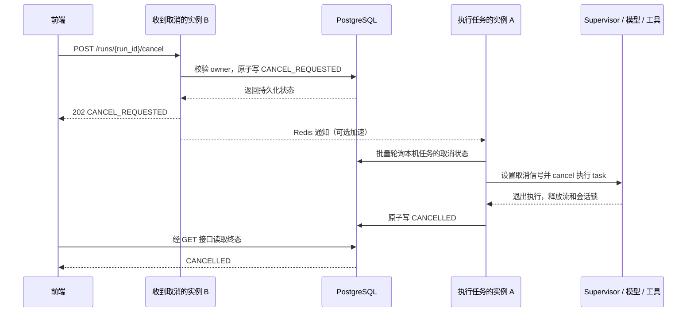

# Agent 任务中途取消：现状与设计

日期：2026-10-06。依据当前工作区代码（包含尚未提交的修改）。本文是设计方案，未实现取消接口或修改运行逻辑。

## 1. 结论与现状

当前没有用户主动取消整次对话运行的能力。流式任务故意与 HTTP/SSE 连接分离，关闭页面、断网、停止读取响应均不会取消后台任务。

| 场景 | 当前行为 | 代码依据 |
| --- | --- | --- |
| 流式对话开始 | PG 登记 run_id，`asyncio.create_task()` 创建独立执行任务 | `fitness-agent-service/app/streaming/service.py`：`start()` |
| 浏览器断流 | 移除 SSE 订阅；后台继续执行，可查询最终结果 | 同上：`events()` 的 `finally` |
| 前端 AbortController | 300 秒计时器终止 HTTP；异常后可能进入 GET 恢复轮询；没有用户停止按钮 | `fitness-web/src/api.ts`：`sendChatStream()`；`App.tsx`：composer |
| 单次流式运行超时 | `asyncio.timeout()` 取消执行；尝试写入 UNKNOWN / EXECUTION_INTERRUPTED | `streaming/service.py`：`_execute()`；配置默认 240 秒 |
| 服务关闭 | 等待 drain，超过配置期限后对本进程任务调用 `task.cancel()` | `streaming/service.py`：`close()`；`app/main.py` |
| 执行进程失联 | GET 时发现执行期限已过，将 RUNNING 更新为 UNKNOWN / EXECUTION_LOST；不重跑 | `streaming/repository.py`：`get()`；期限为任务超时加 15 秒 |
| 普通 JSON 对话 | 直接等待 Supervisor，无同等的 run 登记和用户取消协议 | `api/routes/agent.py`：`chat()` |
| 撤销确认单 | `POST /api/v1/agent/confirmations/{id}/revocations`，仅允许未开始执行的有效确认单 | `confirmation/models.py`：`cancel()` |
| 取消经营动作 | 仅允许 PLANNED / AUTHORIZED / QUEUED / RETRYABLE_FAILED，不中断 RUNNING | `decision/repository.py`：`cancel_action()` |
| 取消预约 | 一个需鉴权、确认的业务工具，不是取消 Agent 任务 | `agent/fitness_tools.py` |

当前任务表只允许 RUNNING / COMPLETED / FAILED / UNKNOWN，没有 CANCEL_REQUESTED 或 CANCELLED，也没有 `/runs/{id}/cancel`。

尤其要区分：`CONFIRMATION_REQUIRED` 是对话响应的业务状态；保存它的 chat run 已是 COMPLETED。之后点击批准，会通过 `confirmations/{id}/decisions` 直接调用 `Supervisor.resume_confirmation()`，并未创建可取消的新 chat run。

已运行现有回归：`tests/test_runtime_streaming.py`、`tests/test_runtime_stream_api.py`，共 9 项通过。其断线测试明确要求后台继续完成。这只验证现状，不代表新方案已经实现或验证。

## 2. 对用户承诺什么

1. 刷新、断网、关闭页面继续保留现有恢复语义。
2. 点击“停止生成”才显式申请取消当前 run。接口成功接收后显示“正在停止”；执行者完成清理并提交终态后才显示“已停止”。
3. 停止后不再启动该 run 的后续模型调用和工具调用，不自动重跑原请求。
4. 保留已经展示的文字，标记“回复已停止”；不把半截答案当完整回答。
5. 停止执行不等于撤销已完成的业务事实。已经发出的预约、训练计划等写入必须查询业务结果；补偿必须走对应业务流程和原有确认机制。
6. 超时、崩溃、主动取消分别记录。不能把一次没有确认停止的运行显示为 CANCELLED。

## 3. 复用现有架构

不引入新的任务队列，也不依赖负载均衡会话粘滞。复用 PostgreSQL 任务表、Redis、进程内 `_tasks`、会话锁和 fencing、确认单与下游幂等机制。



数据库是取消事实来源；Redis 消息只唤醒，不携带用户问题、身份令牌或工具参数。第一版只实现 PG 批量轮询即可；Redis 推送可后续按延迟需求增加，不能作为唯一通知方式。

## 4. 状态机与竞争规则

```text
RUNNING ──完成提交──> COMPLETED
RUNNING ──执行错误──> FAILED
RUNNING ──超时/失联─> UNKNOWN
RUNNING ──用户取消──> CANCEL_REQUESTED ──执行退出并清理──> CANCELLED
                                      └─无法确认停止─> UNKNOWN
```

- 所有终态不可被迟到结果覆盖。重复取消返回现有状态，不再次启动、取消或计费。
- 完成和取消通过同一行的条件更新决定先后。完成先提交则返回 COMPLETED；取消先提交则完成写入必须失败，不得再发 `run.completed`。
- `CANCEL_REQUESTED` 表示已接受，不能立即按终态处理。现有 `events()` 和前端 `recoverChatRun()` 都把非 RUNNING 当终态，需要同时调整。
- 新增 `request_cancel()`、`finish_cancelled()` 和读取规范状态的方法。`finish_cancelled()` 只允许 CANCEL_REQUESTED → CANCELLED；正常 `finish()` 仍只允许从 RUNNING 更新。
- 当前 `_execute()` 在完成 CAS 失败时直接发布 UNKNOWN；异常分支也没有根据 `finish()` 的布尔结果重新读取终态。实施时两处分支都改为重新读取数据库事实再发布，避免取消、完成、过期竞争造成虚假事件。
- 超过取消等待期限仍未得到执行者确认时标记 UNKNOWN / CANCEL_ACK_TIMEOUT。保留取消时间字段，迟到执行者必须继续停止，不能因 status 已变 UNKNOWN 就忽略原取消请求。

迁移使用新的 Alembic revision，不修改已存在的 `20261006_0045_runtime_delivery.py`：

| 字段或约束 | 用途 |
| --- | --- |
| 扩展 `ck_chat_run_status` | 加入 CANCEL_REQUESTED、CANCELLED |
| `cancel_requested_at` | 持久化取消意图，也是迟到执行者的停止依据 |
| `cancel_request_id` | 审计首次取消请求；不同请求 ID 的重复取消仍幂等 |
| `cancel_deadline`、`cancelled_at` | 取消确认期限和完成停止时间 |
| `stop_reason` | USER_CANCELLED / EXECUTION_TIMEOUT / SERVICE_SHUTDOWN / EXECUTION_LOST 等受控枚举 |
| `conversation_scope_hash` | 在暴露新一轮执行前校验旧 run 已停止，值由服务端计算 |
| `source_run_id`（确认单） | 绑定本轮生成的确认单，避免取消误伤其他轮次 |

同步调整活动任务索引、期限扫描和保留策略，使 CANCEL_REQUESTED 不被遗漏。确认字段不包含自由文本取消原因或新身份凭证。owner_hash 保持现有权限范围隔离；身份范围不匹配返回 404，不按前端传来的用户 ID 授权。

## 5. API 与前端流程

新增：`POST /api/v1/agent/runs/{run_id}/cancel`

```json
{"cancel_request_id":"客户端生成并在重试时复用的 UUID"}
```

返回继续复用 run 查询结构，增加 `stop_reason`、取消时间和可安全展示的关联确认单信息：

```json
{"run_id":"原任务 UUID","status":"CANCEL_REQUESTED","response":null,"error_code":null,"stop_reason":"USER_CANCELLED"}
```

| 条件 | HTTP / 行为 |
| --- | --- |
| RUNNING 首次接受取消或仍在 CANCEL_REQUESTED | 202，后台继续停止流程 |
| 已是任一终态 | 200，返回真实终态，不能声称取消成功 |
| 未认证 | 401 |
| 不存在、过期、非本人权限范围 | 404 |
| 请求格式不合法 | 422 |
| 数据库未能确认写入 | 503；前端保持“停止结果待确认”并 GET 核对 |

取消接口复用浏览器认证、CSRF 和服务端身份校验；不消耗模型调用配额，避免用户额度用尽后无法停止任务。重复请求不改写首次取消审计信息。

前端实施顺序：

1. 用 run_id 保存当前活动任务，增加“停止生成”按钮；正在恢复结果时也允许停止。
2. 独立发出取消请求；不能先复用并中止同一个 AbortController，导致取消请求本身被取消。
3. 收到 202 后设置用户停止意图，屏蔽该 run 的后续答案增量，终止旧 SSE 读取，继续 GET 等待规范终态。用户停止与网络错误使用不同分支。
4. SSE 增加 `run.cancel_requested`、`run.cancelled`，保留原事件；其他实例通过 PG 查询也能观察取消。更新 TypeScript 类型和解析分支。
5. 收到 CANCELLED 才清理 pending-chat，保留已有文字及停止标记；若返回 COMPLETED，展示真实完成结果。
6. 取消请求超时不丢失 run_id，不重新 POST 对话；先查询，必要时使用相同取消请求 ID 重试。恢复 GET 和等待定时器也接受独立停止信号，组件卸载避免继续更新 UI。
7. 发送刚开始时取消可能早于任务登记而收到 404：前端先停留“等待任务登记”，等原 POST 的响应或 run.started，再重试取消；404 不代表已经停止。原提交结果不确定时保留 run_id 继续核对，不创建新 run 代替。

第一阶段保留旧 JSON `/chat` 的兼容语义，并明确它尚不支持此取消协议。若也要求取消，应让它使用同一 run manager、显式返回或预分配 run_id，再等待 JSON 结果，不能声称新增流式取消接口已经覆盖旧入口。

## 6. 后端怎样真正停下来

### 6.1 执行者与监管者分离

`ChatRunManager` 管理执行 task 和生命周期监管；取消执行 task，不取消负责写终态、回收子任务的监管者。每个实例启动一个 watcher，约每 500 毫秒批量检查本机活动 run_id，避免每个任务独立轮询。

watcher 发现取消意图后设置 `RunControl` 并只触发一次 `task.cancel()`。监管者等待执行退出及清理，在有限时间内持久化 CANCELLED，然后发布终态。所有附属 task 都有明确所有者，结束时 cancel/await，不能留下无人管理的 shield 任务。

建议初始配置（是验收目标，不是已实现保证）：轮询 500 毫秒、取消清理宽限 5 秒、取消确认期限 10 秒。模型流关闭、数据库清理均设置有限超时；超期记录 UNKNOWN 并继续阻止新步骤，不强杀整个 API 进程。

PG 临时不可用时无法确认新操作是否允许：停止发起新的模型、工具和写入步骤，记录运行不确定；数据库恢复后由期限扫描收敛。Redis 通知失败不影响已持久化的取消请求。

### 6.2 在哪些位置检查

`RunControl` 放入 `SupervisorRuntimeContext` / `ToolContext` 或受控 ContextVar，不放进 LangGraph 持久化 State。它只包含运行控制信息，不携带可持久化的 token。

- Supervisor 路由前、RAG 前后、每个模型回合前后。
- 模型重试前、退避等待后、流式 chunk 消费期间。
- ToolRegistry 中每个工具 handler 调用前，以及工具循环进入下一步时。
- 创建记忆候选、确认单等本地持久化动作之前。
- 发布完整答案、提交 run 最终结果之前。

阻塞于异步网络等待时，由 task 取消把 `CancelledError` 传入 await 链路；检查点用于阻止取消之后又进入下一步骤。不能通过设置一个布尔值就假设当前模型请求已经退出。

当前模型网关已经有流 `finally: await stream.close()`、取消用量记 UNKNOWN 并继续抛出异常的处理，可以复用；补充关闭超时和子任务回收测试。上游模型供应商是否立即停止计算、是否继续计费无法由本地断连保证。

`asyncio.to_thread()` 中的本地 embedding 不会因为取消等待协程就强制终止底层线程。第一版丢弃迟到结果并阻止下游步骤；若需要立即释放 CPU/GPU 计算资源，需要独立进程/推理服务的取消协议，不能把 `task.cancel()` 作为硬终止承诺。

### 6.3 会话锁和 checkpoint

取消执行退出后由现有会话锁上下文释放租约，不在 API 收到取消时提前删除 Redis 锁。监管者提交取消终态之前，后续相同会话的 run 需要额外的活动运行检查；确认停止前返回“上一任务正在停止”。

保留旧 checkpoint 和审计，不删除整个会话。为 turn 记录 run_id、完成/取消标记和上一完整轮次边界；下一轮历史拼接只选择完整轮次，或保留本轮用户消息加明确停止标记。未配对的 assistant tool_calls、未完成工具结果、半截回答不得直接进入模型历史。

现有 `_invoke()` 会直接复用上一 checkpoint 的 messages，因此历史过滤和取消标记必须实际实现并测试，不能只在 UI 隐藏部分答案。取消不调用 LangGraph `Command(resume=...)`；`interrupt()` 继续只用于人工确认暂停。

复用现有 fencing 阻止过期执行者写 checkpoint。取消检查只覆盖调度边界，不能保证检查与外部调用之间绝无竞争；新一轮开始前须确认旧执行退出，并对业务写入使用下一节的独立原子门禁。

## 7. 确认与副作用边界

### 7.1 普通对话停止

当前 `/chat/stream` 不携带确认 token，通常在生成确认卡后结束；停止主要覆盖路由、检索、模型输出及只读工具。

取消与“创建确认单”仍可能竞争。将确认单绑定 `source_run_id`，创建时与该 run 的状态检查放在同一数据库事务内并锁定 run 行。取消处理撤销本 run 尚未执行的确认单；取消先提交就禁止新建，创建先提交则取消清理能找到并撤销。其他本地持久化候选也需关联来源和明确保留/作废策略，不能假设取消会回滚已提交事务。

如果确认卡已经使 chat run COMPLETED，取消接口返回 COMPLETED；用户通过确认卡的“撤销”调用现有 revocations 接口。不能取消一个已经结束的 chat run 来冒充撤销确认单。

### 7.2 批准后的写操作

第二阶段将 `resume_confirmation()` 纳入受管理的执行 run，使用独立 run_id 并关联 confirmation_id，保留确认单 decision_request_id 和业务 request_id 的现有幂等语义。普通 chat run 不重新开启。

| 阶段 | 停止策略 |
| --- | --- |
| 尚未批准 | 使用现有拒绝/撤销接口 |
| 已批准但 execution_status=NOT_STARTED | run 取消与确认单领取执行权在同一事务、固定锁顺序下竞争；取消先赢则禁止领取和发送 |
| 执行权已领取，可能已发出 Gateway 写请求 | 停止后续 Agent 步骤，不能宣称写入取消；保存 operation/request ID 并查询事实 |
| 下游已经成功 | 保留成功事实；需要撤销时重新进入对应业务补偿与确认流程 |
| HTTP 断开，写入结果未知 | 确认单记 UNKNOWN，通过对账恢复，禁止猜测失败或重新生成幂等键重试 |

“执行权领取成功”作为本地不可保证撤回的边界：它与发送网络请求之间仍可能发生取消，所以返回值应表示“可能已经提交，正在核对”。不能仅在 `tools.invoke()` 前查一次取消布尔值就承诺没有副作用。

运行状态与业务状态分开：run 可以 CANCELLED（Agent 已停止），关联确认单可以 UNKNOWN（业务结果待核对）或 SUCCEEDED（业务已完成）。API/UI 同时展示二者，不能把 CANCELLED 翻译成“预约未发生”。

`_confirmation_node()` 目前用 `except Exception` 处理失败，没有专门捕获取消并即时标记业务结果未知。实施受管理的确认执行时补专门分支：有限清理、保留稳定业务 ID、标记 UNKNOWN、继续抛出取消，不将取消写成 FAILED_RETRYABLE。

现有自动对账主要支持 booking 工具；训练等写工具不能直接宣称具备相同能力。上线这些工具的执行中取消之前，需要补操作结果查询契约，或明确保留 UNKNOWN 并走人工核对。经营动作 worker 仍按现有动作状态机单独管理，不能靠停止聊天取消所有后台动作。

## 8. 实施批次与验收

| 批次 | 修改位置 | 交付边界 |
| --- | --- | --- |
| 1 | 新迁移、streaming repository/service、agent routes、Supervisor/ToolRegistry、确认单来源绑定、前端 api/types/App | 流式普通对话停止；跨实例轮询；本轮待执行确认单清理；历史安全续聊 |
| 2 | confirmations routes/service/repository、Supervisor resume、Gateway 与业务操作查询 | 已批准执行的受管理 run；副作用结果单独报告和对账 |
| 3 | 旧 JSON 入口、可选 Redis 通知、监控与部署 | 全入口统一协议、降低通知延迟、验证滚动发布兼容性 |

不能只修改前端 AbortController，也不能只给 `_tasks[run_id]` 增加 cancel 调用：前者只断开流，后者无法跨实例、无法恢复取消事实，还会把用户取消记成 UNKNOWN。

新增测试至少覆盖：

1. 原有断线不取消测试继续通过；主动取消才产生 CANCEL_REQUESTED/CANCELLED。
2. 正在等待模型、读取流、执行只读工具、退避重试、RAG 并行检索时取消，不再调用下一个工具/模型。
3. 取消落在实例 B、执行在 A；Redis 消息丢失仍由 PG 轮询停止。
4. 完成与取消并发、重复取消、取消与异常并发：唯一数据库终态，SSE 与 GET 一致。
5. 创建任务尚未登记就点击停止：404 不显示停止成功，登记后停止同一 run，无第二次 POST 对话。
6. 越权、跨机构、过期身份、权限范围变化、CSRF、限流配额已耗尽时的取消鉴权。
7. 取消后立即发送下一条消息、旧 checkpoint 迟到、未配对工具消息、锁释放失败；不污染新一轮历史。
8. 确认单创建与取消并发、批准与撤销并发；取消先赢时不得发写请求。
9. Gateway 已提交但响应丢失：取消不能伪造失败或回滚，对账成功后呈现真实结果。
10. 停机与主动取消同时发生、取消状态持久化失败、执行者崩溃、清理超时：保留真实原因，无法确认时 UNKNOWN。
11. UI 点击停止、网络断流、刷新恢复分别走正确分支；部分文本保留，pending-chat 只在规范终态后清理。

仓储状态竞争必须使用真实 PostgreSQL 集成测试；当前流式单测的 `MemoryRunRepository.finish()` 会直接覆盖状态，不能证明条件更新在竞争下正确。

建议观测 `cancel_requests_total{outcome}`、`cancel_ack_seconds`、`cancel_ack_timeout_total`、`cancel_pending` 和取消后被拦截的步骤数量。run_id/request_id 只进入日志与 trace，不作为 Prometheus label。

滚动发布先扩展数据库约束，再部署支持新状态的 reader/worker，最后开启取消按钮与接口写入开关。旧实例不识别 CANCEL_REQUESTED，不能在混合版本仍运行时直接放开取消写入；已有活动 run 应先 drain。回滚时先关闭新取消入口并收敛活动取消请求，保留新状态读取兼容。
