# Agent 录音发送与语音回复方案

设计日期：2026-10-13；实施更新：2026-10-14。状态：**核心功能已实施，验证范围见[实施说明](agent-voice-conversation-implementation.md)**。适用现有 `fitness-web`（React/Vite）及 `fitness-agent-service`（FastAPI/LangGraph）。本文保留设计约定；当前行为、验证证据与运行边界以实施说明为准。

## 1. 方案结论与范围

采用 **录音 → ASR 转文字 → 现有 Agent → 最终回复分段 TTS → 浏览器播放**。

- 识别推荐阿里百炼 `qwen3-asr-flash`；合成使用指定的 `qwen3-tts-flash`。
- Agent 的推理模型、工具调用、RAG、记忆与业务确认继续复用现有实现。
- 本次产品范围是单轮录音发送和回复朗读；实时电话、边说边识别、语音唤醒、持续监听、声音复刻不在范围内。
- 输入录音和输出朗读独立：可以录音后只看文字，也可以打字后听回复。
- 首次交付包含异常处理、权限隔离、分段播放、重试、配额、资源清理和浏览器验证，不把这些留作“以后完善”。

复杂度判断：**中等、可控**。增加输入输出适配和前端状态管理，不需要重构 Supervisor，也不需要引入 RTC、语音对话长连接或新的消息队列。

## 2. 已核实的项目现状

| 现有能力 | 位置 | 如何复用 |
| --- | --- | --- |
| React 对话输入、消息列表与停止生成 | `fitness-web/src/App.tsx` | 添加录音入口和每条最终回复的朗读入口 |
| SSE 对话与任务结果恢复 | `fitness-web/src/api.ts`、`chatRun.ts` | 识别后的文字走原接口，保留同一 run 的恢复和取消规则 |
| 对话与任务 API | `fitness-agent-service/app/api/routes/agent.py` | 复用 `/chat/stream`、`/runs/{run_id}` 和取消接口 |
| 已签名身份与浏览器登录 | `api/routes/auth.py`、`infrastructure/agent_context.py` | 语音接口沿用 Cookie/CSRF 或签名 AgentContext |
| 任务归属摘要 | `streaming/control.py::run_owner` | 按用户及当前权限范围验证语音读取权限 |
| 加密最终结果 | `streaming/repository.py` | 从服务端读取最终回答；前端不提交任意文本冒充 Agent 回复 |
| 请求配额、Redis、HTTP 客户端 | `api/chat_protection.py`、`infrastructure/` | 语音使用独立配额，避免消耗原有聊天突发额度 |
| 任务结果保留期 | `core/config.py` | 当前默认 24 小时；语音按 run 读取的有效期不能超出它 |

这里的 run 已完成，可能对应业务响应 `CONFIRMATION_REQUIRED`。这只表示对话完成并展示确认卡，不表示预约等业务操作已经执行。

## 3. 用户体验定稿

### 3.1 录音发送

默认使用“点击开始、点击结束”的交互，兼顾桌面与手机操作。

1. 输入区增加「录音」按钮。首次点击才请求麦克风权限，并显示“录音将发送至语音服务进行识别”。
2. 录音时显示计时与声音强弱提示，提供「结束录音」「取消」。最长 60 秒，到时自动结束，不自动发送。
3. 结束后立即关闭麦克风，再处理音频和识别；取消则立即清理录音。
4. 识别结果进入可编辑的输入框，提示「语音已转为文字，可修改后发送」。保留原来的文字草稿，将识别文字追加到草稿，不能覆盖草稿。
5. 用户点击原有「发送」，提交最终文字，消息可显示「语音输入」标记。
6. 若失败，显示「重试识别」「重新录音」「改用文字」。重试识别只重试 ASR，绝不触发一次新的 Agent 对话。

选择发送前确认，是为了让姓名、训练重量、日期、预约时间等可以纠正。这里只确认输入内容；涉及业务写入时，仍需要原来的业务确认卡。

录音和识别期间暂时禁止普通发送，避免旧识别结果覆盖下一轮输入；原有草稿保留。用户可取消语音操作后继续打字。合并后超过现有 4000 字符上限时保留内容并提示精简，不静默截断、不直接提交。

### 3.2 Agent 语音回复

- 输入区增加独立开关「语音回复」，初始关闭，由用户明确开启后记住偏好。录音与开关互不绑定。
- 开关开启时，新一轮最终回复到达后尝试自动播放；关闭时不提前合成，用户仍可在某条回复点击「朗读」。
- 文字继续按照原有 SSE 展示。等待最终答案完成后才开始 TTS，页面显示「语音准备中」。
- 回复下方提供「朗读 / 暂停 / 继续 / 停止 / 重新播放」，并显示分段进度。
- 同一页面同时只播放一条回复。点击另一条、开始录音、发送新问题、切换账号或离开聊天页时，停止当前播放并清理待播放队列。
- 关闭语音回复开关同时停止本次自动朗读与后续预取；不会停止 Agent 的文字生成。
- 页面恢复历史任务时默认不自动朗读，保留手动朗读，避免刷新后突然出声或重复计费。
- 自动播放被浏览器拦截时显示「语音已就绪，点击播放」，这不是 TTS 失败，不重新合成。

浏览器对有声自动播放有独立限制，用户曾点击发送也不能保证每个浏览器始终允许后续自动播放。[MDN 自动播放说明](https://developer.mozilla.org/en-US/docs/Web/Media/Guides/Autoplay)

## 4. 架构与职责

```mermaid
sequenceDiagram
    participant U as 用户
    participant W as fitness-web
    participant V as Agent 服务语音层
    participant A as 百炼 ASR
    participant G as 现有 Agent / SSE
    participant T as 百炼 TTS
    U->>W: 开始录音、结束录音
    W->>V: 上传有限时长 WAV
    V->>A: qwen3-asr-flash
    A-->>V: 识别文字
    V-->>W: transcript
    U->>W: 检查文字并发送
    W->>G: 原 chat/stream + run_id
    G-->>W: 流式文字、最终结果
    W->>V: 获取该 run 的朗读分段清单
    V->>G: 校验归属并读取已完成结果
    V-->>W: 稳定分段清单
    W->>V: 请求第 0 段音频
    V->>T: qwen3-tts-flash
    T-->>V: 合成结果
    V-->>W: 同源音频字节
    W-->>U: 播放，按需预取下一段
```

语音处理放在 Python Agent 服务中，与现有异步 HTTP、身份、配置和指标设施一起管理。Java Gateway 继续承担既有业务调用职责，音频不必额外经过 Java 业务服务。生产入口仍由现有同源代理转发。

## 5. 音频输入协议

### 5.1 浏览器采集

推荐 `getUserMedia + MediaRecorder`。实际录音格式通过 `MediaRecorder.isTypeSupported()` 探测，不能假定所有浏览器都输出 WebM。结束时收集完整录音，再使用 Web Audio 解码、混合单声道及重采样，编码为统一 WAV。

- 上传格式：16 kHz、单声道、16-bit PCM WAV。
- 产品时长：0.3–60 秒。
- 60 秒音频数据约 1,920,000 字节，另加 WAV 头；接口上限建议 2 MiB。
- 原始编码缓存也设大小上限，防止计时器暂停或录音异常导致无限增长。
- 超过时长的解码结果需要明确提示或让用户重录，不能只相信页面计时器。
- 获取权限、采集、解码、编码和上传均应可取消；异步完成时检查本轮录音标识，丢弃过期结果。
- 页面隐藏、锁屏、设备断开时结束或取消录音并清理，不后台持续录音。返回页面后由用户明确继续操作。
- 录音时需要 HTTPS；本地调试使用浏览器认可的 localhost 环境。内嵌浏览器另做实际设备验证。

MDN 明确要求按类型检测录音支持；`decodeAudioData()` 处理完整文件而不是任意片段。因此必须等待完整录音结束再解码，浏览器录制成功也不能代替解码兼容性验证。[MediaRecorder 类型探测](https://developer.mozilla.org/en-US/docs/Web/API/MediaRecorder/isTypeSupported_static)、[完整音频解码](https://developer.mozilla.org/en-US/docs/Web/API/BaseAudioContext/decodeAudioData)

### 5.2 服务端接收

建议直接接收 `Content-Type: audio/wav` 的二进制请求体，避免额外 multipart 文件字段和临时文件落盘。

1. 读取正文前校验身份、启用状态、配额及 Content-Type。
2. 分块读取并累计大小，同时检查 Content-Length；无长度或伪造长度也必须受限。入口代理另设匹配的正文大小和上传超时。
3. 验证真实 WAV 文件头、声道、采样率、位深、帧数、完整性和时长，拒绝损坏或伪装内容。
4. 对完全静音进行确定性拦截；非零不等于有语音，不能把简单静音检测当成可靠 VAD。最终以 ASR 结果和用户校对共同保证输入质量。
5. 内存中转 Base64 调用 ASR；识别完成或失败后释放上传数据，不长期存储录音。

百炼支持 Base64 音频输入；其文档要求编码后仍满足大小限制。这里固定 60 秒 PCM16，可把编码后的体积控制在该上限以内。[Qwen-ASR API](https://help.aliyun.com/zh/model-studio/qwen-asr-api-reference)

## 6. 语音输出协议与长回复

### 6.1 合成时机

只接受已提交最终结果的 `COMPLETED` run。`RUNNING`、`CANCEL_REQUESTED`、`CANCELLED`、`FAILED`、`UNKNOWN` 均不提供自动朗读。这样不会把未完成、已撤回或失败的片段播给用户。

TTS 失败不改变 run 的状态、不回滚文字、不重新执行 Agent。已完成但需业务确认的回复可以朗读，确认卡操作仍由现有接口处理。

### 6.2 文本准备

后端从最终回答生成朗读文本，使用确定性的 Markdown 解析与渲染，不额外调用 LLM 改写：

- 去除标题装饰、强调标记、代码围栏和图片链接。
- 保留可见链接文字；不朗读长 URL、内部引用 ID 和工具原始数据。
- 有序列表保留顺序；表格按行转为“字段名：值”，不可去掉列名后把数值混读。
- 保留数字、小数、负号、范围、单位、日期及警示/确认措辞。无法可靠口语化的内容提示查看文字，不猜测其含义。
- 代码块提示查看文字回复；不朗读代码本身。

### 6.3 分段与播放

`qwen3-tts-flash` 当前文档给出的输入上限为 600 字符，返回完整音频的临时 URL 有效期为 24 小时。本方案使用 480 字符作为单段设计上限，不把临时 URL 当成长期附件。[Qwen-TTS API](https://help.aliyun.com/zh/model-studio/qwen-tts-api)

- 按段落、句末标点、逗号或空格切分，最后才硬切；计算 Unicode 字符，避免截断字符。
- 先请求第一段；播放期间最多预取下一段，限制并发和无效生成成本。
- 全局播放器按段序播放，不能按网络返回顺序播放。
- 播放中途失败停在失败段，用户重试该段；不能重跑 Agent 或悄悄跳过一段。
- 初始整条朗读上限建议 15,360 字符；超限在合成前明确提示分部分回答，不静默截断。该值是可配置的产品成本边界，需压测确认。
- 这不是实时 TTS 流式播放：每段合成完成才播放，段间可能有短暂停顿，不承诺无缝或毫秒级首声。

### 6.4 音频获取与缓存

- 后端下载供应商生成音频并通过同源鉴权接口返回字节，前端不获得百炼 API Key。
- 下载只允许配置过的百炼结果桶域名，强制 HTTPS，不跟随任意重定向；不转发 Authorization 到 OSS；限制下载大小、响应类型、总耗时并验证音频格式。
- 前端 `fetch` 获取 Blob 后创建对象 URL 播放。停止、切换身份、卸载和缓存淘汰时撤销 URL。
- 浏览器只保留当前/下一段以及有限的近期音频，设置总字节上限。长回答可以淘汰已播放段；重播时按需重新获取。
- 后端默认每进程 32 MiB LRU 缓存、TTL 10 分钟，并合并同一进程内相同片段的并发合成。缓存键包含权限范围摘要、run_id、文本版本、模型、音色、语言及规范化版本。
- 每次命中缓存前仍校验当前身份、run 归属和有效期。缓存淘汰不会删除文字，可重新合成。
- 这是有界的缓存优化，不提供跨实例“只计费一次”保证；实例重启或请求落到另一实例可能重新合成。若业务规模要求全局去重，再引入共享加密缓存和租约；当前功能无需新增对象存储或数据库表。

## 7. 拟新增 API

保留原聊天协议。语音单独使用 `/api/v1/agent/voice` 命名空间，沿用现有请求 ID、Trace ID 和认证边界。

| 接口 | 输入 | 输出 / 作用 |
| --- | --- | --- |
| `GET /voice/config` | 已认证身份 | 启用状态、录音秒数/大小上限、朗读限制；不返回密钥或内部服务地址 |
| `POST /voice/transcriptions` | WAV 二进制 | `{text, duration_ms}`；仅识别，不执行 Agent |
| `GET /voice/replies/{run_id}` | run_id | `{run_id, revision, segment_count, segments:[{index,text}]}`；返回稳定朗读清单，不调用 TTS |
| `POST /voice/replies/{run_id}/segments/{index}` | 清单的 revision | WAV 音频字节；仅合成服务端已确认的该段 |

`/voice` 表中路径均相对于 `/api/v1/agent`。`revision` 绑定回答摘要、分段规范和语音配置，配置或规范改变时返回 409，客户端重新取清单，避免新旧分段混播。清单和音频均 `Cache-Control: no-store`，不通过公共 CDN 缓存。

现有 `ChatMessage` 需要保存该条回复对应的 run_id 和是否完整；`completeOperation()` 关联最终回复，恢复流程保留相同关联。无需为了语音修改 LLM 消息体或 LangGraph checkpoint。

初始版本按现有 run 有效期提供重播（默认 24 小时）。过期时返回 404/410，明确提示“回复语音已过期，文字仍可查看”；不接受客户端重新上传文字来绕开归属校验。若未来产品要求长期历史朗读，应接入持久化聊天消息读取权限，而不是延长临时供应商 URL 或伪装当前 run 永不过期。

## 8. 状态、停止与竞态

录音状态：`IDLE → REQUESTING_PERMISSION → RECORDING → PROCESSING → TRANSCRIBING → REVIEW → IDLE`。失败进入可恢复状态，取消回到 IDLE；只有 REVIEW 的文字点击发送后才创建 Agent run。

播放状态：`IDLE → PREPARING → PLAYING ↔ PAUSED → ENDED`；任意阶段可 STOPPED；浏览器拦截进入 READY_WAITING_CLICK；请求失败进入 ERROR。

| 动作 | 必须发生的事 |
| --- | --- |
| 取消录音 | 停止所有麦克风轨道，取消计时/网络/解码结果交付，保留原文字草稿 |
| 停止生成 | 调现有 run 取消协议；停止本轮相关音频；未完成结果不启动 TTS |
| 停止播放 | 暂停音频、清空队列、取消未发出的片段和预取；不取消/重跑 Agent |
| 开始新录音或发送新问题 | 停止上一条音频，防止录入助手自己的声音或与下一轮重叠 |
| 快速切换两条回复 | 增加播放 generation ID；迟到的网络响应不能启动旧回复 |
| 退出登录/切换机构或角色 | 停止采集和播放，取消所有语音请求，清空音频及识别草稿缓存 |
| 页面刷新/断网恢复 | 按现有 run 恢复文字；不重复发送、不默认自动朗读 |
| 已向百炼发出的请求被用户停止 | 尽力取消本地等待，但不得承诺供应商一定停止或免计费；后续片段不得继续启动 |

预约、取消预约、修改训练计划等仍按既有工具和确认单授权。语音识别到“确认”也不能由前端直接触发批准接口。

## 9. 故障与用户提示

| 情况 | 行为 |
| --- | --- |
| 麦克风权限被拒绝 / 没有设备 / 页面不支持 | 明确说明原因，保留文字输入；不循环弹授权 |
| 录音过短、过长、过大或损坏 | 本地和服务端各自校验，提示重新录制 |
| 静音 / ASR 返回空文本 | 不发起 Agent 调用；提示重录 |
| ASR 超时、429、上游异常 | 保留本轮内存录音供明确重试；提供重新录音与文字输入 |
| Agent 已返回文字，TTS 失败 | 保留完整文字，显示“语音暂不可用，重试朗读” |
| 浏览器禁止自动播放 | 使用已有音频，显示“点击播放”，不重复合成 |
| 分段请求失败 | 保留分段位置，重试该段，不跳过、不重新执行对话 |
| 身份过期 / 范围改变 | 复用登录流程，清理播放队列，不能用音频缓存继续读取旧权限内容 |
| 语音功能未启用 | 显示“语音暂未启用”或禁用入口，文字对话正常 |
| run 未完成 / 结果过期 | 分别返回 409 / 404或410，不能回退为朗读未完成的客户端文本 |

错误响应建议提供稳定 code、面向用户的 message 和 request_id。不得将上游原始异常、音频 URL 签名、模型请求体或凭证透传到前端。

## 10. 配置、配额与可观测性

拟新增配置：

| 配置 | 初始建议 |
| --- | --- |
| `AGENT_VOICE_ENABLED` | false，配置和验收完成后启用 |
| `AGENT_VOICE_API_KEY` | 服务端 Secret；可明确兼容 `DASHSCOPE_API_KEY` |
| `AGENT_VOICE_BASE_URL` | 北京地域官方服务域名或对应业务空间域名；API Key 必须匹配地域 |
| `AGENT_VOICE_ASR_MODEL` | qwen3-asr-flash |
| `AGENT_VOICE_TTS_MODEL` | qwen3-tts-flash |
| `AGENT_VOICE_TTS_VOICE` | Cherry，上线前用中文健身内容试听确认 |
| `AGENT_VOICE_TTS_LANGUAGE` | Auto；全中文场景可配置 Chinese |
| `AGENT_VOICE_MAX_RECORDING_SECONDS` | 60 |
| `AGENT_VOICE_MAX_UPLOAD_BYTES` | 2 MiB |
| `AGENT_VOICE_TIMEOUT_SECONDS` | 单次供应商调用和音频下载共用 60 秒总预算 |
| `AGENT_VOICE_MAX_CONCURRENCY` | 每实例 4；排队时间有界 |
| `AGENT_VOICE_CACHE_MAX_BYTES` | 每实例 32 MiB，TTL 10 分钟 |

数值是设计起点，部署时结合实例数、配额与实测调整。不要复用现有 LLM Key 作为百炼 Key，除非实际凭证来源已明确匹配；也不要把任何 Secret 放入 `VITE_*`。

配额按用户、机构分别限制，ASR 和 TTS 独立计数；TTS 按片段/字符管理预算，不把一条长回复视为一次无限量调用。Redis 配额不可用时只暂停昂贵的语音调用，不能绕过限制。若多实例需要全局并发上限，可复用现有 `RedisModelLease`，供应商 key 使用独立语音资源名。

请求有统一截止时间。429/超时的自动重试保守处理，不能把连接丢失当作上游未执行而无限重试；ASR/TTS 重试都不会进入 Agent 工具链。

记录 ASR/TTS 请求数、成功率、耗时、错误分类、录音时长、合成字符数、缓存命中、排队和配额拒绝。模型费用按百炼实际 usage 与配置的价格版本记录；未核实价格不得记成零。日志不记录录音、转写全文、回复全文、API Key 或带签名音频 URL。

本地不长期保存录音，不等于供应商不处理或不保留数据。上线时依据业务空间实际服务条款与数据配置确认供应商侧处理方式，不在产品说明中作未核实承诺。

## 11. 拟改动范围与实施顺序

| 模块 | 计划内容 |
| --- | --- |
| `app/voice/` | ASR/TTS 适配、音频校验、文本分段、缓存、异常模型 |
| `app/api/routes/voice.py` | 配置、识别、朗读清单与音频接口 |
| `app/core/config.py`、`app/main.py` | 配置校验、服务初始化/关闭、注册路由 |
| `fitness-web/src/voice/` | 录音与 WAV 编码、语音 API、单播放器/队列、状态组件 |
| `fitness-web/src/App.tsx`、`types.ts` | 输入入口、run 关联、语音开关、最终消息朗读按钮 |
| `fitness-web/src/api.ts` | 复用认证头、CSRF、错误和 AbortSignal；支持二进制请求/响应 |
| 环境样例、代理、使用文档 | 开关、Secret 说明、大小/超时与 HTTPS 配置 |
| 前后端测试 | API/权限/状态机/浏览器的关键路径验收 |

按“语音服务契约与模拟测试 → 录音识别 → 最终回答朗读 → 停止/重试/恢复 → 真实百炼联调 → 浏览器验收”推进。暂不需要新增业务数据库迁移，也不需要改造 Java 业务接口。

单人熟悉本仓库且凭证可用时，完整实现与联调粗估 4–7 个工作日；这是按当前代码结构的工程估算，不是交付承诺。主要不确定性在移动端媒体兼容、供应商配额和真实网络条件。

## 12. 完成标准

以下全部满足才视为本范围内可交付：

1. 中文录音能正确进入文字草稿，修改后通过原 Agent 流程获取回复；静音、权限拒绝和取消不会触发 Agent。
2. 60 秒、2 MiB 和真实格式限制在服务端有效；超大、截断、伪造 WAV、慢上传都有界处理。
3. 文本流式输出不等待 TTS，TTS 故障不影响文字或业务确认。
4. 600 字符以上回复可分段朗读，数字/单位/表格语义不丢失，网络乱序不能导致错序播放。
5. 自动播放被拦截、暂停继续、停止、切换消息、开始新录音均有正确行为。
6. 未完成、停止、失败的 run 不朗读；按 run 恢复不重新执行 Agent、不重复自动朗读。
7. 两个用户、不同机构/角色、过期身份之间无法读取彼此音频或命中越权缓存。
8. 重试 ASR、重试某个音频片段不会重复预约等业务写操作；供应商错误不会泄漏敏感数据。
9. 浏览器离开页面/切换账号后，麦克风指示灯关闭、对象 URL 释放、旧请求结果不再进入新会话。
10. 后端模拟测试、前端状态机与编解码测试、原聊天/取消/登录回归通过。
11. 在真实百炼 Key 下验证 ASR、指定 TTS 模型、下载域名、音色及完整录音到播放链路。
12. 桌面 Chrome/Edge、macOS Safari、Android Chrome、iOS Safari 实机验证；微信等内嵌 WebView 如要承诺支持，必须单列验收。
13. 记录短句、60 秒录音和长回答的实际 p50/p95，以及首段音频等待时间、费用与失败率。上线指标依据实测制定，不凭模型名称承诺低延迟。

核心功能已经实现并完成真实百炼及隔离 Chrome 联调；生产部署、全部移动浏览器实机验收与语音费用账本不在本次完成记录内。详情见[实施说明](agent-voice-conversation-implementation.md)。
