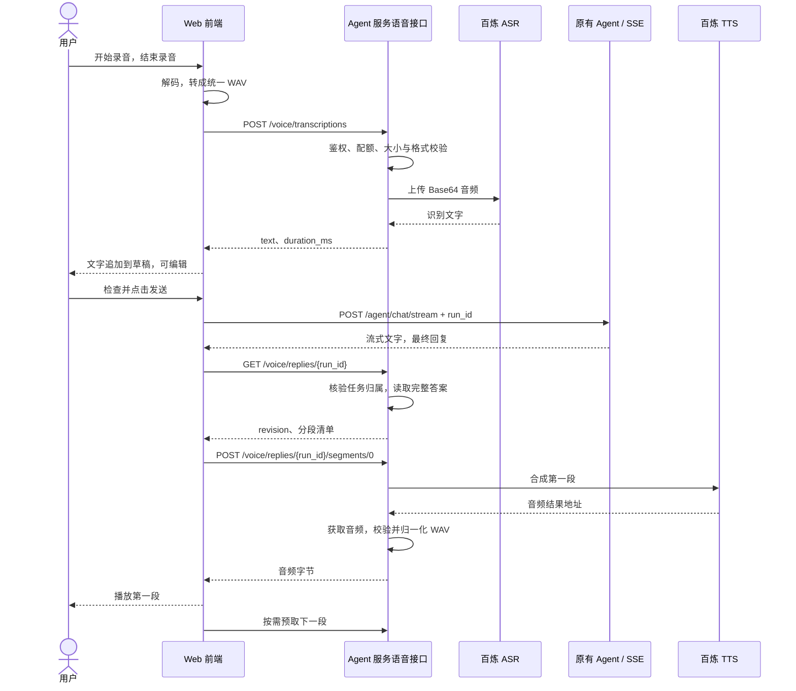

# Agent 语音功能讲解：原理、流程与关键细节

整理日期：2026-10-14。本文依据当前已实现的代码和已有验收记录编写，适用于本项目的 React Web 前端与 FastAPI Agent 服务。

本文用于理解和维护功能；具体接口、配置和验收证据可参阅[实施说明](agent-voice-conversation-implementation.md)，原始方案见[设计文档](agent-voice-conversation-design.md)。

## 1. 这个功能提供什么

用户可以通过录音输入问题，检查识别文字后发送给 Agent；Agent 生成最终回答后，可以把回答合成为语音播放。

核心流程为：

```text
录音 → 语音识别 → 检查、编辑文字 → 发送给 Agent
                                      ↓
                                 流式展示文字回答
                                      ↓
                                 最终回答语音合成 → 播放
```

录音输入和语音输出可以独立使用。

| 用户输入 | 回复方式 | 是否支持 |
| --- | --- | --- |
| 打字 | 阅读文字 | 支持，沿用原有对话 |
| 录音后发送识别文字 | 阅读文字 | 支持 |
| 打字 | 阅读文字并听语音 | 支持 |
| 录音后发送识别文字 | 阅读文字并听语音 | 支持 |

当前采用一次录音、一次发送的交互。录音只在用户主动点击后开始；页面隐藏或离开聊天页时会清理采集和播放。

## 2. 三个能力各自负责什么

| 能力 | 本项目采用的实现 | 接收什么 | 返回什么 |
| --- | --- | --- | --- |
| ASR：语音识别 | 百炼 `qwen3-asr-flash` | 用户录音 | 识别文字 |
| Agent：理解与处理问题 | 项目原有 Agent 链路及现有推理模型 | 用户确认发送的文字 | 回答、工具处理结果或业务确认卡 |
| TTS：语音合成 | 百炼 `qwen3-tts-flash` | 最终回答的朗读文本 | 音频 |

**`qwen3-tts-flash` 负责把文字说出来。** 录音转文字由 ASR 完成，查询课程、生成训练建议、调用业务工具等仍由原有 Agent 完成。

例如用户说：“今天练腿，帮我安排一组训练。”

1. ASR 识别这句话。
2. 用户检查文字并点击发送。
3. Agent 根据当前身份、会话和可用工具处理问题。
4. TTS 将最终训练建议合成为语音。

这样语音可以接入已有对话能力，无需为语音再维护一套业务执行逻辑。

## 3. 用户实际如何操作

### 3.1 录音发送

1. 登录并连接 Agent，点击输入区的「录音」。
2. 首次使用时允许浏览器访问麦克风。
3. 录音中可以看到计时和音量提示，点击「结束录音」或「取消」。
4. 结束后先显示「正在处理录音」，再显示「正在识别语音」。
5. 识别文字追加到原来的输入草稿，用户可以修改。
6. 点击「发送」，才创建本轮 Agent 对话任务。

**结束录音会进行识别，但不会自动发送给 Agent。** 如果识别后的姓名、重量、日期或预约时间有误，可以在执行对话前纠正。

已有草稿不会被覆盖。例如原草稿是“我的目标是增肌”，录音识别为“今天想练胸”，输入框会保留两部分内容。

录音、转换和识别期间暂时禁止普通发送。识别失败后可以重试识别、重新录音，或改用文字。合并后的消息超过 4000 字符时需要精简，系统不会静默截断后发送。

### 3.2 语音回复

「语音回复」开关控制**新一轮最终回答的自动朗读**，初始关闭，用户选择会保存在本浏览器的偏好中。

- 开启后：文字仍按原有方式流式显示，最终回答完成后尝试播放语音。
- 关闭时：仍可点击某条完整回复下方的「朗读」。
- 播放时：可以暂停、继续、停止，并查看当前分段进度。
- 播放结束：可以重新播放。
- 浏览器拦截自动播放：显示「点击播放」，用户主动点击即可继续尝试播放已有音频。

同一页面只有一个播放器。切换朗读的回复、开始录音或发送新问题，会停止上一条音频，避免声音重叠或把助手的声音录进用户问题。

## 4. 一次完整请求如何流转



图中的 `/voice` 接口均位于 `/api/v1/agent/voice` 下。获取朗读清单不会调用 TTS；请求某个音频片段时才检查缓存并按需合成。

## 5. 录音为什么要统一格式

不同浏览器可能录出不同编码格式。前端使用 `MediaRecorder.isTypeSupported()` 探测支持情况，再通过 Web Audio 解码并生成统一音频。

服务端接收的标准是：

| 参数 | 当前要求 | 含义 |
| --- | --- | --- |
| 容器 | WAV | 文件头描述格式、采样率和数据长度 |
| 编码 | PCM16 | 每个采样点用 16 位整数表示 |
| 采样率 | 16 kHz | 每秒 16,000 个采样点 |
| 声道 | 单声道 | 一路声音数据 |
| 时长 | 0.3–60 秒 | 服务端按真实帧数校验 |
| 上传大小 | 最多 2 MiB | 同时受前端、API 和部署代理限制 |

60 秒的 PCM 数据约为：

```text
16,000 采样/秒 × 2 字节/采样 × 60 秒 = 1,920,000 字节
```

这让输入格式和资源占用更容易控制。生产语音服务不依赖 FFmpeg；真实联调脚本使用 FFmpeg 只是为了转换固定测试音频。

服务端会检查实际文件结构，不能只相信扩展名、Content-Type 或浏览器计时。上传数据分块读取，累计超过限制会拒绝；没有 Content-Length 的请求也受同样限制。

当前静音拦截针对完全为零的 PCM 数据，**不等于完整的语音活动检测（VAD）**。背景噪声、很轻的声音和识别错误仍可能存在，发送前检查文字依然有必要。

## 6. Agent 对话如何复用原有流程

识别成功后，Agent 接收的是用户最终确认的文字。这条文字走原有 `/api/v1/agent/chat/stream` 接口，沿用身份验证、会话、路由、RAG、工具调用及业务确认机制。

SSE 是服务端持续向浏览器推送事件的机制，因此用户可以逐步看到文字答案。语音通过另一组 HTTP 接口获取音频，文字流不必等待音频合成。

有两个标识容易混淆：

| 标识 | 作用 |
| --- | --- |
| `conversation_id` | 标识对话会话，用来关联上下文 |
| `run_id` | 标识一次具体任务，用于获取结果、取消、恢复和关联朗读 |

前端在收到最终答案后，把 `run_id` 关联到对应的助手消息。朗读时用这个 ID 请求后端，而不是把浏览器里的回答文字重新提交给 TTS。

后端只有在任务为 `COMPLETED`、结果可读取且当前身份属于该任务范围时，才生成朗读清单。正在运行、取消中、已取消、失败或结果不确定的任务不会提供朗读。

这里的 `COMPLETED` 表示**这轮对话已经完成**。如果回答含有业务确认卡，预约或修改计划等动作仍可能等待用户确认，不能把“对话完成”理解为“业务已经执行”。

## 7. 长回答如何变成语音

### 7.1 先准备适合朗读的文字

Agent 回答可能包含 Markdown。后端会解析结构，再生成朗读文本，避免把格式符号和网址读出来。

| 回答内容 | 当前朗读处理 |
| --- | --- |
| 标题、加粗 | 保留可见文字，去掉装饰 |
| 有序列表 | 保留项目顺序，例如“第 1 项” |
| 表格 | 按行读出“字段名：值” |
| 可见链接文字 | 保留文字，不直接朗读长 URL |
| 图片 | 不朗读图片地址 |
| 代码块 | 提示“代码内容请查看文字回复” |
| 数字、小数、负号、单位 | 保留原有文本，避免另一次模型改写改变内容 |

例如下面的表格：

| 动作 | 重量 | 次数 |
| --- | --- | --- |
| 深蹲 | 12.5 kg | 3 × 10 |

会转换成类似“动作：深蹲；重量：12.5 kg；次数：3 × 10”的文字交给 TTS。模型的具体发音效果仍取决于音色与文本。

这一阶段使用确定性的 Markdown 解析，不额外调用 LLM 做摘要。语音文本会省略代码、图片等不适合朗读的部分，因此完整信息仍以文字回答为准。

### 7.2 分段合成，顺序播放

应用每段最多使用 **480 个字符**，优先选择标点或空格作为边界；没有合适边界时才按长度切开。整条可朗读文本默认上限为 15,360 字符，超限会提示阅读文字或让助手分部分回答。

播放器的工作方式是：

```text
取第 0 段 → 播放第 0 段，同时预取第 1 段
                                ↓
           播放第 1 段，同时预取第 2 段
                                ↓
                         依次完成后续片段
```

一次只预取下一段。播放顺序由分段索引和音频结束事件决定，不会因为网络返回乱序而把后面的内容提前播放。

当前按完整音频片段播放，段间可能有短暂停顿。暂停当前播放时，已经发出的下一段预取可能继续完成；停止播放会取消浏览器等待并清空队列。

### 7.3 `revision` 为什么必要

朗读清单包含 `revision`，它根据分段内容、分段规范版本、模型、音色和语言设置计算。

请求音频时必须带上同一个 revision。内容或配置发生变化后，旧 revision 返回 409，播放器重试时重新获取清单，避免新旧分段混用。

多实例部署时应保持语音配置和代码版本一致，否则请求落在不同配置的实例上，可能反复遇到 revision 不匹配。

## 8. 停止、取消和重试的区别

| 操作 | 当前行为 | 与 Agent/业务的关系 |
| --- | --- | --- |
| 取消录音 | 停止麦克风，清理本轮音频和识别等待 | 尚未发送的输入不创建 Agent 任务 |
| 停止播放 | 停止声音，清空播放队列，释放音频 URL | 已生成文字保留，不取消 Agent |
| 停止生成 | 使用原有任务取消协议，并停止相关播放 | 按任务状态确认是否真正停止 |
| 重试识别 | 重新提交仍保留在页面内存中的 WAV | 只重试 ASR，不发送 Agent 对话 |
| 重试朗读 | 重试失败片段；修订变化时刷新清单 | 不重新执行 Agent 或业务工具 |
| 重新播放 | 从该回复第一段重新开始取音频 | 可能命中缓存，也可能重新合成 |

停止生成不代表撤销已经完成的业务操作。业务事实仍按原有查询、确认与取消流程处理。

用户录音说出“确认”也只会变成普通输入文字；前端不会据此直接批准业务确认卡。

重试识别通常复用已经转换好的录音。若失败发生在录音采集或解码阶段，没有可用 WAV，则需要重新录音或输入文字。

## 9. 如何避免旧音频、旧录音进入新会话

用户可能在请求尚未完成时取消录音、切换回复或切换账号。网络响应往往不能与点击操作同时停止。

前端为录音和播放分别维护递增的本轮标识。异步任务完成后检查标识，如果它属于已经失效的旧操作，就丢弃结果。

浏览器用 Blob 保存二进制音频，再创建临时对象 URL 交给播放器。这个 URL 引用当前页面中的数据，不是一个已经上传的公共文件地址；停止或淘汰音频时需要撤销它，释放引用。

例如：

```text
开始播放 A，标识为 10
用户停止 A，标识增加为 11
用户开始播放 B，标识增加为 12
A 的音频迟到：发现自己的标识是 10，丢弃，不会抢播
```

清理包括停止麦克风轨道、关闭音频分析上下文、清除计时器、取消网络等待，以及撤销 Blob 对象 URL。

以下动作会触发相应清理：

- 开始新录音或发送新问题：停止原有播放。
- 离开聊天页：清理录音和播放。
- 页面隐藏，例如切换浏览器标签或部分锁屏场景：清理录音和播放。
- 账号或授权范围变化：清理旧音频、识别缓存和输入草稿。
- 组件卸载：释放剩余资源。

刷新后的任务恢复以读取原任务结果为主，不重新发送同一条业务请求，也不默认自动朗读恢复的回答。

## 10. 访问权限与数据去向

语音接口沿用已有认证：正式浏览器登录使用 Cookie 与 CSRF 校验；签名 AgentContext 方式用于已有的可信身份接入。

后端按用户及当前机构、角色、能力等权限范围核验任务归属。每次获取朗读清单和请求音频段都进行校验，不能仅凭知道某个 run_id 就读取别人的回复。

| 数据 | 当前项目如何处理 |
| --- | --- |
| 百炼 API Key | 只放在服务端环境配置；不写入前端产物或语音响应 |
| 原始录音与转换后的 WAV | 在页面和请求内存中处理；识别成功或取消后清理，不作为长期附件保存 |
| 识别文字 | 经用户确认后进入原有 Agent 对话流程，沿用原有聊天数据管理 |
| 合成音频 | 后端短期内存缓存，浏览器持有当前/下一段 Blob |
| 百炼返回的音频地址 | 后端下载使用，浏览器直接获取同源音频字节 |
| 日志和指标 | 记录操作类型、耗时、结果、单位数量等，不主动记录音频或转写全文 |

音频下载限制为百炼结果桶域名，使用 HTTPS，不跟随任意重定向；下载 OSS 时不传送百炼 Authorization。下载大小和总耗时有上限。

服务端同源音频响应使用 `Cache-Control: no-store`，避免交给公共 HTTP 缓存。应用内部受控的内存缓存是另一层机制，可以继续复用音频。

“项目不长期保存录音”描述的是应用业务层行为。部署代理的请求缓冲可能使用临时文件，例如当前 Nginx 没有显式关闭请求体缓冲，因此这不构成“整条链路绝不临时落盘”的承诺。

录音仍会发送到百炼完成识别，供应商侧的数据处理与保留策略需要按实际业务空间配置和条款确认。

## 11. 缓存、资源配额与费用

### 11.1 缓存解决什么

后端采用每进程 LRU 内存缓存，默认最多 32 MiB，缓存条目有效期为 10 分钟。空间不足时淘汰较久未使用的内容。

缓存键包含权限归属摘要、run_id、revision 和分段文本。相同进程内，对同一片段的并发请求会合并到同一次合成任务，避免重复调用供应商。

每次请求仍会先核验身份和任务有效期。缓存不会绕过访问权限。

**缓存命中可能省去一次供应商调用，但当前仍会计入语音接口请求配额。** 配额检查发生在进入缓存服务之前。

进程重启、缓存过期、空间淘汰或请求进入另一实例时，重播可能重新调用 TTS，因此当前没有跨实例“只计费一次”的保证。

### 11.2 默认限制

| 项目 | 默认值 | 限制对象 |
| --- | --- | --- |
| 最长录音 | 60 秒 | 一次录音 |
| 录音上传 | 2 MiB | 一次上传 |
| 聊天文字 | 4000 字符 | 一次最终发送的消息 |
| 朗读总长度 | 15,360 字符 | 一条规范化后的回答 |
| 单段朗读 | 480 字符 | 一次 TTS 请求 |
| 上传读取预算 | 15 秒 | API 读取请求体的总时间 |
| 供应商处理预算 | 60 秒 | 一次 ASR，或一次 TTS 加音频下载 |
| 等待本地并发槽 | 最多约 1 秒 | 没有空闲槽的请求 |
| 模型并发槽 | 4 | 每个服务进程，ASR/TTS 共用 |
| ASR 用户/机构配额 | 10 / 120 次每分钟 | 识别请求 |
| TTS 用户/机构配额 | 60 / 600 段每分钟 | 音频段请求 |
| TTS 下载上限 | 12 MiB | 一个供应商音频结果 |
| 服务端音频缓存 | 32 MiB / 10 分钟 | 每个进程 |
| 任务结果保留期 | 24 小时 | 现有 run 配置的默认值 |

多数限制可以通过配置调整；单段 480 字符是当前代码中的分段常量。并发槽和音频缓存属于单个进程，用户与机构配额通过共享 Redis 管理。多个 worker 或实例的并发能力会累加，当前语音并发槽没有接入全局分布式租约。

如果 Redis 配额服务不可用，昂贵的语音调用会暂时拒绝，文字链路继续按自身的依赖和配额规则运行。

### 11.3 什么时候可能产生费用

录音识别产生 ASR 调用；请求没有缓存的音频段产生 TTS 调用。打开开关本身不会立即朗读已有全部消息。

已经发给百炼的请求，在用户停止或网络断开后仍可能完成并计费。后端会让受限的合成任务在截止时间内结束，以免影响同片段的其他等待者；停止浏览器播放不能保证供应商撤销调用。

当前指标记录调用结果、录音秒数、合成字符和缓存命中。这些用于观察使用情况，**不能直接当作实际账单**；本次没有增加语音费用持久化账本，金额应以百炼实际账单为准。

## 12. 几个容易忽略的实际问题

### 12.1 浏览器录音需要安全上下文

生产环境使用 HTTPS，本地调试使用 localhost 等浏览器认可的安全环境。通过普通 HTTP 的局域网 IP 打开页面，即使其他功能正常，也可能无法录音。

首次请求麦克风只在用户点击录音时发生。权限被拒绝、设备不存在或被占用时，界面给出提示，并保留文字输入方式。

### 12.2 自动播放不一定被允许

浏览器有独立的有声自动播放规则。开启「语音回复」意味着应用尝试自动播放，不能保证所有浏览器都自动出声。

出现「点击播放」时通常已有可用音频，无需因此重新合成。用户主动点击后继续尝试播放即可。

### 12.3 输入和输出 WAV 的采样率不必相同

输入固定为 16 kHz PCM16；真实 TTS 联调得到的是 24 kHz 音频。输出保留其有效格式供浏览器播放，不要求为了播放再转换成输入格式。

### 12.4 百炼音频的 WAV 文件头可能使用占位长度

真实联调发现，下载音频的文件头可能声明约 2GB/4GB 的占位数据长度，但实际音频只有数百 KiB。这是流式输出常见的头部兼容问题，不能照声明帧数直接判断时长。

当前实现限制下载大小，读取实际 PCM 帧，对达到占位长度范围且帧完整的结果重建准确长度的 WAV。普通长度不匹配、被截断的文件仍会被拒绝。

### 12.5 语音故障与 Agent 故障需要分别排查

识别失败时，Agent 可能根本还没收到问题。TTS 失败时，Agent 的文字答案可能已经正常完成。

排查时先确定失败发生在采集、识别、Agent、合成、音频下载还是播放阶段。不要把“听不到声音”直接处理成“重新发送 Agent 请求”，以免重复执行业务操作。

### 12.6 语音重播受 run 有效期限制

目前朗读从已有任务结果读取答案，默认有效期为 24 小时。任务结果过期后，新的朗读请求会返回 404，不能靠前端上传旧文字绕开权限校验。

这与供应商临时音频地址是不同的有效期概念。后端缓存和浏览器 Blob 也各自有生命周期。未来如需长期历史朗读，需要接入持久化消息读取与权限机制。

## 13. 接口与代码分别在哪里

| 接口 | 用途 |
| --- | --- |
| `GET /api/v1/agent/voice/config` | 获取语音开关与输入/朗读限制 |
| `POST /api/v1/agent/voice/transcriptions` | 上传 WAV，返回识别文字和时长 |
| `POST /api/v1/agent/chat/stream` | 原有 Agent 对话，输入识别后的最终文字 |
| `GET /api/v1/agent/voice/replies/{run_id}` | 读取最终回答的朗读清单 |
| `POST /api/v1/agent/voice/replies/{run_id}/segments/{index}` | 按 revision 获取一个音频段 |

| 代码文件 | 主要职责 |
| --- | --- |
| [recorder.ts](../fitness-web/src/voice/recorder.ts) | 录音支持检查、WAV 编码、音频归一化、采集错误提示 |
| [useVoice.ts](../fitness-web/src/voice/useVoice.ts) | 录音/识别/播放生命周期与状态管理 |
| [player.ts](../fitness-web/src/voice/player.ts) | 分段播放器、预取、暂停、重试、迟到结果隔离 |
| [VoiceControls.tsx](../fitness-web/src/voice/VoiceControls.tsx) | 录音和朗读控件 |
| [App.tsx](../fitness-web/src/App.tsx) | 草稿合并、发送、回复与 run_id 关联 |
| [api.ts](../fitness-web/src/api.ts) | 同源请求、认证头、CSRF、截止时间和错误处理 |
| [voice.py](../fitness-agent-service/app/api/routes/voice.py) | 语音 API、配额、任务归属与终态检查 |
| [service.py](../fitness-agent-service/app/voice/service.py) | 百炼调用、格式校验、Markdown 处理、分段、缓存和指标 |
| [config.py](../fitness-agent-service/app/core/config.py) | 语音配置与启动校验 |

语音默认由 `AGENT_VOICE_ENABLED` 控制；密钥配置为服务端 `AGENT_VOICE_API_KEY`，也支持 `DASHSCOPE_API_KEY`。模型、音色和语言可分别配置。修改环境配置后需要重启后端，前端重新获取语音配置。

## 14. 常见问题与处理方式

| 现象 | 优先检查或处理 |
| --- | --- |
| 显示“语音暂未启用” | 服务端开关、密钥配置、是否已重启 |
| 提示麦克风权限未允许 | 浏览器网站权限，确认安全访问地址 |
| 点击结束后仍在处理中 | 正在解码/归一化或识别；可取消后改用文字 |
| 识别出错误的重量、姓名或时间 | 编辑文字后再发送；尽量靠近麦克风、减少噪声 |
| 文字有回复但没有声音 | 查看语音开关、自动播放提示、TTS/下载错误和设备音量 |
| 某段播放失败 | 点击重试朗读，重试该段，不重新发送问题 |
| 返回 429 | 用户/机构配额、供应商额度或本地并发繁忙 |
| 返回 503 | 功能关闭、服务更新或 Redis 配额依赖不可用 |
| 返回 409 | run 尚未完成，或朗读 revision 已变化 |
| 返回 404 | run 不存在、已过期或当前身份无权读取 |
| 切换标签页后录音/播放停止 | 当前实现会在页面隐藏时主动清理 |
| 重播再次消耗额度 | 缓存过期、淘汰、进程重启或访问另一实例等缓存未命中场景 |

## 15. 已验证的内容与尚未验证的范围

截至 2026-10-14，已有的验证记录是：

- 后端语音、对话、流式、取消、浏览器认证相关回归 73 项通过，配置与指标回归另 18 项通过，共 91 项。
- 前端测试 27 项通过，TypeScript 与生产构建通过；新增 Python 模块通过 Ruff 和严格 mypy。
- 真实百炼调用完成固定测试句的 TTS、下载归一化和 ASR 识别。
- 隔离 Chrome 使用真实 MediaRecorder/Web Audio 和固定音频，验证了录音转换、草稿保留、发送、播放控制、取消与识别重试，没有控制台错误。

真实接口测试的单次样本为：音频 5.76 秒，TTS 约 1.815 秒，ASR 约 0.522 秒。这个样本不包含真实 Agent 推理，不能直接当作完整对话延迟，也不是性能保证。

验证范围需要区分：

| 验证方式 | 已覆盖 | 未覆盖 |
| --- | --- | --- |
| 真实百炼语音联调 | 实际模型、凭证、音频格式与语音路由 | 真实业务库和 Agent 推理，使用进程内身份与已完成任务夹具 |
| 隔离 Chrome 交互验收 | 实际录音、转换和播放，390px 布局 | API 使用测试夹具；不是完整生产环境联调 |
| 现有回归测试 | 对话、取消、鉴权及语音边界的程序行为 | 无法代替所有设备与网络条件的实际体验 |

macOS Safari、Android/iOS 实机及微信 WebView 尚未逐一验收。Chrome 手机宽度的视口验证不能代表 iOS Safari 的麦克风、编码或自动播放兼容性。

完整 Java/数据库业务栈与生产部署未在本次语音验收中启动或发布。部署后仍应使用真实登录、实际对话和目标浏览器补充应用级验收。
