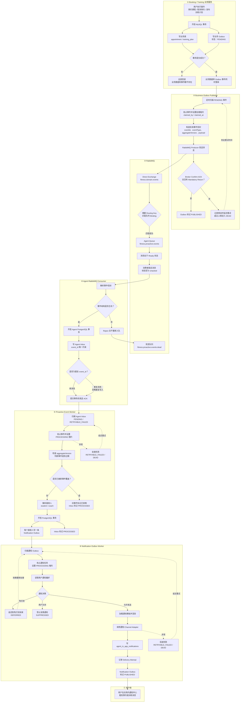
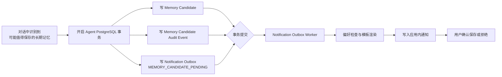

# 业务消息可靠传递流程详解

## 一、核心结论

系统并不是“业务模块生成消息后直接发送 RabbitMQ”，而是经过三道可靠性关卡：

1. **业务 Outbox**：保证业务数据和“待发送事件”同时成功。
2. **Agent Inbox**：保证消息被 Agent 持久化接收，并且重复投递不会重复处理。
3. **Notification Outbox**：保证事件处理结果和“待通知任务”同时成功，通知失败可以单独重试。

三层机制分别解决了三个不同系统边界上的“双写一致性”问题：

```text
业务数据库 ──业务 Outbox──> RabbitMQ
RabbitMQ ──Agent Inbox──> Agent 业务处理
Agent 业务处理 ──Notification Outbox──> 用户通知渠道
```

## 二、Booking/Training 到用户通知的完整流程图



## 三、每一步具体发生了什么

### 第 1 步：业务请求进入 Booking 或 Training

例如用户预约课程：

```text
POST /appointments
```

Booking Service 会开始一个 MySQL 事务。在这个事务中，它不只是写预约表，还会同时写业务 Outbox。

概念上类似：

```sql
BEGIN;

INSERT INTO appointment (...);

UPDATE contract
SET remaining_hours = remaining_hours - 1;

INSERT INTO agent_booking_outbox (
    event_id,
    event_key,
    event_type,
    aggregate_id,
    aggregate_version,
    payload,
    status
)
VALUES (
    'evt-10001',
    'appointment-created:apt-9001',
    'APPOINTMENT_CREATED',
    'apt-9001',
    1,
    '{"studentId":"u01","coachId":"u02"}',
    'PENDING'
);

COMMIT;
```

这里最重要的是：预约数据和 Outbox 事件处于同一个数据库事务。

因此只可能出现两种结果：

- 预约成功，Outbox 事件也存在；
- 预约失败，Outbox 事件也被回滚。

不会出现：

```text
预约成功了，但程序在发送 RabbitMQ 前崩溃，导致消息永久丢失
```

这正是业务 Outbox 解决的问题。

### 第 2 步：Business Outbox Publisher 扫描事件

Booking 和 Training 都有独立的定时 Publisher。

它们大约按照下面的逻辑工作：

```text
每隔一段时间扫描一次
    ↓
查询 status=PENDING 且已经到达重试时间的事件
    ↓
为事件设置 claimed_by、claimed_at
    ↓
获得一段时间的处理租约
```

租约是为了避免多个 Publisher 实例同时发送同一条记录。

例如实例 A 抢到了事件：

```text
claimed_by = booking-publisher-01
claimed_at = 2026-09-17 10:00:00
```

如果实例 A 崩溃，租约超时以后，实例 B 可以重新抢占，不会永久卡住。

### 第 3 步：Publisher 构造标准事件信封

业务 Outbox 中存的是业务事件记录。Publisher 会将其转换成统一消息格式，例如：

```json
{
  "eventId": "evt-10001",
  "source": "booking",
  "eventType": "APPOINTMENT_CREATED",
  "aggregateId": "apt-9001",
  "organizationId": "org-01",
  "contractVersion": 1,
  "aggregateVersion": 1,
  "occurredAt": "2026-09-17T10:00:00Z",
  "payload": {
    "appointmentId": "apt-9001",
    "studentId": "user-01",
    "coachId": "coach-01"
  }
}
```

其中几个字段尤其重要：

- `eventId`：全局事件唯一标识，用于消费端幂等。
- `eventType`：业务事件类型。
- `aggregateId`：发生变化的业务实体，例如预约 ID。
- `aggregateVersion`：实体版本，用于判断事件先后顺序。
- `contractVersion`：消息结构版本，用于兼容未来升级。
- `payload`：事件所需的最小业务数据。

### 第 4 步：Producer 把消息发送到 Exchange

这里容易混淆的两个概念是：

- `OutboxPublisher`：负责扫描数据库、重试、更新状态。
- `RabbitMessagePublisher/Producer`：负责真正调用 RabbitMQ 客户端发送消息。

也就是说：

```text
OutboxPublisher
    ↓ 调用
RabbitMQ Producer
    ↓ 发送
Exchange
```

消息发送到：

```text
Exchange：fitness.domain.events
类型：Direct Exchange
```

Routing Key 映射如下：

| 业务事件 | Routing Key |
|---|---|
| APPOINTMENT_CREATED | `appointment.created` |
| APPOINTMENT_RESCHEDULED | `appointment.rescheduled` |
| APPOINTMENT_CANCELLED | `appointment.cancelled` |
| TRAINING_PLAN_REVIEW_REQUIRED | `training.plan.review_required` |
| TRAINING_PLAN_PUBLISHED | `training.plan.published` |

### 第 5 步：Exchange 根据 Routing Key 分发

Exchange 自身通常不负责长期保存消息，它主要负责路由。

Direct Exchange 会进行精确匹配：

```text
消息 routing key
        =
队列 binding key
```

Agent 队列：

```text
fitness.proactive.events
```

绑定了上述预约和训练计划相关 Routing Key，因此消息会被路由到该队列。

要注意：同一条消息可以被分发到多个队列。

例如未来可以增加：

```text
fitness.proactive.events     → Agent 主动通知
fitness.analytics.events     → 数据分析
fitness.audit.events         → 审计归档
```

三个队列都绑定 `appointment.created`，那么一次发布可以产生三份相互独立的队列消息。

### 第 6 步：Broker Confirm 后更新业务 Outbox

Producer 启用了两个机制：

- Publisher Confirm；
- Mandatory Return。

只有满足下面两个条件，业务 Outbox 才会标记为 `PUBLISHED`：

```text
RabbitMQ 返回 ACK
并且
消息没有因为找不到绑定队列而被 Return
```

需要特别理解：

```text
业务 Outbox = PUBLISHED
```

只表示 RabbitMQ 已经接受并正确路由了消息，不表示 Agent 已处理，更不表示用户已经看到通知。

如果出现 NACK、超时或者 Return：

```text
记录 last_error
增加 attempts
计算下一次重试时间
```

超过最大重试次数后进入 `DEAD`，等待人工排查或受控重放。

### 第 7 步：RabbitMQ Consumer 取得消息

消息进入 `fitness.proactive.events` 后，状态大致经历：

```text
Ready
  ↓ 被消费者获取
Unacked
  ↓ 消费者 ACK
从队列删除
```

Agent Consumer 会先校验：

- 消息是不是合法 JSON；
- 是否存在 `eventId`；
- `eventType` 是否支持；
- `contractVersion` 是否兼容；
- 必要字段是否存在。

如果消息结构非法：

```text
reject(requeue=false)
```

消息进入死信队列：

```text
fitness.proactive.events.dead
```

### 第 8 步：Consumer 先写 Agent Inbox，再 ACK

这是第二道可靠性关卡。

Agent Consumer 不会拿到消息后立即 ACK，而是：

```text
开始 PostgreSQL 事务
    ↓
INSERT agent_proactive_event_inbox
    ↓
提交事务
    ↓
向 RabbitMQ 发送 ACK
```

Agent Inbox 中的 `event_id` 有唯一约束。概念上类似：

```sql
INSERT INTO agent_proactive_event_inbox (...)
VALUES (...)
ON CONFLICT (event_id) DO NOTHING;
```

因此，如果同一条 RabbitMQ 消息被重复投递：

```text
第一次：
写入 Inbox 成功 → ACK

第二次：
event_id 已存在 → 不重复写入 → ACK
```

这就是 Inbox 的幂等作用。

还有一种重要异常：

```text
Inbox 已成功提交
但 Consumer 在发送 ACK 前崩溃
```

RabbitMQ 会认为消息没有处理完成，随后重新投递。但第二次写 Inbox 时会被 `event_id` 唯一约束挡住，因此不会重复创建后续通知。

所以这里实现的是：

```text
RabbitMQ 至少投递一次
+
Agent Inbox 幂等接收
```

而不是依赖所谓的“绝对只投递一次”。

## 四、Agent Inbox 后面的处理流程

Inbox 只是可靠接收区，不负责直接通知用户。

后台 `ProactiveEventWorker` 会继续处理 Inbox：

```text
PENDING
   ↓ 抢占
PROCESSING
   ↓ 成功
PROCESSED
```

失败时则会：

```text
PROCESSING
   ↓
RETRYABLE_FAILED
   ↓ 延迟后重试
PROCESSING
```

超过最大次数进入：

```text
DEAD
```

### 1. 判断事件是否过期

假设同一个预约连续产生：

```text
version=1 APPOINTMENT_CREATED
version=2 APPOINTMENT_RESCHEDULED
version=3 APPOINTMENT_CANCELLED
```

如果因为网络和重试，消费顺序变成：

```text
先处理 version=3
后处理 version=2
```

那么 `version=2` 已经是过期事件，不能再通知用户“预约已改期”。

系统会通过 `aggregateId + aggregateVersion` 判断旧事件是否已经被新事件覆盖，并将旧通知抑制掉。

### 2. 计算通知接收人

不同事件对应不同接收人：

| 事件 | 接收人 |
|---|---|
| 预约创建 | 学员、教练 |
| 预约改期 | 学员、教练 |
| 预约取消 | 学员、教练 |
| 训练计划待审核 | 教练 |
| 训练计划已发布 | 学员 |

### 3. 写 Notification Outbox

对于每一个接收人，生成一条通知任务：

```text
proactive:{eventId}:{userId}
```

例如：

```text
proactive:evt-10001:user-01
proactive:evt-10001:coach-01
```

这个 `dedupe_key` 有唯一约束，因此即使某个 Inbox 事件被 Worker 重试，也不会为同一用户重复生成通知任务。

而且下面两个动作处在同一个 PostgreSQL 事务里：

```text
写 Notification Outbox
+
Agent Inbox 标记 PROCESSED
```

从而避免：

- Inbox 已标记成功，但通知任务没有生成；
- 通知任务已生成，但 Inbox 一直被当成未处理。

## 五、Notification Outbox 到最终通知

Notification Outbox 是第三道可靠性关卡。

它和业务 Outbox 不是同一张表，也不是同一种任务：

| Outbox | 内容 | 目标 |
|---|---|---|
| Business Outbox | 跨服务领域事件 | RabbitMQ |
| Notification Outbox | 给某个用户的通知任务 | In-App、短信、Push 等渠道 |

Notification Worker 会：

1. 抢占待处理任务；
2. 查询用户通知偏好；
3. 判断免打扰时间；
4. 加载通知模板；
5. 渲染标题和正文；
6. 调用通知渠道适配器；
7. 记录投递结果；
8. 更新 Outbox 状态。

目前项目中的主要渠道是：

```text
IN_APP
```

因此最终不是再次发送 RabbitMQ，而是写入：

```text
agent_in_app_notifications
```

用户打开通知中心时，从这张表查询消息。

如果处于免打扰时间：

```text
Notification Outbox → DEFERRED
```

设置未来的 `available_at`，到时间后继续处理。

如果用户关闭了该类通知：

```text
Notification Outbox → SUPPRESSED
```

如果渠道调用失败：

```text
Notification Outbox → RETRYABLE_FAILED
```

达到重试上限：

```text
Notification Outbox → DEAD
```

## 六、Memory 为什么不经过 RabbitMQ

Memory 需要单独讲，因为它和 Booking/Training 不完全一样。

当前项目中的 Memory Candidate 是 Agent 服务内部流程，它和 Notification Outbox 都在 Agent PostgreSQL 中，所以不需要为了跨服务通信再绕一圈 RabbitMQ。



因此三类模块的链路是：

```text
Booking：
MySQL Business Outbox
→ RabbitMQ
→ Agent Inbox
→ Notification Outbox
→ 用户通知

Training：
MySQL Business Outbox
→ RabbitMQ
→ Agent Inbox
→ Notification Outbox
→ 用户通知

Memory Candidate：
Agent PostgreSQL 本地事务
→ Notification Outbox
→ 用户通知
```

Memory 的审计事件 `memory_candidate_events` 或 `memory_events` 主要用于记录生命周期和操作历史，不代表它们都必须发布到 RabbitMQ。

只有未来出现下面的需求时，Memory 才有必要走 RabbitMQ：

- Memory 拆成独立微服务；
- 其他服务需要订阅 Memory 变化；
- Memory 需要驱动分析、审计或推荐系统；
- Memory 写入和通知不再位于同一个数据库。

## 七、最容易混淆的几个名词

### 1. Queue 和 Inbox 不是一个东西

`RabbitMQ Queue` 是消息中间件中的队列，保存等待消费者接收的消息。

`Agent Inbox` 是 PostgreSQL 中的业务表，保存 Agent 已经可靠接收到的领域事件。

`In-App Notifications` 则是用户最终看到的通知收件箱。

三者完全不同：

```text
RabbitMQ Queue
    ↓ Consumer
Agent Event Inbox
    ↓ Proactive Worker
Notification Outbox
    ↓ Notification Worker
User In-App Inbox
```

### 2. Exchange 和 Queue 的职责不同

```text
Producer → Exchange → Queue → Consumer
```

- Producer：产生并发送消息；
- Exchange：根据 Routing Key 决定消息去哪里；
- Queue：保存等待消费的消息；
- Consumer：从 Queue 获取消息；
- Inbox：Consumer 将消息持久化后的可靠接收记录。

### 3. PUBLISHED 在两个 Outbox 中含义不同

| 状态 | 实际含义 |
|---|---|
| Business Outbox `PUBLISHED` | 消息已被 RabbitMQ 接受并路由 |
| Agent Inbox `PROCESSED` | 事件已经转换成通知任务或被抑制 |
| Notification Outbox `PUBLISHED` | 通知渠道投递完成；当前 In-App 表示通知记录已落库 |

所以业务 Outbox 显示 `PUBLISHED`，并不能证明用户已经看到通知。

## 八、异常情况下系统如何保证不丢、不重

| 异常位置 | 系统行为 |
|---|---|
| 业务表写成功、Outbox 写失败 | 同一事务整体回滚 |
| Outbox 已落库、Publisher 崩溃 | 定时任务之后继续扫描 |
| RabbitMQ NACK 或发送超时 | Business Outbox 延迟重试 |
| RabbitMQ 已接收，但 Confirm 丢失 | Producer 可能重发，由 Agent Inbox 去重 |
| Inbox 提交后、Consumer ACK 前崩溃 | RabbitMQ 重投，Inbox 根据 event_id 去重 |
| Proactive Worker 处理中崩溃 | 租约超时后其他 Worker 重新抢占 |
| Notification Outbox 重复处理 | dedupe_key 阻止重复生成通知 |
| 用户处于免打扰时段 | 通知进入 DEFERRED，稍后处理 |
| 通知渠道短暂故障 | RETRYABLE_FAILED，延迟重试 |
| 多次重试仍失败 | 进入 DEAD，等待人工处理 |

整个系统真实提供的是：

```text
至少一次投递
+
数据库幂等
+
版本控制
+
重试和死信
```

而不是理论上的端到端 Exactly Once。

## 九、面试总结话术

> Booking 和 Training 在业务事务中通过 Transactional Outbox 同步记录领域事件，由独立 Publisher 通过 Confirm 和 Mandatory Return 可靠发布到 RabbitMQ。Agent Consumer 在 ACK 前先将事件写入带唯一 event_id 的 Inbox，从而承受消息重复投递。后台 Worker 再通过 aggregateVersion 处理乱序和过期事件，并在同一事务中生成带 dedupe_key 的 Notification Outbox。通知 Worker 根据用户偏好、免打扰规则和模板完成最终渠道投递。因此整条链路采用的是 At-Least-Once 加分层幂等，而不是依赖 Exactly-Once。

## 十、当前实现中值得确认的问题

当前 Booking 配置中还声明了 `fitness.booking.events` 队列，并绑定预约事件；但现有代码里没有对应的 Java Listener。真正的主动通知链路消费的是 Agent 的 `fitness.proactive.events`。

如果 `fitness.booking.events` 没有实际用途，生产环境中应当：

- 删除不需要的队列及绑定；或者
- 补充真正需要的消费者。

否则消息可能在没有消费者的队列中持续积压。
