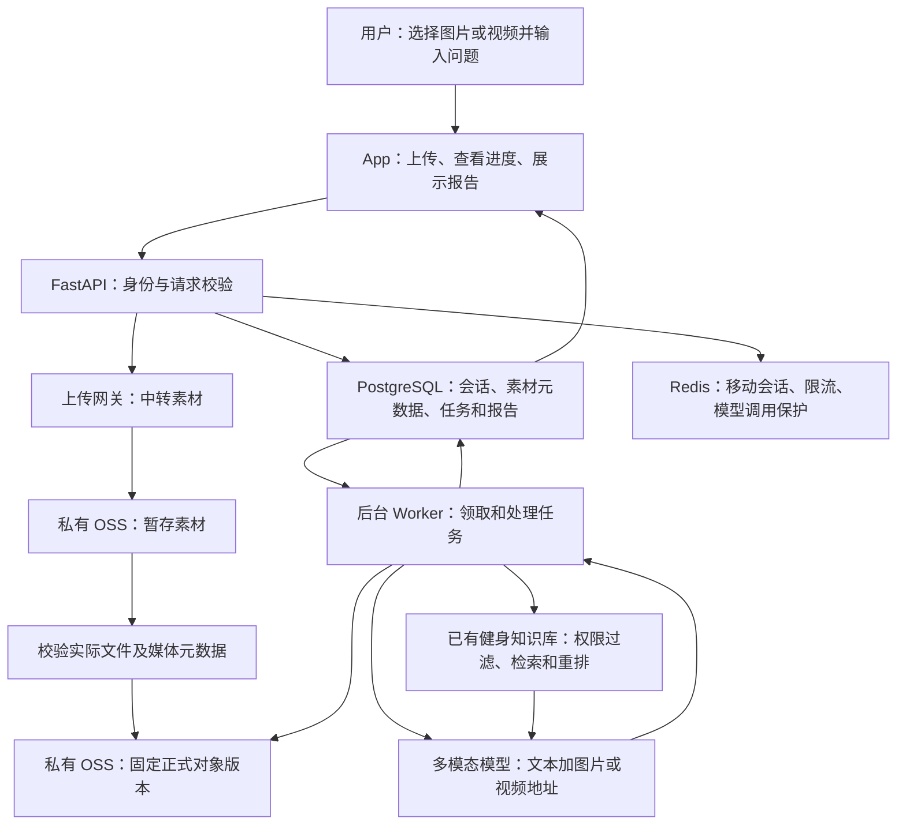

# 健身多模态分析：功能说明与面试讲解

> 基于项目截至 2026 年 11 月 4 日的代码和本机验收记录整理。本文既说明已经实现的内容，也说明尚未完成的验证；它不是生产上线证明。

## 一、这个功能解决什么问题

原有健身项目已经有文本对话、健身知识库和训练业务。新增多模态能力后，用户除了输入文字，还可以选择一张图片或一段视频，向系统提问。例如：

- 上传深蹲视频，问：“我的动作有哪些地方需要注意？”
- 上传坐姿划船的图片，问：“从这张图里能看出什么？”
- 上传一张健身知识图片或一段讲解视频，问：“这里介绍了什么训练方法？”

系统结合用户问题、图片或视频、可用的历史上下文及经过授权的知识资料，生成结构化回答。**动作分析是辅助观察和建议，不能承诺诊断伤病、保证动作安全，也不能把模型回答当作专业教练的最终判断。**

这里有两种不同的分析模式：

| 模式 | 用户上传的内容 | 系统主要做什么 |
| --- | --- | --- |
| 动作分析 | 健身动作图片或视频 | 识别或确认动作，描述画面中可见的情况、可能需要留意的地方及无法判断的内容。 |
| 知识素材解读 | 健身知识图片或视频 | 概括素材画面中的知识，结合可用资料回答问题，不假设画面中的人一定是用户本人。 |

两种模式都有独立的输出结构；知识素材解读由单独的功能开关控制，默认关闭。

## 二、先记住一段面试讲解

> 我在健身项目中实现了一个图片和视频的多模态分析功能。用户在 App 中上传素材并输入问题，服务端先校验身份和上传请求，素材进入私有 OSS 暂存后再校验实际文件并固定对象版本。分析请求不是让用户一直等待同步接口，而是把任务和状态持久化到 PostgreSQL，由后台 Worker 领取任务处理。
>
> Worker 会重新确认身份和素材权限，给模型提供短期有效的 OSS 访问地址。如果请求没有单独提供动作名称参数，会先识别动作；然后在用户有权访问的健身知识范围内做检索，把知识证据、用户问题和图片或视频一起交给多模态模型。模型返回后，后端检查报告结构、素材来源和知识引用，再加密保存，客户端通过查询任务状态展示结果。
>
> Redis 主要用于移动会话、登录限流和跨进程的模型调用并发与次数控制；PostgreSQL 才是分析任务、幂等记录和报告的持久化位置。图片与视频保存在 OSS。删除时先让应用内内容不可访问，再异步清理 OSS 的对象版本。
>
> 目前真实 OSS、模型以及知识库检索链路已经在本机做过联调，但使用的是测试身份。真实账户对接、原生设备和专业动作质量验收仍需完成；我不会把模型成功返回等同于动作判断准确。

这段话适合先讲全貌。面试官追问时，再从下面几节展开。

## 三、用户看到的功能和操作流程

### 1. 用户侧流程

1. 用户进入多模态对话页面，选择“动作分析”或“知识素材解读”。
2. 用户从设备选择图片或视频，并输入希望了解的问题。
3. App 创建会话和上传任务，展示上传与分析状态；遇到失败时显示失败提示，并提供相应的重试入口。
4. 分析完成后，用户可查看简要回答、完整报告、可观察到的内容、建议、局限和可用的知识引用。
5. 用户可以查看历史对话与报告、继续针对素材提问，或删除素材和会话。
6. 在训练关联功能启用且有权限时，可把报告关联到本人已发布训练计划中的某个具体动作，并查看相关训练日的完成／跳过记录。

当前客户端代码使用 **React Native + Expo**，可以在电脑上通过 Expo Web 模拟 App 交互。**微信小程序还没有开发；iOS／Android 真机、相册权限、弱网和切后台等场景尚未完成验收。**

### 2. 一张图看懂技术链路

图中箭头是职责关系的简化表达。Worker 实际会读取数据库里的任务和素材信息，并在调用和发布前进行权限、状态及版本检查。

### 3. 用大白话讲：一个问题到底怎么走

先把“技术链路”理解成**一次业务从用户发起，到结果回到用户面前，依次经过哪些组件，每个组件做什么**。它不是指一个接口从头到尾一次完成。当前实现里，上传素材、提交分析、查询结果是配合完成的多次请求。

拿“上传深蹲视频，问动作有什么需要注意的地方”来说，流程可以这样口头讲：

1. **用户先在 App 里选视频、写问题。** 比如选择一段视频，输入“帮我看看我的深蹲动作，有哪些需要注意的地方？”App 会准备上传和分析需要的标识，用来在网络不稳定时确认是不是同一次操作。
2. **App 先找后端申请上传。** 后端先检查多模态功能是否启用、用户会话是否有效，再检查会话归属以及声明的文件类型、大小等。申请阶段就在 PostgreSQL 创建素材／上传记录和标识，并把素材 ID、上传 ID 返回给 App；此时素材还没有完成上传，不能用于分析。上传申请、服务端中转和提交分析等环节会根据配置执行请求限流；它不是把所有限流和熔断只放在整个流程最前面。
3. **通过后，视频先进入 OSS 暂存。** 在当前生产配置要求的 gateway 方式下，App 先把视频传给后端，后端再转存到私有 OSS。非生产环境还支持短期授权的客户端直传。真实视频文件存在 OSS；PostgreSQL 记录它属于谁、属于哪个会话以及上传状态等信息。
4. **上传完成后，后端检查实际素材。** 包括文件类型和媒体元数据等；检查通过后，把可用于分析的对象及其 OSS 版本固定下来，素材状态变为可用。这样后面模型访问的是已确认的文件版本。项目这里没有自行抽取视频帧或识别人体骨架。
5. **App 再提交问题和素材 ID，创建分析任务。** 注意，这时传给分析接口的主要是问题、素材 ID、会话 ID 和请求标识，不是再次把视频文件塞进问题文本。后端再次鉴权，检查素材是否属于当前用户、是否可用，并把任务及有关消息写入 PostgreSQL，然后先返回一个任务 ID。
6. **用户看到“排队中”或“正在分析”。** App 可以拿任务 ID 查询状态，不用一直让一个 HTTP 请求等待模型生成。此时任务相当于一张存入数据库的“待办单”。
7. **后台 Worker 领取这张待办单。** Worker 可以理解成后台专门负责干耗时工作的程序。它从 PostgreSQL 找到待处理任务，通过数据库锁和有时限的租约领取；如果有多个 Worker，其他 Worker 不应同时领取同一份有效租约。Worker 处理期间还会更新心跳。
8. **Worker 重新核验身份和素材。** 它确认用户仍有权访问素材、素材没有被删除、版本仍与任务记录一致，然后为这个固定版本生成短期有效的 OSS 读取地址，供模型使用。
9. **Worker 准备上下文，但不是每次都读 checkpoint。** 默认情况下，它从 PostgreSQL 读取当前多模态会话里有权使用的近期消息；上一轮助手回答通常取摘要。如果用户**明确关联了有权限的旧文字会话**，才会在校验归属和状态后，通过旧会话的 LangGraph checkpoint 读取部分历史文字。新会话可以没有历史；内容会按数量和长度截断，不会把全部聊天记录原样发给模型。
10. **如果还不知道动作，先尝试识别动作。** 动作分析请求没有单独提供 `exercise_hint` 时，系统先把问题、可用近期对话和素材交给多模态模型识别；如果看不清，就要求用户补充说明。当前 App 即使问题里写了“深蹲”，也没有单独传这个参数，所以仍可能先做识别。这是一次独立模型调用，会受到模型调用保护和额度限制。
11. **有动作名称后，再去 RAG 知识库查资料。** 比如用“深蹲 + 用户当前问题”查询；先按用户、机构、角色和资料类型过滤，再做向量／关键词检索与重排。近期聊天会作为模型回答时的上下文，但当前代码不是把所有聊天记录直接拼进 RAG 查询。找不到资料或知识库不可用时，会标明相应状态，不会编造引用。
12. **组装最终请求。** 系统准备规则提示、当前问题、可用的近期文字上下文、符合条件的沟通偏好、检索到的知识片段，以及视频或图片的短期 OSS 地址。视频文件本身不需要作为一大段文字放进请求。知识素材解读使用独立提示词，流程略有不同。
13. **先做资源保护，再调用模型。** 程序先申请本进程的并发槽，启用共享保护时再向 Redis 申请跨进程槽位；随后检查本进程熔断状态，并在配置共享额度时向 Redis 预留当天调用次数。保护通过后，才把上一步的内容发送给模型，模型通过地址读取素材。连续供应商故障可能触发熔断，稍后再尝试探测恢复。**这里的熔断器是各进程内存中的，不是存在 Redis 里的全局熔断器。** Redis 不可用时，共享保护不会悄悄失效后继续放行；第 10 步的动作识别调用也经过适用的保护。
14. **模型返回后，后端先检查再保存。** 后端检查 JSON 报告格式、素材 ID、视频时间范围和引用 ID；命中已知风险表述时，新报告会保守降级。检查后的消息与报告加密保存到 PostgreSQL，任务状态更新。
15. **App 查询到完成，展示结果。** 用户看到动作观察、建议、局限和可用引用；也可能看到“画面不足”或“本次无法可靠评价”。用户之后可以继续问、查看历史或删除素材。

**特别区分三件事：**当前会话历史主要从多模态消息表读取；旧文字 checkpoint 只有用户显式关联后才作为有限上下文读取；RAG 是按照当前动作和问题查知识资料。这三者都可能帮助回答，但不是同一个东西，也不是每次都一定有。

### 4. 用一个具体对话串起来

假设用户小李选择一段深蹲视频，并输入：**“帮我看看这段深蹲动作，有什么需要注意的？”** 下面是一次可能的执行过程，报告内容仅作流程示例，不代表模型已经对该视频判断正确：

1. 小李打开 App、选择视频、写好问题，点击发送。App 先申请上传；后端核验小李的会话和上传请求。
2. 申请上传时后端已经分配素材 ID；视频经后端中转进入私有 OSS 暂存，实际素材检查通过后，后端固定最终对象版本并确认素材可用。视频本身留在 OSS。
3. App 提交“这句问题 + 素材 ID”，后端在 PostgreSQL 写入分析任务，返回任务 ID，页面显示“排队中”。
4. 后台 Worker 领取任务，检查小李的身份与素材权限，并为对应版本生成短期读取地址。
5. 如果小李在这个多模态会话之前问过问题，系统可取部分有权限的近期消息；如果是第一次对话，历史可以为空。只有小李明确关联旧文字会话时，才可能从旧 checkpoint 读取有限历史。
6. 当前 App 未单独传动作名称参数，系统可能先请模型看视频识别“这是什么动作”。如果模型不能确定，会请小李说明；确定是深蹲后，才继续使用“深蹲 + 当前问题”检索有权访问的知识资料。
7. 系统把小李的问题、有限历史、可用知识片段和视频地址交给模型；每次模型调用前都会经过适用的并发、额度和熔断保护。
8. 假设模型返回“从画面可观察到下蹲和起身过程，但侧面视角不足以确认膝盖左右方向”，并给出相应建议和局限，后端会先检查结构、素材和知识引用；只有通过相关检查的结果才会被保存并返回。若命中已知风险规则，则展示无法可靠评价的提示。
9. App 查询到任务完成后展示结果。**即使这一流程成功，也只能说明系统完成了分析并返回回答，不代表该回答已经被专业人员证实准确。**

### 5. 失败和“重试”分别怎么处理

重试不能一概而论，要先看事情进行到哪一步：

| 发生了什么 | 当前处理方式 | 为什么这样做 |
| --- | --- | --- |
| 上传或上传响应中断 | App 尝试确认原上传任务是否已经完成；gateway 单次传输结果不明确时不会直接自动重放写入。必要时清理待发送记录并重新选择／创建素材。 | 请求超时不一定代表 OSS 没收到文件；当前不能宣称支持断点续传。 |
| 分析提交响应丢失，App 重发**同一**请求 | 使用原客户端消息标识和相同内容做幂等确认；若同一标识对应不同内容，则拒绝冲突。 | 避免一次点击因网络重发创建多份业务任务。 |
| Worker 领取后中断，还未标记开始模型处理 | 租约过期后，在总期限允许时可回到待处理状态，由 Worker 再领取；已超过期限则失败。 | 在尚未进入模型处理的阶段可以按任务状态恢复。 |
| 已标记开始模型处理后，Worker 中断 | 标记为结果未知，不自动重发；即使实际模型请求可能还没发出，也保守处理。 | 系统无法可靠证明供应商是否已收到或计费。 |
| 模型请求超时、网络异常或供应商 5xx | 本次结果标记为未知，不静默自动重试；界面会提示重新分析可能产生额外费用，由用户决定是否再发起。 | 供应商可能已经处理，重复调用可能产生费用。 |
| 模型明确失败，例如部分非成功状态 | 任务标记失败并展示相应提示；用户可以根据原因决定是否重新分析。 | 明确失败与结果未知不是同一种情况。 |
| 用户点击“重新分析” | 前端带回原素材和问题供用户确认再发送；再次发送会产生新的分析任务。 | 这是主动重新分析，不等同于网络层重发同一个幂等请求。 |

因此可以这样向面试官说：**“我们对网络重复提交用幂等控制；对后台中断按任务阶段恢复；对模型调用结果不明保守标记，不做无条件自动重试。”**

### 6. 素材版本、短期地址和状态查询怎么理解

**素材版本是什么？** 开启 OSS 版本控制后，同一个对象路径多次写入，可以有不同的 OSS `versionId`。例如路径相同的 A 版和 B 版是两个不同版本。项目先固定暂存对象的版本并检查它，再把已检查的那个版本复制到正式对象，记录正式对象的版本号。Worker 领取任务时核对素材记录和任务中的版本，再按该版本生成读取地址。这样可以降低“检查的是 A，模型读取时却变成 B”的风险；这不证明视频画面真实，也不证明模型判断准确。

**短期地址怎么生成？** 后端持有服务端 OSS 凭证，使用 OSS SDK 对“读取哪个对象、哪个版本、有效多久”签名，生成 HTTPS 地址。当前模型分析调用使用 600 秒的有效期。模型服务商在有效期内通过这个地址读取私有素材；后端不会把 AccessKey Secret 直接交给模型。签名地址在有效期内相当于一张临时取件凭证，泄露给别人也可能被使用，应当避免暴露。它过期只代表地址失效，不代表 OSS 文件已删除。

**“近期消息”是什么？** 如果用户前面问过“我在练深蹲”，助手也给过回答，后面又问“那膝盖呢”，这些经过权限和状态检查的近期文字可帮助模型理解“那”指什么。当前会话消息默认来自 PostgreSQL；实际发模型的历史还受条数、每条长度和总文本预算限制，不是把整段历史无条件发出。

**旧文字会话怎样关联？** 当前 Expo 客户端在多模态会话列表提供“关联已有文本对话”。用户点击后选择本人有权访问且已完成的旧文字对话，系统创建或打开与其关联的多模态会话，之后可以在该会话上传素材并提问。不是在已经打开的任意上传页面里随时选择旧会话；旧文字和新报告也没有合并成同一份 checkpoint。

**App 怎么知道任务完成？** 当前 Expo 的 Live 会话页使用普通 HTTP **轮询**，不是 WebSocket 或 SSE：页面打开先读取消息并查询待处理任务；只要仍有排队中、运行中或取消中的任务，前台约 4 秒后再次查询；没有活跃任务则停止定时查询。App 进入后台时不持续请求服务器，回到前台会刷新。查询出错有有限次数的退避重试。这是当前前端代码行为，不能代表尚未开发的微信小程序或未完成真机验收的表现。

### 7. 多模态和原来的文字 Agent 是同一条链路吗？

**目前不是。** 项目中原来的文字 Agent 通过 LangGraph 的 Supervisor 图进行路由和领域处理；当前多模态分析由独立的 `MultimodalWorker` 直接调用 `MovementAnalysisService`，再由该服务编排动作识别、RAG 与多模态模型调用，不经过文字 Agent 的 Supervisor 领域路由。多模态复用了项目里的知识库、部分记忆和权限能力，但不能因此说多模态请求已经进入 LangGraph 图。

**OSS 返回的是什么？** 对象路径（Object Key）由项目指定；OSS 写入成功会返回响应元数据，其中包括版本信息。后端后续核对并记录正式对象的 Key 和 `versionId`；项目自己的 `asset_id` 则是在申请上传时由项目生成的，两者不是同一个 ID。模型需要读取时，服务端使用 Key、版本和期限调用 OSS SDK 签发短期地址，OSS 在模型发起读取时验证签名，而不是把长期密钥发给模型。

**前面已经分析过的报告会进入上下文吗？** 有可能。同一多模态会话里，符合权限、完成状态、删除状态及记忆版本要求的近期消息可以参与后续回答；对于助手生成的报告，当前代码只从报告 JSON 里取 `summary` 概述字段，不会自动把完整报告的每条观察、建议和引用都带上。用户过去上传的视频也不会仅因为出现在历史中就自动重新发送；若需要再次分析，需在本次请求中引用相应可用素材。历史读取和提示词还有条数及长度限制。

**长期记忆和会话摘要呢？** 当前动作分析在记忆服务和身份范围等条件满足时，可读取与本人和机构相符的、已启用的沟通偏好，例如“回答简洁一点”，用于最终动作分析；它不会自动注入全部训练目标、身体资料或预约记忆。知识素材解读目前不自动读取这项偏好。报告里的 `summary` 是那一次报告的概述，不是将整个会话压缩后的长期摘要。多模态路径当前没有调用原文字 Supervisor 的自动会话摘要服务；即使关联旧文字会话，也不能假定会自动带上旧摘要。

## 四、一次分析请求在后端如何执行

### 第一步：认证和创建会话

App 调用服务端接口创建多模态会话。后端从移动端会话中取得用户身份及机构范围，用于后续读取素材、提交分析、获取报告等操作的授权。

代码里实现了移动认证代理、访问令牌和刷新令牌的轮换、退出撤销，以及向可信上游刷新签名身份的机制。**但当前尚未完成与原有真实账户体系的正式联调**：本机测试使用了模拟认证上游，不能说“已用真实用户完整跑通”。

### 第二步：申请上传并保存到 OSS

App 先向后端申请上传，后端创建素材和上传任务，记录所属用户、会话等信息。当前支持两种上传模式：

- **gateway 服务端中转**：App 把素材发送给后端，后端再写入 OSS。当前代码要求生产环境使用这一模式。
- **direct 直传**：非生产环境可选择由客户端使用短期签名表单上传到 OSS。客户端不需要拿到长期 OSS 密钥。

素材保存在**私有 OSS Bucket**，数据库保存素材的归属、状态和对象版本等元数据。用户 App 中不保存模型 API Key 或 OSS 长期 AccessKey。

上传后，服务端还会进行文件类型和媒体元数据检查，并固定 OSS 对象版本。版本固定的目的，是让后续分析针对已经确认的那个对象版本，降低同名文件被替换后读到不同内容的风险。

这里要区分两个概念：**检查文件格式和元数据不等于做视频抽帧分析**。项目当前没有自行做动作视频抽帧，也没有接入人体骨架识别。

### 第三步：创建分析任务

用户提交问题和素材后，API 创建分析任务，返回任务标识；客户端可根据状态查询进度和结果。

任务、状态和幂等记录写入 PostgreSQL。客户端重复提交相同请求时，服务端依据客户端消息标识和请求摘要处理：相同内容可以返回原有结果；标识相同但内容不同则发生冲突，避免把两次不同提问误认为同一请求。

**面试时不要说“Redis 队列保存了分析任务”。当前多模态任务的持久化、领取和幂等主要依靠 PostgreSQL。**

### 第四步：后台 Worker 领取和处理

独立的 Worker 从 PostgreSQL 中领取待处理任务，使用数据库事务、行锁和 `FOR UPDATE SKIP LOCKED` 避免多个 Worker 同时领取同一条任务。Worker 获得有时限的租约，并通过心跳维持处理资格；发布结果前仍要检查租约、任务状态、用户及素材状态。

这样设计的好处是：模型调用可能比较慢，API 不必一直同步等待；同时服务重启或 Worker 异常时，可以根据持久化状态和租约处理恢复。

**但不能说系统保证“模型一定只调用一次”。** 请求发出后如果发生超时，供应商可能已经处理或计费，系统会把这类情况标记为结果未知，不能无条件自动重放，更不能保证零重复计费。

### 第五步：识别动作、检索知识、调用模型

对于动作分析：

1. 如果请求没有单独提供动作名称参数 `exercise_hint`，系统先调用多模态模型识别动作；识别不确定时要求用户补充说明，而不是继续猜测。
2. 如果客户端在请求中显式传入 `exercise_hint`，可跳过这次单独识别。当前 App 尚未单独发送该参数，所以即使用户在普通问题文本里写了“深蹲”，仍可能先进行动作识别。
3. 系统根据动作名称和问题，在用户有权访问的训练类资料中检索相关知识。
4. Worker 生成指向已固定 OSS 对象版本的短期签名读取地址，把用户问题、可用知识和图片／视频地址交给多模态模型。
5. 模型按要求返回 JSON 格式的动作报告，包括结论、观察、建议、局限等。

对于知识素材解读，系统使用另一套提示词和报告结构，重点解释素材画面中的内容，不走“先判断用户动作”的逻辑。

当前模型配置默认值为 `qwen3.7-plus-2026-05-26`，通过阿里云百炼的兼容接口调用；模型名称和地址可配置。视频通过模型接口传递视频地址，项目还会传 `fps` 参数；**这不等于本项目自行把视频抽帧后上传**，也不代表可以断言模型供应商内部如何处理视频。

### 第六步：校验、保存和展示

后端不是把模型返回的任意文本直接当成可靠结果，而会检查：

- JSON 是否符合预定义的报告结构，必要字段是否存在。
- 报告中的素材 ID 是否属于本次请求；视频时间范围是否超出视频长度。
- 模型引用的知识 ID 是否来自这次实际提供给模型的知识证据。
- 对已经发现的特定风险表述做有限规则检查；命中时将整份新报告降级为无法可靠评价的提示。

检查通过后，消息和报告以加密形式保存到 PostgreSQL，客户端按会话和任务读取。结构正确和引用有效，只能说明**格式和来源符合约束**，不能证明建议一定科学或动作判断准确。

## 五、用了哪些技术，各自承担什么职责

| 技术／组件 | 在这个功能中的职责 | 面试时的重点 |
| --- | --- | --- |
| React Native + Expo | 实现 App 形式的页面、素材选择、上传、进度、报告和历史等交互；Web 用于桌面模拟。 | 已有跨端代码，但不能说原生真机验收已经完成。 |
| Python + FastAPI | 提供移动端认证代理、素材、会话、任务和报告接口。 | API 层做鉴权、校验与任务受理，不把长时间模型调用全部放在同步请求里。 |
| PostgreSQL + SQLAlchemy | 持久化任务、素材元数据、会话、消息、报告和幂等记录，并负责 Worker 任务领取。 | 数据库事务、行锁、租约、心跳和状态检查用于多 Worker 协作。 |
| 阿里云 OSS | 保存图片／视频，使用私有 Bucket、对象版本和短期签名读取地址。 | OSS 存文件本身；数据库存引用、归属和状态。 |
| Redis | 保存移动会话及相关索引；执行登录限流、模型并发租约和调用次数控制。 | Redis 保护共享资源，不是本功能的持久化任务队列，也不存视频。 |
| 百炼多模态模型 | 根据用户文本与图片／视频生成结构化观察和建议。 | 模型直接接收素材地址，输出仍需后端校验。 |
| 现有 RAG 知识库 | 使用向量和关键词召回、融合与重排，从授权的训练资料中提供证据和引用。 | 先权限过滤；引用真实不代表内容一定正确。 |
| Pydantic、AES-GCM | 校验报告结构；对会话、消息或报告等敏感载荷进行加密保护。 | 格式校验、加密保存与专业准确性是不同问题。 |

## 六、Redis 到底怎么用

面试官经常追问 Redis 的数据结构、原子性和异常处理，建议按下面四点回答。

### 1. 保存移动端会话

移动认证代理把加密后的身份上下文、上游刷新凭证等会话数据保存在 Redis，并为访问令牌或刷新令牌建立对应索引和有效期。令牌刷新、轮换和撤销使用 Redis 的原子操作；并发刷新时还有会话锁，避免多个请求同时把刷新状态弄乱。

签名身份默认最多使用约 60 秒后，需要向可信认证上游重新核验。这个机制依赖上游确实检查账号状态和权限，**不能承诺账号停用后所有请求都在某一秒立即失效**。

### 2. 限制登录请求

按来源和账户维度使用 Redis 计数，限制固定时间窗口内的登录尝试；账户标识会做哈希处理。作用是减少异常频繁登录对认证系统的冲击。

### 3. 控制模型的全局并发

多台进程／多个 Worker 共享一个模型服务时，如果每个进程只限制自己的并发，整体仍可能超过供应商容量。因此项目使用 Redis **有序集合和 Lua 脚本**进行跨进程的并发槽位管理：原子地清理过期租约、判断是否有空位、领取槽位；处理结束释放，异常中断后可通过过期时间回收。

当前默认的全局并发上限是 **4**，属于可配置值，不代表生产环境最终容量。

### 4. 限制模型调用次数

项目使用 Redis Hash 与 Lua 脚本，按 UTC 日期、供应商和模型维度原子统计调用次数。当前默认上限是 **每天 2000 次**，属于配置示例；要使多个进程共享同一限制，它们必须使用相同的 Redis 和一致的配置。统计的是调用前的额度预留，不只是成功次数；预留后即使调用失败，额度也不会自动退回。

重要边界：

- 调用次数上限**不等于**金额预算，也不等于 Token 上限。
- Redis 数据丢失可能导致计数重置；生产需要考虑持久化和云侧预算告警。
- Redis 不可用时，这些共享保护按拒绝放行处理，不是悄悄跳过限流。
- 这些机制经过本机和隔离测试，不代表已完成生产级多节点故障演练。

## 七、知识库是怎么参与回答的

项目复用已有 RAG 能力，大致过程是：

1. 根据用户问题和动作名称生成检索问题。
2. 依据当前用户主体、机构、角色及训练资料类型做服务端权限过滤。
3. 并行进行向量召回和关键词召回，将结果融合并重排。
4. 选择有限数量的知识分块，并限制提供给模型的文本长度。
5. 每个可引用片段带有引用 ID，模型只能引用本次提供的 ID；后端再检查引用是否真实存在于本次证据中。
6. 如果没有可用资料或检索发生故障，报告会区分知识为空或不可用，不伪造“已使用资料”。

**为什么要用 RAG？** 模型可以直接识别画面，但健身知识可能需要结合项目中允许用户访问的资料，并按资料质量和审核状态管理。RAG 可以给回答提供可追溯的参考，也便于资料更新和权限控制；当前已发现的风险片段仍待专业审核。

**为什么仍然不能盲信 RAG？** 资料本身可能有适用范围，模型也可能把适用于某个动作或人群的提示错误推广到其他情况。真实测试就发现检索资料中的特定表述与模型建议相似，因此当前对已发现的两类表述做了临时隔离，等待专业人员复核。规则可能误拦截或漏检，不是医学审核，也不会追溯修正历史报告。

## 八、图片和视频怎么存，删除时发生什么

### 保存

- **文件本身**：保存在私有 OSS 中，不放进 PostgreSQL 或 Redis。
- **素材信息**：用户归属、会话、类型、状态、对象键和版本等保存在 PostgreSQL。
- **对话和报告**：保存在 PostgreSQL，敏感载荷加密。
- **模型访问**：服务端针对固定版本生成短期有效的签名读取地址；模型通过地址获取媒体。

### 删除

用户请求删除后，系统先在应用中将素材及已记录的关联内容置为不可访问，再由后台删除 Worker 异步清理 OSS 对象版本。对直传场景，系统还会在签名凭证过期后安排再次清理，处理可能晚到的写入。

需要如实说明：删除是一个包含后台清理的过程，不等于点击按钮的瞬间所有副本都已被物理删除。已经发给模型供应商的数据、用户此前下载或缓存的数据也不能通过本项目单方面收回。旧报告中未记录的历史素材依赖无法凭空补全。

## 九、和项目原有能力如何融合

### 1. 与文本对话和记忆融合

- 同一多模态会话可以使用已授权、未删除的近期对话作为上下文。
- 在启用个性化时，可使用现有 Memory 中符合用户和机构范围的沟通偏好；不是把所有个人信息都发送给模型。
- 用户可以显式关联有权访问的旧文本会话，系统有限读取近期安全文本作为上下文。
- 旧文本和多模态内容仍是不同存储：关联是只读复用，不是把两套数据合并，也不会自动把多模态报告写回旧文本 checkpoint。

### 2. 与训练计划融合

代码支持将报告关联到本人当前机构下、已发布训练计划中的具体动作；支持取消关联，并可只读查看对应训练日的完成／跳过记录。

这里的边界非常重要：该能力**默认关闭**，还需正式认证与训练服务联调；模型建议不会自动修改训练计划，也不会直接写入训练实绩。训练计划的访问权仍以训练服务的授权结果为准。

## 十、关键设计问题与面试问答

### Q1：为什么不直接让 App 把视频发给模型？

需要先处理用户身份、素材归属、上传限制、隐私、任务状态和历史记录。项目让素材先进入私有 OSS，由服务端在授权后生成短期读取地址，再交给模型。这样 App 不需要持有模型或 OSS 长期密钥，后端也能记录素材版本并管理删除。

### Q2：为什么用异步任务？

图片／视频分析可能比普通接口慢。把任务持久化并交给 Worker，可以让客户端查询进度，也便于处理进程重启、任务超时和多 Worker 协作。当前实现主要依靠 PostgreSQL 的任务记录、行锁和租约，而不是把任务丢进 Redis 后就不管。

### Q3：怎么防止用户重复点击导致重复任务？

客户端提交稳定的消息标识，服务端结合请求摘要做幂等校验。相同标识、相同内容可返回已有结果；相同标识、不同内容应冲突处理。需要注意：这不等于供应商网络结果不明确时绝不会重复调用或计费。

### Q4：多个 Worker 怎么避免同时处理一个任务？

领取任务时使用数据库事务和 `FOR UPDATE SKIP LOCKED`，再写入租约；Worker 用心跳续租，写结果时再次检查租约与任务状态。这样可以减少并发重复处理和旧 Worker 覆盖新状态的风险，但不能把分布式执行描述成绝对的“恰好一次”。

### Q5：为什么 OSS 要启用版本控制？

分析前确认并绑定对象版本，避免检查的是一个文件，模型读取时同名对象已经被替换。删除时也要考虑版本，而不是只处理当前版本。

### Q6：是不是一定要抽帧或做人体骨架识别？

当前项目没有自行做这两件事，而是将视频地址提供给支持视频的多模态模型。项目仍需检查文件和媒体元数据。是否需要骨架或其他辅助技术，应由专业评估、效果和成本决定；现有结果还不足以证明单靠模型可以可靠纠正所有动作。

### Q7：模型给出了一条错误建议，怎么办？

先记录素材、模型版本、提示词版本、知识版本和输出，再检查是模型自身推断、检索资料还是资料被错误套用导致。当前项目已对发现的少数绝对化表述采取分块隔离和输出降级，之后需要专业人员审核资料，并用独立标注样本重新测试。不能把几条规则当成完整安全保证。

### Q8：怎么评价模型好不好？

不能只看“模型有没有回答”。需要有授权的图片和视频，由专业人员独立标注，覆盖不同动作、视角、清晰度及证据不足场景，再统计明显问题漏判、正常动作误报、画面不清却给确定结论、不安全建议和系统失败。同时要保留样本量和分组，不能把一两次成功当成准确率。

### Q9：超时了能不能马上重试？

不一定。请求发出后发生超时，供应商可能已经处理甚至计费。项目将这类情况标记为结果未知，不应自动无条件重放；要结合状态、费用和具体失败阶段决定后续处理。

### Q10：Redis 掉线会怎样？

跨进程并发和次数控制无法可靠执行时，相关模型保护会拒绝放行，避免在失去限制的情况下继续大量请求。移动会话也依赖 Redis，可用性会受到影响。生产还需要验证 Redis 持久化、故障恢复和告警。

### Q11：视频是否会被去掉声音和隐私信息？

当前功能声明分析的是画面，不代表上传的视频已经被移除音轨，也不能保证位置等元数据已经清除。上线前仍需明确隐私政策、第三方处理范围、保留期限以及是否需要做素材净化。

## 十一、已经验证了什么，还有什么不能说

| 项目 | 当前实际状态 | 面试时可以怎样说 |
| --- | --- | --- |
| 真实 OSS 和模型 | 图片、视频经过真实 OSS 与真实模型联调，验证过上传、模型调用、报告和删除等链路。 | “真实供应商链路已在本机联调过。”不要说已完成生产验收。 |
| 知识库 | 真实知识库只读副本、检索和模型引用做过联调。 | “知识检索和引用链路跑通，但内容和建议仍需专业审核。” |
| 测试身份 | 移动会话及认证逻辑有隔离测试；模型联调使用测试身份。 | “实现了移动认证代理，真实账户对接仍需完成。” |
| 模型效果 | 做过少量公开视频对照，发现错误或需复核的建议。 | “已发现问题并加临时保护，还没有专业样本验证出的准确率。” |
| 客户端 | Expo App 和桌面模拟可运行。 | “App 形式的前端已实现，原生真机验收和小程序未完成。” |
| 运行环境 | 本机和隔离测试环境做过验证。 | “生产部署、容量和完整故障演练仍是上线前工作。” |

2026 年 11 月 4 日，最终后端回归记录为 **1048 项通过、90 项跳过**；跳过项有各自的环境或显式开关要求，不能说成“所有场景都测试通过”。测试数字只是当时一次运行结果，代码或测试环境变化后应重新确认。

当前本地配置中的多模态及相关 API 开关保持关闭。最新风险规则只作用于更新后生成的新报告，历史报告不会自动经过新规则复核。

## 十二、建议你按这个顺序阅读代码

1. [移动素材与任务接口](../fitness-agent-service/app/api/routes/mobile_media.py)：看会话、上传、任务、报告和删除接口。
2. [动作与知识素材分析](../fitness-agent-service/app/agent/movement_analysis.py)：看识别动作、调用 RAG、提示词和报告校验。
3. [多模态模型网关](../fitness-agent-service/app/infrastructure/multimodal_gateway.py)：看图片／视频地址如何交给模型，以及超时和用量处理。
4. [多模态任务持久化](../fitness-agent-service/app/streaming/durable_multimodal.py) 和 [后台 Worker](../fitness-agent-service/app/streaming/multimodal_worker.py)：看幂等、领取、租约、心跳和发布。
5. [模型并发与次数保护](../fitness-agent-service/app/infrastructure/model_protection.py) 和 [移动认证](../fitness-agent-service/app/infrastructure/mobile_auth.py)：看 Redis 的具体作用。
6. [OSS 存储](../fitness-agent-service/app/media/storage.py) 和 [删除处理](../fitness-agent-service/app/media/deletion.py)：看对象版本、签名访问与删除。
7. [RAG 检索服务](../fitness-agent-service/app/rag/service.py)：看向量、关键词召回、融合和重排。
8. [定向验收记录](multimodal-acceptance-20261104.md) 和 [质量复核方案](multimodal-quality-review-20261104.md)：看实际结果与未完成事项。

面试时建议先讲“用户做了什么、系统怎么走、结果有什么边界”，再根据追问深入 Redis、任务可靠性、知识库或素材安全，不需要一开始就把所有组件和配置项背出来。
