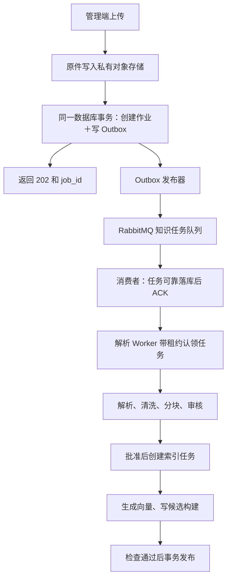

# 健身项目 RAG 文档处理与入库最终设计

整理日期：2026-10-19  
适用项目：fitness-backend  
文档性质：目标工程设计与面试讲解材料。当前仓库尚未完成本文全部改造，不能把设计直接表述为已经通过生产验收。

## 先明确两个关键问题

**“先把文件保存到已有对象存储，再通过 RabbitMQ 异步解析”，应当采用。项目已有这些基础设施，应把它们串成可靠的异步处理链路。**

**“用了父子分块，就可以不用标题分块”，这个推断不成立。** 标题、段落、列表和表格决定内容的语义边界；父子关系决定命中后补充什么上下文；Token 数只控制输入大小。这三件事要一起使用。

下面把方案定具体：选什么组件、每种内容怎样解析、清洗规则如何执行、父子块怎样生成，以及怎样可靠发布。

## 一、Docling 是什么，在这套方案里具体负责什么

它叫 **Docling**，可以近似读作“多克灵”，项目是 [docling-project/docling](https://github.com/docling-project/docling)。

它是一个开源的文档解析框架。输入 Word、PDF 等文件，输出有结构的文档对象，其中可以包含：

```text
章节、段落、列表、表格、图片、公式
以及它们的顺序、父子关系、页码和坐标
```

例如，它输出的不只是：

```text
坐姿划船 调整座椅 …… 常见错误 ……
```

而是尽可能保留：

```text
章节：坐姿划船
  段落：器械调整说明
  编号列表：动作步骤
  图片：图1
  表格：常见错误与检查方法
```

它内部针对不同格式使用不同技术：Word 读取原生结构，PDF 使用文字提取、版面模型、OCR 和表格结构模型。它也提供分块工具，但权限、审核、业务父子块和发布事务仍由我们自己的系统实现。[Docling 官方介绍](https://github.com/docling-project/docling)

针对本项目，明确采用下面这套组合：

| 环节 | 确定的方案 |
|---|---|
| 文件保存 | 复用现有私有 MinIO/S3 存储 |
| 异步分发 | 复用现有 RabbitMQ，知识任务使用独立队列 |
| Word 解析 | Docling 的 Word 原生后端 |
| Markdown 解析 | 项目已有的 `markdown-it-py`，解析节点树 |
| PDF 解析 | Docling `StandardPdfPipeline` |
| PDF OCR | 在同一 Docling 管线中使用 RapidOCR，固定中文模型及模型文件 |
| PDF 表格 | Docling 表格结构模型，使用 Accurate 模式 |
| 清洗与业务分块 | 我们自己的规则，直接操作结构化节点 |
| 入库 | 继续使用 PostgreSQL＋pgvector |

这意味着：**现有 OCR 服务的独立部署、鉴权、资源限制和健康检查可以保留，内部解析引擎需要迁移。** 现有 PP-StructureV3 可以用于迁移对比验收，正式链路最终只确定一套 PDF 结果，避免多套解析结果互相冲突。

已经核对 Docling 已发布版本的源码：它提供区域 OCR、原生文字与 OCR 合并、表格结构识别以及 PDF 标题层级推断配置。生产交付时需要把代码、模型和配置一起锁定，升级时重新跑文档回归测试。[已发布版本配置源码](https://github.com/docling-project/docling/blob/v2.140.0/docling/datamodel/pipeline_options.py)

## 二、上传之后，怎样通过 RabbitMQ 可靠地开始解析

具体实现应是：



这里不要简单写成“上传成功后调用一次 `sendMessage()`”。数据库和 RabbitMQ 之间存在故障窗口，具体这样解决：

1. 文件先写入私有对象存储，保存对象键、文件哈希和不可变版本。
2. 在 **Agent 的 PostgreSQL 本地事务内**，同时创建知识作业和待发送的 Outbox 事件。
3. 独立发布器发送消息，收到 RabbitMQ 发布确认、确认消息可路由后，将 Outbox 标记为已发送。
4. 消费者根据 `event_id` 幂等接收，可靠写入待执行任务后再 ACK。
5. Worker 从数据库认领任务，更新租约和心跳，执行解析。

MQ 消息只需要：

```json
{
  "event_id": "...",
  "job_id": "...",
  "stage": "PARSE",
  "contract_version": 1
}
```

文件本体不放进 MQ。对象地址、权限和处理配置由 Worker 从可信数据库读取。

**这里采用“消息可靠接收后 ACK，长任务由数据库租约驱动”。** 不让一条消息在 OCR 和人工审核期间一直保持未确认。

对应的恢复方式也明确：

| 故障 | 系统行为 |
|---|---|
| 数据库已提交，RabbitMQ 暂时不可用 | Outbox 保留，恢复后重发 |
| 消息发送成功，但发布器没来得及更新状态 | 允许重复发送，消费端去重 |
| 消费者提交后 ACK 丢失 | 重投后识别为已接收，再 ACK |
| OCR Worker 退出 | 租约到期，其他 Worker 重新认领 |
| 旧 Worker 恢复后继续提交 | 用执行代次校验，拒绝过期执行者覆盖 |
| 原件已保存，但创建作业失败 | 定期对账清理未关联的隔离对象 |

RabbitMQ 的发布确认和消费 ACK 分别解决发送端与消费端的可靠交接，不能代替数据库幂等和任务恢复。[RabbitMQ 官方确认机制](https://www.rabbitmq.com/docs/confirms)

这些模式在项目的预约、主动事件链中已经存在，可以复用设计；知识作业应放在 Python 服务及 Agent PostgreSQL 中。

## 三、Word、Markdown、PDF 中的文字和图片，究竟怎样解析

### Word：读取 XML 结构，图片作为独立资产处理

`.docx` 本质上是一个包含 XML 和附件的压缩包。里面有正文、样式、对象关系以及图片文件。

处理过程是：

```text
正文 XML → 按顺序遍历段落、列表、表格、图形
样式信息 → 识别标题层级
对象关系 → 找到图片、超链接等附件
公式对象 → 提取公式表达
最终组装成结构树
```

图片不是从 `paragraph.text` 里读出来的。解析器要通过正文中的图片关系 ID，找到实际图片，保存到对象存储，再建立：

```text
图片资产 → 所属章节 → 正文引用 → 图注
```

对于表格，读取单元格及其横向、纵向合并信息；对于公式，读取 Word 的公式结构。Docling 的 Word 后端已经包含这些处理分支，也包括文本框等内容的处理，能力比当前代码只取段落文字和表格更完整。[Word 后端源码](https://github.com/docling-project/docling/blob/main/docling/backend/msword_backend.py)

遇到无法正确还原的复杂绘图，在隔离进程中固定渲染为页面，保留图形快照，进入图像内容处理。解析结果必须记录这个对象是否得到处理，不能默认“正文有文字就是完整成功”。

### Markdown：先解析语法，再清洗节点

例如：

```markdown
## 坐姿划船

### 动作步骤
1. 第一步……
2. 第二步……


```

`markdown-it-py` 会识别出标题、列表、段落、图片等节点，并保留来源行号。随后使用标题栈构造章节树：

```text
遇到 H2：结束前一个同级章节，建立新章节
遇到 H3：挂到当前 H2 下
遇到正文或列表：挂到当前章节下
```

图片节点包含路径、替代文字和标题。系统根据上传附件清单找到 `images/row.png`，保存图片资产，再关联到“坐姿划船”。

这里必须改正一个处理顺序：**不能先对整个 Markdown 每行执行 `strip()` 再解析。** 那会损坏嵌套列表和缩进代码。正确顺序是：

```text
仅处理 BOM、换行编码
→ 解析节点树
→ 在普通文本节点内做清洗
```

代码块里的 `#` 也不会被当成文档标题。

### 原生 PDF：读取文字坐标，使用版面模型恢复关系

PDF 里的文字通常是带坐标的字符或文字单元，并没有 Word 那样可靠的章节树。

Docling 的管线主要做：

```text
读取原生文字及坐标
→ 页面版面检测
→ 识别标题、正文、表格、图片等区域
→ 将文字分配到对应区域
→ 恢复阅读顺序
→ 推断标题层级
→ 组装文档结构
```

双栏页面先识别栏位和段落关系，再确定阅读顺序。

PDF 标题层级推断应显式启用，使用书签、章节编号和字体样式等信号；同时保留中间解析数据，方便检查来源与结果。不能只导出一份 Markdown 就把坐标和原始结构丢掉。

### 扫描 PDF：页面图片进入 OCR，再进入同一结构管线

扫描件没有可用文字层，处理方式是：

```text
渲染页面
→ 版面区域检测
→ 对文字区域执行 OCR
→ 得到文字、坐标和识别信息
→ 表格结构恢复
→ 阅读顺序恢复
→ 组装文档
```

选择固定的 RapidOCR 中文识别模型及推理后端，部署时预装模型，启动时检查模型文件和加载状态。

纯扫描页，或已有文字层明显损坏的页面，使用整页 OCR 模式；这时该页采用 OCR 结果，避免把损坏文字层继续混入正文。

### 同一页文字和图片混合：按区域补 OCR

例如一页中有原生正文、扫描表格和动作图片：

```text
原生正文 → 使用原生文字
扫描表格 → 识别该区域的文字和表格结构
动作图片 → 导出图片、关联图注和所属动作
```

Docling 的 `PDF_AWARE_LAYOUT_REGIONS` 模式会结合版面区域和 PDF 内容判断哪些区域需要 OCR，并在合并时优先保留适当的原生文字。这个逻辑解决的是“同一页有文字，就跳过整页 OCR”的问题。[区域选择及合并实现](https://github.com/docling-project/docling/blob/v2.140.0/docling/models/base_ocr_model.py)

### 图片里的字和图片表达的动作，是两种处理任务

- 图片上的文字：OCR。
- 图片本身：提取原图或区域裁剪。
- 图注：从关联正文中提取。
- 姿态、箭头、动作顺序等视觉含义：OCR 不能完整解释。

针对健身项目，正式版本采用一个明确规则：**图中独有的动作知识，经过人工标注和专业审核后才进入可回答知识。** 审核界面展示原图、附近正文，并录入动作名称、步骤、图示说明和适用范围。通过后，文字说明参与检索，原图作为引用附件。

视觉模型可以辅助生成候选描述，但发布不依赖模型自行推断动作要点。这样系统对图片的处理有确定的交付结果。

## 四、表格具体怎样解析

不同来源分别恢复单元格，之后统一成相同的网格结构。

| 来源 | 实际解析方法 |
|---|---|
| Word 表格 | 读取原生行、单元格和合并属性 |
| Markdown 表格 | 从表格语法节点读取表头与数据行 |
| Markdown 内嵌 HTML 表格 | 使用 HTML 解析器读取 `rowspan`、`colspan` |
| PDF 表格 | 检测表格区域，用结构模型恢复行列，再将原生/OCR 文字匹配到单元格 |

PDF 表格结构模型负责判断“这里有几行几列、哪些格子合并”；文字提取或 OCR 负责判断“格子里写了什么”。这是两个不同步骤。

系统内部保存类似这样的数据：

```json
{
  "table_id": "T1",
  "caption": "某食物营养成分表",
  "basis": "原文中的计量基准",
  "cells": [
    {
      "row": 0,
      "col": 0,
      "row_span": 1,
      "col_span": 1,
      "text": "食物名称",
      "is_header": true
    }
  ],
  "footnote_ids": ["N1"],
  "source_page": 8
}
```

**JSON 网格是主数据，HTML 用于还原展示，Markdown 是派生的检索文本。** 只保存 Markdown 会丢失复杂合并关系。

表格解析后执行具体检查：

- 单元格范围是否合法，是否出现不应有的重叠。
- 识别文字有没有遗漏或重复映射。
- 每组数据是否能关联到列名和单位。
- 计量基准、表题和脚注是否已关联。
- 数字与原图存在冲突时，提交人工核对。

跨页表格要同时检查相邻页、列结构、表头、续表标记和上下文。证据不足时保留两张表，不能自动拼接成一张。

用于检索时，按完整行分组，每组重复必要的表头、单位和表注。涉及营养合计等计算，再从审核通过的网格生成结构化业务数据，由代码计算。

## 五、页眉页脚、页码、乱码、断行和重复文字，具体怎样清洗

这里统一采用：**原始节点保留，生成清洗后的正文视图；每次修改记录规则、位置和修改结果。**

“从正文移走”的含义是把节点标记到 `furniture` 等非正文区域，检索正文默认排除它，同时仍能在原件和解析制品中找到。

### 页眉页脚：根据格式结构或页面坐标识别

Word 的页眉页脚本来就在独立结构里，直接分开读取；页码字段进入定位信息，版本信息进入文档元数据。

PDF 采用两类证据结合：

```text
版面模型给出的页眉/页脚标签
＋页面边缘位置
＋跨页同位置重复
＋页码格式
```

具体步骤可以是：

1. 收集页面顶部、底部区域的候选行。
2. 对候选行做空白规范化；仅对明确的页码部分生成比较模板。
3. 按文本模板和相近坐标分组，统计跨页出现情况。
4. 重复且位置稳定、符合页眉页脚特征的节点移到非正文区域。
5. 正文中的相同文字保留，不能全局替换删除。

例如：

```text
第 8 页 共 30 页
第 9 页 共 30 页
```

可以归为同一页码模板；“2025 年版”应保留为版本信息。

实现中可以从顶部/底部 8%、至少 3 页且覆盖相关页面 60% 的重复规则开始产生候选，区分奇偶页模板。这些是**规则初值，不能单凭阈值删除正文**。短文档没有足够重复证据时，保留或复核。

### 多余空行：在节点内部处理

普通段落里，连续空白行压缩成一个段落间隔。列表节点、代码节点、表格单元格分别按自己的规则处理，不能对整篇文件统一替换。

### 错误断行：只合并同一个正文块中的视觉折行

例如：

```text
训练前应根据器械说明
完成座椅调整。
```

只有当两行属于同一正文块、同一栏位，且没有新段落或新列表特征时，才合并成一句。

以下边界不合并：

```text
1. 调整座椅
2. 检查器械
```

英文连字符也不能一律删除。软连字符可以按规则处理；真实连接词保留。无法判断的词保留原样，避免把正确内容“清洗坏”。

### 乱码：先重新提取或 OCR，不做随意删除

检测替换字符、异常控制字符、私用字符及明显映射异常后：

```text
定位到原页面或区域
→ 重新解析或 OCR
→ 比较结果
→ 仍无法恢复则标记失败
```

不能直接把乱码字符删掉，因为删掉的可能是小数点、单位或否定词。

Unicode 规范化也按类型进行，避免全局折叠导致 `²`、公式符号等含义变化。

### 重复文字层：同时比较位置和内容

原生文字与 OCR 结果只有在以下条件同时成立时才去重：

```text
同一页面
＋空间位置高度重合
＋规范化文本一致或高度相符
＋关键数字、单位、否定词无冲突
```

同一句注意事项出现在不同动作章节里，应分别保留。仅凭全文相似度或“它是另一段的子串”不能删除。

数字、单位或否定词冲突时保留证据并阻断该区域发布，交给复核。

## 六、父子分块到底怎样做

**B 站讲按标题切，并不是因为它没有父子分块。即使用了父子分块，仍然要按标题和文档结构组织内容。**

最终算法是：

```text
结构树
→ 确定业务对象和完整上下文
→ 建立父块
→ 提取段落、步骤、表格行等语义单元
→ 语义单元装入子块
→ 超限时再沿自然边界拆分
```

用一个具体 Markdown 示例：

```markdown
# 动作库

## 坐姿划船

### 适用范围
……

### 动作步骤
1. ……
2. ……

### 注意事项
……

## 腿举
……
```

处理后：

```text
父块 P1：坐姿划船
  包含适用范围、步骤、注意事项和图片引用

子块 C1：适用范围
子块 C2：动作步骤
子块 C3：注意事项

父块 P2：腿举
  包含腿举的完整相关内容
```

所以，父块也不必机械地等于每个 Markdown 标题。“坐姿划船”是业务对象，它下面的三级标题共同构成该对象的上下文。

对于健身资料，使用明确的文档类型规则：

| 类型 | 父块范围 | 必须关联的上下文 |
|---|---|---|
| 动作资料 | 一项动作或一个完整动作小节 | 适用范围、注意事项、相关图片 |
| 门店制度 | 一条完整规则 | 条件、例外、生效时间 |
| 指南 | 一个相对完整的小节 | 适用人群、限定条件、引用说明 |
| 表格 | 表格及说明 | 表头、单位、脚注 |

归属优先依据标题层级、明确引用和审核标注，不能让系统仅凭“离得近”随意判断。

### 子块的生成是按语义单元装箱

```python
for parent in business_units:
    units = parent.paragraphs_lists_and_tables()

    for unit in units:
        if unit.is_table:
            # 完整行分组，重复必要表头和说明
            candidates = split_table_by_rows(unit)
        else:
            # 先保留完整段落或步骤
            # 只有超出预算时，才按句子、子句继续拆
            candidates = split_only_if_too_large(unit)

        pack_compatible_units(
            candidates,
            same_parent=True,
            preserve_source_order=True,
            count_tokens_on_final_embedding_text=True
        )
```

这是算法示意。实际计数必须使用所选 Embedding 模型的 Tokenizer，并计入标题路径、必要条件等前缀。

一个完整知识单元只有 100 Token，就保留 100 Token，不必凑满。一个长段落超过模型预算，才逐级按段落、句子、子句拆分。

重叠同样按语义处理：跨块时有必要才重复完整句子或步骤上下文；不默认复制前后固定 120 个字符。表格重复表头和相关条件。

Docling 的 HybridChunker 也是先利用结构，再按 Token 预算拆分或合并。但它不会自动替我们建立业务父块、注意事项依赖和数据库 `parent_id`。[官方分块说明](https://docling-project.github.io/docling/concepts/chunking/)

项目当前配置为 **1200 字符＋120 字符重叠**。这套最终设计会将它改为“结构优先＋模型预算校验”，不能把现有字符窗口直接改名叫语义分块。

### 命中后也不能只截父块前面一段

每个子块保存确切的来源节点以及必要上下文 ID：

```text
parent_id
source_unit_ids
required_context_ids
heading_path
table_id / row_ids
```

检索重排之后，按顺序组装：

```text
命中内容
＋必须携带的适用条件、注意事项、表头或例外
＋预算允许的相邻完整内容
```

这样才能避免父块过长时，恰好把重要限制裁掉。父块完整保存在库中，送给模型的内容按节点选择。

## 七、最后怎样入库，怎样保证只发布完整结果

解析、清洗、分块完成后，保存一份不可变制品：

```text
原件哈希
＋解析器及模型版本
＋清洗和分块规则版本
＋结构化文档
＋父子块
＋质量报告
```

审核针对这份制品进行。批准后，索引 Worker 直接使用这份制品，避免再跑一次 OCR 得到与审核时不同的正文。

随后：

```text
校验审批和制品哈希
→ 对子块批量生成向量
→ 检查数量、维度和父子关系
→ 写入 STAGING 构建
→ 校验权限、引用及检索
→ 数据库事务切换 active_build_id
```

父块保存完整上下文，子块保存检索文本和向量。当前 PostgreSQL 中的向量与词法索引可以继续使用。

线上检索只读取文档当前激活的构建。半批向量失败、解析不完整或审核未完成，候选构建都不能被启用，旧构建继续服务。

这也区分了两个版本：

- **文档版本**：原始指南或业务规则更新。
- **索引构建版本**：同一原件换了解析器、模型或分块配置。

重新解析只创建新构建，通过验收后切换，并保留前一构建供回退。

## 八、面试时怎样把这套方案讲清楚

按这个设计落地后，可以这样讲：

> 我们把健身知识入库做成异步、可恢复的发布流程。文件先保存到私有对象存储，数据库事务创建作业和 Outbox，再通过 RabbitMQ 触发解析。消息允许重复，消费端幂等接收，长任务用数据库租约和心跳恢复。
>
> Word 读取原生文档结构，Markdown 解析语法树，PDF 使用统一的版面、OCR 和表格管线。原生文字优先使用文字层，扫描和混合区域补 OCR，图像资产与文字说明分别处理。
>
> 清洗直接操作带位置的结构节点：页眉页脚结合位置和跨页重复识别，断行只在同段同栏内合并，重复文字层同时校验坐标和内容，所有修改保留追溯信息。
>
> 分块先按标题和业务对象建立父块，再用完整段落、步骤和表格行生成子块，Token 只是大小约束。召回子块后补齐适用条件、注意事项和例外。审核后的制品生成候选索引，检查通过后事务发布，失败保持旧构建可用。

如果追问“父子分块与标题分块是什么关系”，可以直接回答：

> **标题结构决定内容属于哪里，子块负责精确命中，父块及关联节点补齐解释所需的上下文，Token 预算负责限制输入大小。它们共同构成分块和检索方案。**

当前面试中，应把“现有代码已经实现的基础链路”和“本方案确定的生产改造设计”明确分开；Docling 主解析器、知识 RabbitMQ 链路及上述结构化分块，尚不能说已经在项目里上线。
