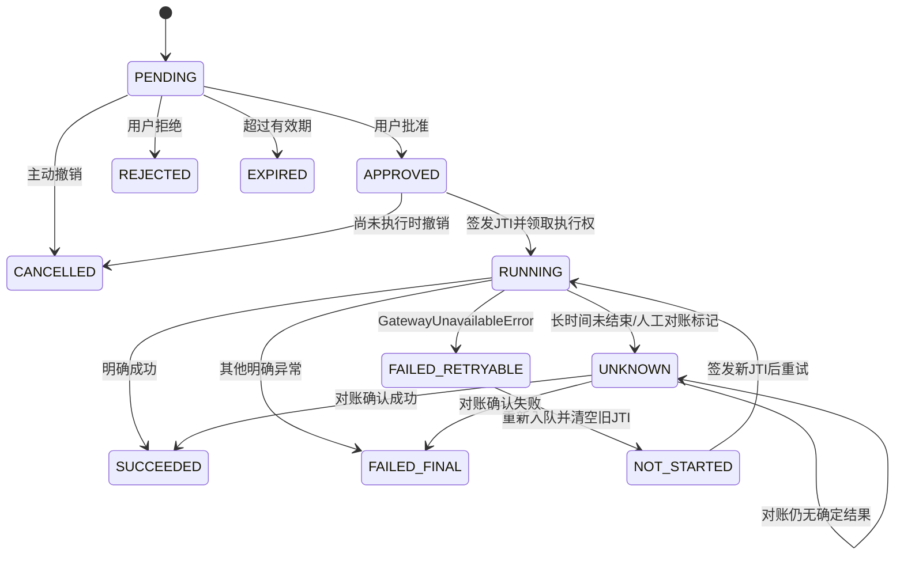
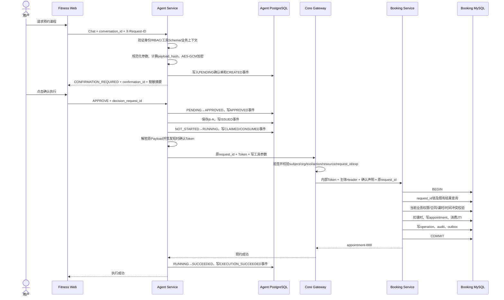

# 第八章补充：预约确认、幂等、JTI、重试与对账

本文是《AI 健身平台项目精讲》第八章的补充说明，集中讲清预约写操作中的身份授权、确认单、Payload 加密、JTI、`request_id`、事务、失败重试和 `UNKNOWN` 对账。

文档严格区分：

- **当前实现**：仓库现有代码真实具备的行为；
- **存在的问题**：当前链路尚未闭环或语义不够严谨的地方；
- **建议方案**：后续应该怎样修改。

---

# 1. 先建立完整心智模型

一次安全的 Agent 预约，不是“模型调用一个创建预约接口”，而是六层机制共同完成：

```text
身份与 RBAC
    ↓ 决定用户有没有资格发起该类操作
工具白名单、Schema 和上下文绑定
    ↓ 决定模型能够调用什么、参数是否合法
持久化确认单
    ↓ 记录用户具体同意了什么
短时确认 Token 与 JTI
    ↓ 授权一次受限的执行尝试
request_id 与数据库事务
    ↓ 防止同一业务操作重复落库
UNKNOWN 对账
    ↓ 调用结果不确定时查清真实业务事实
```

这几层解决的问题不同，不能互相替代。

---

# 2. RBAC 与确认机制的区别

## 2.1 RBAC 是什么

RBAC 是 Role-Based Access Control，即基于角色的访问控制。

它回答的是：

> 当前用户凭借自己的角色，是否有资格执行某一类操作？

例如：

| 角色 | 可能具备的权限 |
| --- | --- |
| `STUDENT` | 为本人查询课程、创建预约、取消本人预约 |
| `COACH` | 查询自己的排课、为被分配学员执行受控操作 |
| `ORGANIZATION_ADMIN` | 管理本机构资源、执行机构级管理动作 |
| `SYSTEM_ADMIN` | 执行系统级运维或对账操作 |

RBAC 是长期权限，不能证明用户同意了某一次具体写操作。

## 2.2 确认机制解决什么

确认机制回答的是：

> 用户是否明确同意这一次具体操作及其具体参数？

例如，用户具有预约权限，不代表系统可以随时替他预约。仍然需要确认：

```text
课程：私教课
教练：coach-007
开始时间：2026-09-20 18:00
结束时间：2026-09-20 19:00
合同：contract-101
```

因此：

```text
RBAC通过 + 用户未确认 → 不能执行
用户点击确认 + RBAC不通过 → 也不能执行
RBAC通过 + 确认有效 + 业务校验通过 → 才能执行
```

确认不是 RBAC 的替代品，而是对一次具体写操作的额外授权。

---

# 3. 核心标识符分别是什么

## 3.1 标识符总表

| 标识符 | 生成位置 | 是否在重试中保持 | 主要作用 | 主要存储位置 |
| --- | --- | --- | --- | --- |
| `subject` | 签名身份上下文 | 是 | 标识当前登录主体，通常对应用户 ID | 确认单 `subject_user_id`、审计、下游 `actor_id` |
| `conversation_id` | 前端会话 | 同一浏览器会话保持 | 标识用户看到的对话 | 前端 `sessionStorage`，参与内部线程 ID 计算 |
| `thread_id` | Agent 服务端 | 同一身份范围和会话保持 | 隔离 LangGraph Checkpoint | 确认单 `thread_id`、Checkpoint |
| `request_id` | 首次业务请求上下文 | **同一业务操作重试必须保持** | 业务幂等、对账、链路定位 | 确认单、Booking operation、审计、确认消费表 |
| `trace_id` | HTTP 请求上下文 | 不一定保持 | 串联一次调用链的日志和 Trace | 日志、审计事件 |
| `confirmation_id` | Agent 创建确认单时 | 同一确认单保持 | 标识一张持久化确认单 | Agent PostgreSQL、Token、下游消费表 |
| `decision_request_id` | 前端批准/拒绝动作 | 同一决定重试保持 | 防止批准或拒绝重复提交 | 确认单、确认事件 |
| `revocation_request_id` | 撤销动作 | 同一撤销重试保持 | 防止重复撤销 | 确认单、确认事件 |
| `jti` | 每次执行凭证签发 | 每次新的执行尝试应更换 | 标识一次性执行凭证 | Agent 确认单、Token、下游确认消费表 |
| `appointment_id` | Booking 创建预约时 | 已成功后保持 | 标识真实预约业务事实 | `appointment`、operation、audit、outbox |
| `event_key` | Booking 事务内 | 同一业务事件保持 | Outbox 消息幂等 | `agent_booking_outbox` |

## 3.2 `subject` 是不是用户 ID

在当前项目中，`subject` 是签名身份里的主体标识，落到确认单后是：

```text
subject_user_id
```

当前业务中通常可以理解为登录用户 ID，但更准确的说法是“身份系统签发的主体 ID”。它不应该从模型输入、URL 参数或前端自由填写。

内部线程 ID 使用：

```text
subject
+ 排序后的 organization_ids
+ 排序后的 roles
+ conversation_id
```

这样即使前端复用了相同的 `conversation_id`，只要用户、机构范围或角色不同，也不会读取到同一个 Checkpoint。

## 3.3 为什么有多个 request ID

项目里最容易混淆的是以下三个 ID：

```text
业务 request_id
decision_request_id
HTTP/trace request_id
```

- 业务 `request_id`：标识“这一次预约业务动作”，用于 Booking 幂等和对账；
- `decision_request_id`：标识“用户这一次批准或拒绝动作”，用于决定接口幂等；
- HTTP 请求 ID：标识某一次网络调用，用于日志和 Trace，前端每次请求可以不同。

批准接口的 HTTP 请求 ID 变化，不代表 Booking 的业务 `request_id` 变化。恢复执行时，Supervisor 会重新使用确认单中保存的业务 `request_id`。

---

# 4. Payload 三个字段分别做什么

确认单不保存明文执行参数，而是保存：

```text
payload_ciphertext
payload_key_version
payload_hash
```

## 4.1 `payload_ciphertext`

它是规范化业务参数经过 AES-GCM 加密后的密文。

作用：

- 数据库泄露时不直接暴露预约时间、教练、合同、用户等参数；
- 服务重启后仍能恢复原始执行参数；
- 用户批准后不需要让前端重新提交参数。

## 4.2 `payload_key_version`

它表示这段密文是使用哪个版本的加密密钥生成的。

例如：

```text
payload_key_version = confirmation-key-v3
```

服务解密历史确认单时，根据该版本找到正确密钥：

```text
读取 payload_key_version
    ↓
在密钥环/KMS中选择对应密钥
    ↓
解密 payload_ciphertext
```

它解决的是密钥轮换问题，不是业务版本号。没有它，密钥升级后历史确认单可能无法解密。

## 4.3 `payload_hash`

它是规范化参数和可信业务范围计算出的 SHA-256。

主要作用：

1. 把确认单、确认 Token 和具体参数绑定起来；
2. 作为 AES-GCM 的 AAD，防止密文被换绑到另一张确认单；
3. 判断同一个 `request_id` 是否被错误用于另一组参数；
4. 在审计中证明用户批准的是哪一组规范化参数。

它不是用来比较“用户再次从前端提交的Payload”，因为当前批准接口根本不允许前端重新提交业务参数。批准时只提交决定，服务端解密确认单里原来保存的参数。

## 4.4 当前完整性缺口

先排除一个容易出现的误解：当前批准接口中，前端只提交“批准/拒绝”和 `decision_request_id`，并不重新提交预约时间、教练、合同等业务 Payload，也不提交一个由前端计算的 Hash。所以当前链路不是：

```text
前端传回业务参数和Hash
→ Agent与确认单中的Hash对比
→ Java没对比
```

真实链路是：

```text
Agent创建确认单时规范化业务参数
→ 计算payload_hash
→ 以payload_hash作为AES-GCM AAD加密Payload
→ 密文、密钥版本、Hash一起落库

用户批准时只提交决定
→ Agent从确认单解密原Payload
→ AES-GCM用已保存的Hash作为AAD验证密文绑定
→ Token签入同一个payload_hash
→ Gateway验签和验证声明范围
```

当前 Python Agent 会计算 `payload_hash`，并把它签入 Token；Gateway 会验证 Token 签名、Hash 格式以及主体、机构、工具、动作、资源、`request_id` 等范围，再把 Hash 转发给 Booking。

但是 Java Gateway/Booking 当前没有对最终收到的请求体执行同一套 Canonicalization 并重新计算 Hash。因此目前是：

```text
凭证中带有 payload_hash
下游保存 payload_hash
但下游没有证明实际请求体的哈希等于它
```

建议后续实现共享规范化协议，或由 Gateway 根据版本化 Schema 重算请求体 Hash，并与 Token 中的值进行常量时间比较。

因此，准确结论是：

> 当前已防止前端在批准阶段替换参数，也能发现确认单密文与Hash被错误换绑；但尚未让 Java 侧对“它最终收到的实际请求体”重算Hash，所以还不是最强意义的端到端参数完整性校验。

---

# 5. 两套状态为什么必须分开

## 5.1 授权状态

`authorization_status` 表示用户是否允许执行：

| 状态 | 含义 |
| --- | --- |
| `PENDING` | 等待用户确认 |
| `APPROVED` | 用户已经批准 |
| `REJECTED` | 用户拒绝 |
| `EXPIRED` | 确认单过期 |
| `CANCELLED` | 执行前被撤销 |

## 5.2 执行状态

`execution_status` 表示业务执行结果：

| 状态 | 含义 |
| --- | --- |
| `NOT_STARTED` | 尚未领取执行权 |
| `RUNNING` | 已领取执行权，正在或曾经尝试调用下游 |
| `SUCCEEDED` | 下游业务明确成功 |
| `FAILED_RETRYABLE` | 当前实现认为可以再次尝试的失败 |
| `FAILED_FINAL` | 当前实现认为不能直接重试的失败 |
| `UNKNOWN` | 无法确认第一次执行是否成功 |

例如：

```text
authorization_status = APPROVED
execution_status = FAILED_FINAL
```

表示用户确实批准过，但业务执行最终失败。不能把授权状态改成 `REJECTED`，因为用户没有拒绝。

## 5.3 当前状态流转



当前代码中，普通被捕获的超时或网络异常会归入 `FAILED_RETRYABLE`；`UNKNOWN` 主要由长时间 `RUNNING` 的后台扫描或管理员对账入口产生。它与“所有超时直接进入 `UNKNOWN`”的理想设计并不完全一致。

---

# 6. 从用户发起预约到落库的完整流程

下面使用一组固定示例贯穿全流程：

```text
subject              = user-88
organization_id      = org-1001
conversation_id      = web-abc
thread_id            = thread-hash-001
request_id           = request-001
confirmation_id      = confirmation-001
decision_request_id  = approve-001
jti                   = jti-A
appointment_id        = appointment-888
trace_id              = trace-approve-001
```

## 6.1 总体时序图



## 6.2 第一步：前端发起聊天预约

前端为一次 HTTP 请求生成：

```text
X-Request-ID
X-Trace-ID
```

同一个浏览器会话还保留：

```text
conversation_id
```

Agent 从签名 `AgentContext` 读取：

```text
subject
roles
organization_ids
```

服务端使用身份范围和 `conversation_id` 生成内部 `thread_id`。前端不能直接决定最终线程隔离键。

## 6.3 第二步：模型提出预约工具调用

Tool Registry 在真正执行前完成：

1. 工具是否存在且属于当前领域；
2. 当前角色是否允许调用；
3. 输入是否通过 Schema；
4. 机构、用户等敏感字段是否由可信上下文覆盖；
5. 该工具是否为写操作并要求确认。

模型只能提出调用，不能自行批准确认单、生成确认 Token 或绕过 Gateway。

## 6.4 第三步：创建持久化确认单

Agent 对工具参数进行确定性规范化，生成：

```text
display_summary
canonical_payload
payload_hash
payload_ciphertext
payload_key_version
```

然后向 Agent PostgreSQL 写入：

### `agent_action_confirmations`

```text
id                        = confirmation-001
thread_id                 = thread-hash-001
subject_user_id           = user-88
organization_id           = org-1001
tool_id                   = fitness.booking.create.v1
action                    = CREATE_APPOINTMENT
resource_type             = CONTRACT
resource_id               = contract-101
request_id                = request-001
payload_hash              = <sha256>
payload_ciphertext        = <AES-GCM密文>
payload_key_version       = confirmation-key-v3
authorization_status      = PENDING
execution_status          = NOT_STARTED
expires_at                = created_at + 600秒（默认）
credential_jti            = NULL
credential_consumed_at    = NULL
actor_roles               = 创建时角色快照
actor_organization_ids    = 创建时完整机构范围快照
```

数据库对 `request_id` 有唯一约束。同一个业务 `request_id` 不能创建两张不同确认单；如果参数不同，仓储会拒绝“请求 ID 已绑定到其他操作”。

同时写入不可变事件表：

### `agent_action_confirmation_events`

```text
confirmation_id       = confirmation-001
event_type            = CREATED
request_id            = request-001
authorization_status  = PENDING
execution_status      = NOT_STARTED
authorization_version = 当前确认单version
```

前端只收到：

```text
confirmation_id
display_summary
expires_at
```

不会收到明文恢复参数、JTI或确认 Token。

## 6.5 第四步：用户批准

前端提交：

```json
{
  "decision": "APPROVE",
  "decision_request_id": "approve-001"
}
```

它不提交：

```text
tool_id
预约参数
thread_id
jti
payload_hash
confirmation_token
```

服务端根据 URL 中的 `confirmation_id` 和签名身份查找确认单，并再次校验：

- `subject_user_id`；
- 机构范围；
- 创建确认单时的角色快照；
- 创建确认单时的完整机构范围快照；
- 当前是否仍为 `PENDING`；
- 是否已过期。

批准后：

```text
authorization_status = APPROVED
approved_at           = 当前时间
decision_request_id   = approve-001
```

同时写 `APPROVED` 事件。`decision_request_id` 有唯一约束，前端因网络问题重复提交同一批准请求时会返回同一决定事实，而不是重复批准。

## 6.6 第五步：签发 JTI 和短时确认 Token

服务端为本次执行尝试生成：

```text
jti = jti-A
```

先把它写入确认单：

```text
credential_jti = jti-A
```

并写入 `ISSUED` 事件，然后根据确认单签发短时 Token。Token包含：

```text
sub
tool_id
action
organization_id
resource
request_id
confirmation_id
payload_hash
jti
exp
alg
kid
```

签发时满足：

```text
确认单 credential_jti = Token.jti = jti-A
```

Token 默认寿命约120秒，并且不能超过确认单自身的过期时间。

## 6.7 第六步：领取执行权

Agent PostgreSQL 对确认单加行锁，只允许一条请求完成：

```text
NOT_STARTED → RUNNING
```

并设置：

```text
execution_started_at  = 当前时间
credential_consumed_at = 当前时间
```

这里的 `credential_consumed_at` 表示 Agent 侧已经领取本次执行权；真正的下游JTI消费发生在 Booking MySQL 的业务事务中。

同时写入：

```text
CLAIMED
CONSUMED
```

两个审计事件。并发的第二个恢复请求不能再次把同一确认单领取为 `RUNNING`。

## 6.8 第七步：Gateway 验证 Token

Agent把确认 Token放到内部请求头：

```text
X-Confirmation-Token
```

Gateway执行：

1. 验证HS256/RS256签名；
2. 验证 `kid` 和算法；
3. 验证 `exp`；
4. 校验Token的 `sub` 与签名AgentContext一致；
5. 校验 `tool_id`、`action`、`resource`；
6. 校验Token中的 `request_id` 与当前请求一致；
7. 校验机构在主体授权范围中；
8. 校验 `payload_hash` 格式。

Gateway验签通过后，不把原Token交给Booking，而是把已验证声明拆成内部Header，并附带内部服务Token。

## 6.9 第八步：Booking业务事务

Booking收到请求后再次校验：

- 内部服务Token；
- 主体、角色和机构范围；
- 确认工具、动作、机构和资源；
- 学员是否只能操作自己或教练是否有学员范围；
- 学员和教练是否属于当前机构；
- 合同状态、有效期、剩余课时和课程；
- 课程是否存在且启用；
- 教练请假、营业日、学员/教练时间冲突等业务事实。

创建预约方法带有 `@Transactional`。在同一个MySQL事务中完成：

```text
BEGIN
  获取同一request_id请求锁
  查询agent_booking_operation是否已有结果
  获取教练日期锁和学员日期锁
  FOR UPDATE读取合同
  乐观锁扣减课时
  INSERT appointment
  INSERT agent_booking_confirmation_consumption
  INSERT agent_booking_operation
  INSERT agent_booking_audit
  INSERT agent_booking_outbox
COMMIT
```

其中任何一步失败，整个事务回滚。不会出现“预约写入了但课时没扣”“业务失败但JTI永久消费”等半成功状态。

## 6.10 第九步：Agent记录最终执行结果

Booking成功返回后，Agent确认单更新：

```text
execution_status = SUCCEEDED
finished_at      = 当前时间
last_error_code  = NULL
```

并写入 `EXECUTION_SUCCEEDED` 事件。

如果明确失败，则根据当前异常分类写入：

```text
FAILED_RETRYABLE
或
FAILED_FINAL
```

并写入 `EXECUTION_FAILED` 事件。

---

# 7. 预约链路涉及哪些表

## 7.1 Agent PostgreSQL

### `agent_action_confirmations`

作用：保存当前授权和执行状态的最新快照。

核心内容：

```text
谁发起、属于哪个机构、哪个线程
执行哪个版本化工具和动作
操作哪个资源及预期版本
稳定request_id
展示摘要
加密Payload、密钥版本、Payload Hash
授权状态、执行状态
decision/revocation幂等ID
当前credential_jti
执行开始、结束、错误码
角色和机构范围快照
乐观锁version
```

### `agent_action_confirmation_events`

作用：保存不可变的状态变化历史，不能只依赖主表的最新状态。

主要事件：

```text
CREATED
APPROVED
REJECTED
EXPIRED
CANCELLED
ISSUED
CLAIMED
CONSUMED
REQUEUED
EXECUTION_SUCCEEDED
EXECUTION_FAILED
EXECUTION_UNKNOWN
```

## 7.2 Booking MySQL

| 表 | 作用 | 关键唯一约束 |
| --- | --- | --- |
| `appointment` | 真实预约业务事实 | 预约ID及既有业务约束 |
| `contract` | 合同和剩余课时 | 版本字段配合乐观锁 |
| `agent_booking_operation` | 创建预约的业务幂等结果 | `PRIMARY KEY(request_id)` |
| `agent_booking_reschedule_operation` | 改约幂等结果 | `PRIMARY KEY(request_id)` |
| `agent_booking_cancel_operation` | 取消预约幂等结果 | `PRIMARY KEY(request_id)`，预约取消唯一约束 |
| `agent_booking_confirmation_consumption` | 下游JTI消费事实 | `PRIMARY KEY锁jti)`，`UNIQUE(request_id)` |
| `agent_booking_audit` | 预约Agent写操作审计 | `UNIQUE(request_id)` |
| `agent_booking_outbox` | 事务后可靠发布预约事件 | `UNIQUE(event_key)` |
| `agent_booking_resource_lock` | 教练/学员按日期的并发锁键 | 机构、资源类型、资源ID、日期联合主键 |

创建预约成功后，关键关联关系是：

```text
confirmation-001
    ├─ request-001 ──> agent_booking_operation ──> appointment-888
    ├─ jti-A ────────> agent_booking_confirmation_consumption
    ├─ request-001 ──> agent_booking_audit
    └─ appointment-888 ──> agent_booking_outbox.event_key
```

## 7.3 确认单表和确认消费表是不是同一张表

不是。它们属于不同服务、不同数据库，承担不同责任。

| 表 | 所在服务/数据库 | 回答的问题 |
| --- | --- | --- |
| `agent_action_confirmations` | Agent PostgreSQL | 用户是否批准、批准了什么、现在执行到哪个状态 |
| `agent_booking_confirmation_consumption` | Booking MySQL | Booking是否已经在本地业务事务中消费了该JTI |
| `training_confirmation_consumption` | Training MySQL | Training是否已消费该JTI |
| `agent_customer_service_confirmation_consumption` | Customer Service MySQL | Customer Service是否已消费该JTI |

两类表不能合并，原因是：

1. Agent记录的是“授权和编排事实”；
2. 下游消费表记录的是“该服务在业务事务中真正消费了凭证”；
3. Booking必须把JTI消费、扣课时、写预约、幂等结果和审计放在同一个MySQL事务里；如果只写Agent的PostgreSQL，就会出现跨库半成功；
4. 各业务服务要在自己的信任边界内完成防重放，不能只信任Agent说“我已经消费了”。

这些表之间不建立跨数据库外键，而是通过下列字段建立逻辑关联：

```text
confirmation_id
request_id
jti
organization_id
payload_hash
```

正常成功时，两边的事实是：

```text
Agent确认单：用户批准且本次执行成功
Booking消费表：jti-A已被request-001消费
Booking operation：request-001已产生appointment-888
```

对账时，不是把两张表做跨库Join，而是Agent拿原 `request_id` 调用下游查询接口，让Booking返回自己数据库里的operation事实。

---

# 8. JTI 到底怎样使用

## 8.1 JTI解决什么

JTI标识一次具体执行凭证，解决的是：

> 同一张执行授权能不能被拿去反复执行或挪作其他写操作？

它不负责判断业务上是否已经存在预约。业务去重主要由 `request_id` 完成。

## 8.2 JTI的完整生命周期

```text
确认单APPROVED
    ↓
生成jti-A并保存到Agent确认单
    ↓
Token中签入同一个jti-A
    ↓
Agent领取执行权并记录credential_consumed_at
    ↓
Gateway验签并转发jti-A声明
    ↓
Booking在业务事务中INSERT jti-A消费记录
    ↓
事务提交后jti-A成为已消费事实
```

如果Booking事务失败并回滚，JTI消费记录也回滚，避免“业务未成功但凭证永久失效”。

## 8.3 什么叫旧Token重放

旧Token重放是指某个调用者再次发送完全相同的已签名Token。

当前Token还绑定了原 `request_id`、工具、动作、资源、机构和Payload Hash，所以不能合法地改成另一个业务请求。篡改任何声明都会导致签名失败。

对于当前Booking：

- 完全相同的Token和相同 `request_id` 再次到达，Booking会优先查到原预约并幂等返回；
- 相同Token试图配合不同 `request_id`，Gateway会因为Token范围不匹配而拒绝；
- 即使有人绕过Gateway进入内部服务，JTI和 `request_id` 唯一约束仍提供下游防护。

“确认凭证可能被用于别的请求”描述的是弱实现或防御缺失时的风险，不是说当前正常代码路径允许这样做。例如只校验Token签名和有效期，却不校验 `request_id` 、工具、动作、资源和 `payload_hash` 时，一张“创建预约A”的凭证就可能被拿去搭配“创建预约B”的请求体。

当前正常链路已用签名声明把凭证绑定到：

```text
subject + organization_id + tool_id + action
+ resource_type/resource_id + request_id + payload_hash + jti + exp
```

所以：

- 改任一声明都会破坏签名；
- 请求Header/路由/业务范围与Token声明不一致时，Gateway应拒绝；
- 绕过Gateway的异常内部路径仍受下游JTI与 `request_id` 唯一约束限制。

因此更准确的说法是：

> JTI防止一次执行授权被挪用于另一项写操作；相同业务操作的重复发送由 `request_id` 幂等收敛。

JTI仍然必要，因为它是纵深防御：即使未来新增了某个内部路由，遗漏了一层范围校验，业务服务仍可以用“该JTI已消费”拒绝第二次真正执行。

## 8.4 重试后旧Token会怎样

第一次：

```text
确认单 credential_jti = jti-A
Token-A.jti             = jti-A
```

进入可重试失败并重新入队后：

```text
credential_jti = NULL
然后生成jti-B
credential_jti = jti-B
```

旧Token-A不会被修改，所以此时：

```text
数据库最新JTI = jti-B
旧Token中的JTI = jti-A
新Token中的JTI = jti-B
```

当前Gateway采用离线验签，不会实时查询Agent数据库确认Token中的JTI是不是最新值。因此旧Token-A在尚未过期且没有被消费时，理论上仍可能通过Gateway验签。

当前风险由以下边界降低：

- Token只在服务端内部传递，浏览器拿不到；
- Token默认短时有效；
- Token绑定原始范围和 `request_id`；
- Booking有JTI消费表和 `request_id` 强幂等。

如果需要更强保证，可增加当前JTI在线内省或短期撤销缓存。

---

# 9. `request_id` 幂等为什么能阻止重复预约

## 9.1 当前Booking的强幂等

创建预约时，Booking会：

1. 按 `request_id` 获取数据库请求锁；
2. 查询 `agent_booking_operation`；
3. 已存在则直接返回第一次的预约；
4. 不存在才继续校验、扣课时和创建预约；
5. 最终由 `PRIMARY KEY(request_id)`兜底。

例如第一次实际已成功但响应丢失：

```text
第一次：jti-A + request-001
        → 创建appointment-888
        → 响应丢失
```

第二次即使换成新JTI：

```text
第二次：jti-B + request-001
```

Booking仍会查询到：

```text
request-001 → appointment-888
```

并返回原预约，不会再扣课时或创建第二条预约。

## 9.2 为什么 `UNKNOWN` 仍然先对账

对当前Booking而言，只要保持同一个 `request_id`，换新JTI通常也不会重复预约。但状态机仍要求 `UNKNOWN` 先对账，原因是：

- 查询比重新发起写请求更符合语义；
- 可以减少无意义的写流量和审计噪音；
- 保证所有写服务遵守同一套恢复规则；
- 未来其他服务不一定具备Booking同等级强幂等；
- 防止实现错误时重新生成业务 `request_id`；
- 保留清晰的事故证据。

所以正确说法不是“换JTI一定会重复预约”，而是：

> 当前Booking强幂等能兜住相同 `request_id` 的重新调用，但 `UNKNOWN` 的规范流程仍是先对账，不应把业务幂等当成随意重新执行的理由。

## 9.3 当前正常重试会不会生成新 `request_id`

不会。

同一张确认单重试时，Supervisor明确使用：

```text
prepared.record.request_id
```

因此：

```text
第一次：confirmation-001 + request-001 + jti-A
重试：  confirmation-001 + request-001 + jti-B
```

不会变成 `request-002`。

但是，如果用户放弃原确认单，重新发送一条新的聊天指令，就会创建新的HTTP请求、新确认单和新业务 `request_id`。这是新业务操作，不是原确认单重试。当前前端缺少显式重试按钮，可能诱导用户这样做，是需要修复的产品缺口。

## 9.4 Booking是否可能绕过幂等入口

在 `fitness-booking-service` 微服务内部，当前三个写入口都进入 `BookingService`，没有发现Agent调用直接绕过 `request_id` 锁和operation表的旁路。

但整个仓库仍保留旧版 `AppointmentController`，它也会写 `appointment` 业务表，不属于Agent的 `agent_booking_operation` 幂等协议。它不是Agent重试旁路，却可能并发改变合同、预约和时间冲突等业务事实。因此Booking执行时仍必须重新校验业务事实，不能只依赖 `request_id`。

---

# 10. 失败是怎样分类的

## 10.1 当前代码的实际分类

Supervisor当前逻辑较简单：

```text
异常是 GatewayUnavailableError
    → FAILED_RETRYABLE

其他异常
    → FAILED_FINAL
```

`GatewayUnavailableError`来源包括：

```text
httpx.TimeoutException
httpx.NetworkError
HTTP 408
HTTP 429
HTTP 5xx
```

Booking明确的业务错误通常经Gateway映射为：

| 下游情况 | Gateway层结果 | Agent执行状态 |
| --- | --- | --- |
| 未认证/确认凭证问题 | 401/认证错误 | `FAILED_FINAL` |
| 机构或资源无权限 | 403 | `FAILED_FINAL` |
| 资源不存在 | 404 | `FAILED_FINAL` |
| 课时、时间、状态冲突 | 409 | `FAILED_FINAL` |
| 非法参数 | 4xx | `FAILED_FINAL` |
| 超时、限流、服务端错误 | 408/429/5xx | 当前为 `FAILED_RETRYABLE` |

## 10.2 什么叫“业务事务未提交”

Booking创建预约在一个MySQL事务中完成。事务未提交表示：

```text
合同课时没有最终扣减
appointment没有最终新增
operation没有最终写入
JTI消费没有最终写入
audit和outbox没有最终写入
```

即使事务中途执行过部分SQL，只要最终回滚，数据库对外就不存在这次业务副作用。

如果已经提交但HTTP响应丢失，则真实预约已经存在。这不是“业务事务未提交”，而是“调用方不知道事务已经提交”，应通过 `request_id` 对账。

## 10.3 当前分类的不足

当前项目不能区分：

```text
连接建立前失败，请求肯定没发出
```

与：

```text
请求已经发出，只是读取响应超时
```

两者都可能变成 `GatewayUnavailableError`。对Booking而言相同 `request_id` 强幂等能够降低重复风险，但更严谨的状态应是：

```text
DNS失败、连接拒绝、连接建立前失败
    → FAILED_RETRYABLE

发送后读超时、响应丢失、提交结果不确定
    → UNKNOWN
```

---

# 11. 当前重试有三种不同机制

## 11.1 第一层：单次HTTP请求内立即重试

Gateway Client当前配置：

```text
gateway_max_retries = 2
gateway_retry_backoff_seconds = 0.1
```

所以一次工具调用最多发送3次：

```text
第1次失败
等待0.1秒
第2次失败
等待0.2秒
第3次失败
```

触发条件：

```text
网络错误
超时
408
429
5xx
```

三次使用相同的：

```text
request_id
confirmation_token
jti
Payload
```

只要中途一次成功，确认单最终进入 `SUCCEEDED`，用户通常看不到中间重试。

## 11.2 第二层：`FAILED_RETRYABLE` 后的新执行尝试

如果请求内重试全部耗尽，确认单进入：

```text
authorization_status = APPROVED
execution_status     = FAILED_RETRYABLE
```

下一次调用 `prepare_execution()` 时会：

```text
FAILED_RETRYABLE
    ↓ requeue_retryable
NOT_STARTED
credential_jti = NULL
credential_consumed_at = NULL
execution_started_at = NULL
    ↓
生成jti-B
    ↓
RUNNING
    ↓
使用原request_id重新调用
```

这里的 `FAILED` 是执行状态，不是授权状态。授权仍保持 `APPROVED`，因为用户批准事实没有变化。

### 当前真实触发缺口

当前没有扫描 `FAILED_RETRYABLE` 的后台Worker，也没有确认单专用 `/retry` 接口。

后端可以通过再次使用原 `decision_request_id` 调用批准接口，间接再次恢复Supervisor并触发重排；但是当前前端批准后按钮被锁定，没有提供该入口。

因此现在的真实情况是：

```text
后端具备重排能力
但普通前端用户没有清晰可用的重试动作
```

## 11.3 第三层：`RUNNING/UNKNOWN` 对账

对账Worker不是重试Worker。它不会重新调用创建预约，也不会签发新JTI。

它只做：

```text
查询原request_id到底发生了什么
```

这是“结果恢复”，不是“业务重做”。

---

# 12. `UNKNOWN` 是怎样产生和处理的

## 12.1 Agent崩溃为什么会留下 `RUNNING`

执行顺序是：

```text
先在Agent PostgreSQL中领取执行权，写RUNNING
再调用Gateway/Booking
最后写SUCCEEDED或FAILED
```

如果Agent在中间崩溃：

```text
RUNNING已提交
Booking可能成功也可能没收到请求
Agent没有机会写最终状态
```

确认单就会长时间停留在 `RUNNING`。

## 12.2 后台Worker如何触发

独立入口：

```text
fitness-agent-service/app/confirmation_reconciliation_worker_main.py
```

默认参数：

```text
confirmation_ttl_seconds                 = 600秒
长时间RUNNING阈值                        = max(60, 600 / 2) = 300秒
confirmation_reconciliation_poll_seconds = 60秒
batch_size                               = 100
```

Worker循环：

```python
while True:
    await worker.run_once()
    await asyncio.sleep(60)
```

所以记录执行满300秒后只是“具备被扫描资格”，不会在第300秒精确触发。假设扫描发生在：

```text
10:00:30
10:01:30
...
10:05:30
```

而记录从10:00:00开始 `RUNNING`，它会在10:05:30被发现，即约5分30秒。

“最多再等约1分钟”只在Worker健康、单轮处理耗时较短时成立。当前是 `run_once` 完成后再休眠60秒，如果单轮本身耗时20秒，两次扫描开始时间可能相隔约80秒；进程停止、数据库故障或积压也会进一步延迟。

## 12.3 扫描SQL语义

Worker查找：

```text
execution_status IN (RUNNING, UNKNOWN)
并且 execution_started_at 早于当前时间减300秒
```

扫描到 `RUNNING` 后：

```text
RUNNING → UNKNOWN
last_error_code = EXECUTION_RESULT_UNKNOWN
写入EXECUTION_UNKNOWN事件
```

随后在同一次 `run_once` 中立即对账。

已经是 `UNKNOWN` 的记录也会在后续轮次继续被扫描和对账。

## 12.4 对账使用什么，不使用什么

对账使用：

```text
request_id
organization_id
subject_user_id/actor_id
```

对账不使用JTI，也不重新执行写操作。

`请求发出后响应超时`和`Agent调用下游后崩溃`只是进入结果不确定状态的原因，不是说对账需要JTI。

## 12.5 对账结果如何判断

### 下游返回 `SUCCEEDED`

```text
UNKNOWN → SUCCEEDED
```

例如 `request-001` 已关联 `appointment-888`。

### 下游返回 `FAILED`

```text
UNKNOWN → FAILED_FINAL
```

当前Agent对账接口支持这一状态；但当前Booking `queryOperation()`的实际实现主要返回 `SUCCEEDED` 或 `UNKNOWN`，没有完整持久化并返回失败operation结果。这是后续需要补齐的地方。

### 下游返回 `PROCESSING`

继续保持 `UNKNOWN`，后续再次对账。

### 查不到operation或对账请求失败

继续保持 `UNKNOWN`。查不到不等于一定没有执行，可能是：

- 原请求没有到达；
- 下游事务尚未完成；
- operation记录尚不可见；
- 查询读到延迟副本；
- 对账接口自身异常。

### 组织或操作者不一致

如果下游operation的：

```text
organization_id
actor_id
```

与确认单保存范围不一致，对账拒绝收敛，防止跨租户串单。

## 12.6 人工对账

管理员可以调用：

```http
POST /api/v1/agent/confirmations/{confirmation_id}/reconcile
```

允许角色：

```text
SYSTEM_ADMIN
ORGANIZATION_ADMIN
```

人工入口同样只能查询下游真实结果，不能手工伪造成功。

## 12.7 Worker部署前提

代码里存在独立Worker入口，不代表生产环境一定已经启动它。必须在部署中把API和对账Worker作为独立进程运行，并监控：

```text
Worker存活
扫描成功率
待对账数量
UNKNOWN存量和最长年龄
对账耗时
连续失败次数
```

否则Agent API崩溃后，没有其他进程接管遗留 `RUNNING`。

---

# 13. 当前前端真实表现

## 13.1 已经实现的部分

前端确认卡展示：

```text
动作
资源
有效期
authorization_status
execution_status
```

用户批准后，只要状态不是 `SUCCEEDED` 或 `FAILED_FINAL`，前端每2秒查询一次确认单。

已有中文映射：

```text
PENDING            待确认
APPROVED           已批准
REJECTED           已拒绝
EXPIRED            已过期
CANCELLED          已撤销
NOT_STARTED        未执行
RUNNING            执行中
SUCCEEDED          执行成功
FAILED_RETRYABLE   可重试失败
FAILED_FINAL       最终失败
```

## 13.2 当前缺口

### `UNKNOWN`没有中文映射

页面会直接显示：

```text
执行：UNKNOWN
```

应该显示：

```text
结果确认中
系统正在核实本次预约是否成功，请勿重复提交。
```

### `FAILED_RETRYABLE`一直轮询但不会触发重试

前端的轮询停止条件只有：

```text
SUCCEEDED
FAILED_FINAL
```

因此 `FAILED_RETRYABLE` 会每2秒查询，但GET查询不会重新执行预约。批准按钮又已经锁定，所以状态可能长期不变。

### 最终失败不显示具体原因

接口返回 `last_error_code`，但前端确认卡没有展示。用户只能看到“最终失败”或顶部通用503，无法知道是课时不足、课程下线、时间冲突还是权限问题。

### `PENDING`过期不会自动刷新

前端只对 `APPROVED` 自动轮询。确认卡停留在 `PENDING` 时即使已经过期，也要用户手动刷新或尝试批准，才能看到 `EXPIRED`。

### Payload修改没有专门交互

当前确认卡不能修改参数。修改预约时间或教练应拒绝/放弃旧确认单，重新发起新操作并生成新确认单。页面尚未提供“修改预约”引导。

## 13.3 建议前端文案和动作

| 状态 | 建议提示 | 建议动作 |
| --- | --- | --- |
| `RUNNING` | 正在提交预约，请勿重复操作 | 自动刷新 |
| `UNKNOWN` | 结果确认中，系统正在自动核实 | 自动刷新；超时后联系客服 |
| `FAILED_RETRYABLE` | 预约暂时未完成，可以安全重试原操作 | 显示“重试原预约” |
| `FAILED_FINAL` | 显示稳定业务原因 | 根据原因提供“修改条件后重新发起” |
| `EXPIRED` | 本次确认已过期，未继续执行 | 显示“重新发起预约” |
| `SUCCEEDED` | 预约成功并展示预约ID/时间 | 查看预约详情 |

---

# 14. 当前实现与建议改造

## 14.1 P0：补齐 `FAILED_RETRYABLE` 重试闭环

### 当前

```text
请求内自动重试耗尽
→ FAILED_RETRYABLE
→ 前端继续轮询
→ 没有重试按钮
→ 没有后台Worker处理
```

### 建议

新增显式接口：

```http
POST /api/v1/agent/confirmations/{confirmation_id}/retry
```

只允许：

```text
authorization_status = APPROVED
execution_status = FAILED_RETRYABLE
确认单仍在有效期内，或有明确的重试授权期限
原Payload和资源版本仍有效
```

接口执行：

```text
FAILED_RETRYABLE → NOT_STARTED
清空jti-A
签发jti-B
保持原request_id
重新领取执行权并调用
```

前端停止对 `FAILED_RETRYABLE` 无意义轮询，显示“重试原预约”。

## 14.2 P0：拆分明确失败和结果不确定

### 当前

所有网络超时、网络错误、408、429、5xx都统一为 `GatewayUnavailableError → FAILED_RETRYABLE`。

### 建议

至少区分：

```text
PRE_SEND_FAILURE
    DNS失败、连接拒绝、连接建立前失败
    → FAILED_RETRYABLE

POST_SEND_AMBIGUOUS
    发送后读超时、连接中断、响应丢失
    → UNKNOWN

REMOTE_RETRYABLE
    明确429/部分503且下游声明未执行
    → FAILED_RETRYABLE
```

对于所有非Booking写工具，只有具备强幂等和对账能力后，才能使用与Booking相同的自动重试策略。

## 14.3 P0：完善前端状态与错误信息

### 当前

- `UNKNOWN`显示英文；
- `last_error_code`不展示；
- 503统一显示“Agent服务暂时不可用”；
- 用户不知道系统是否会重试。

### 建议

- 增加 `UNKNOWN: 结果确认中`；
- 后端返回稳定、安全、可展示的业务错误码；
- 前端建立错误码到用户文案的映射；
- 清楚区分“自动重试中”“等待用户重试”“自动对账中”；
- 避免用户因提示不明重新发送聊天，从而创建新 `request_id`。

## 14.4 P0：确保对账Worker独立部署

### 当前

仓库有独立Worker入口，但仅从代码不能证明所有环境都实际运行了它。

### 建议

- Docker Compose/Kubernetes/systemd显式启动独立Worker；
- 设置存活、就绪和Metrics端口监控；
- 对长时间 `RUNNING`、`UNKNOWN`积压和对账失败告警；
- 做进程崩溃后的真实恢复演练。

## 14.5 P1：补齐Booking失败operation事实

### 当前

Booking对账查询主要能返回：

```text
SUCCEEDED
UNKNOWN
```

Agent协议虽然支持 `FAILED`，但Booking没有完整保存和查询失败operation终态。

### 建议

建立统一operation表或扩展现有operation记录：

```text
request_id
status: PROCESSING/SUCCEEDED/FAILED
error_code
organization_id
actor_id
resource_id
created_at
finished_at
```

并保证operation状态与业务事务原子更新，使对账能够明确收敛失败。

## 14.6 P1：下游重算实际请求体Hash

### 当前

下游只验证 `payload_hash` 格式并保存，没有对实际请求体重算。

### 建议

- 固化 Canonicalization 协议版本；
- Gateway或Booking根据实际请求体重算Hash；
- 与Token中的Hash比较；
- 不一致则拒绝执行并记录安全审计。

## 14.7 P1：加强旧Token失效能力

### 当前

重试生成jti-B后，旧Token-A只要尚未过期，Gateway离线验签仍可能通过；正常前端拿不到Token，且业务幂等可降低风险。

### 建议

根据风险选择：

- Gateway在线查询确认单当前JTI；
- Redis保存短期撤销JTI；
- Token进一步缩短TTL；
- 服务间使用mTLS并限制内部Header伪造；
- 对旧JTI请求记录高优先级审计。

## 14.8 P1：对账适配器覆盖所有有副作用工具

### 当前

自动对账主要针对：

```text
fitness.booking.*
```

### 建议

为每类写工具注册统一Reconciler：

```text
fitness.booking.*   → BookingReconciler
fitness.training.*  → TrainingReconciler
fitness.customer.*  → CustomerServiceReconciler
fitness.memory.*    → MemoryReconciler
```

没有可靠查询接口的写工具，不应该宣称已经具备完整 `UNKNOWN` 恢复能力。

## 14.9 P2：改善Worker调度和积压处理

### 当前

```text
run_once耗时 + sleep 60秒
每批最多100条
```

长期失败的最老记录可能持续占据批次。

### 建议

- 按固定频率扣除本轮耗时；
- 设置分页或按下次对账时间调度；
- 增加 `reconcile_attempts`、`next_reconcile_at`；
- 使用指数退避和最大自动尝试次数；
- 超过阈值转人工队列而不是无限高频查询。

## 14.10 P2：同步状态文档

当前状态字典和部分历史说明没有完整体现 `UNKNOWN`，应同步：

- 状态定义；
- 进入条件；
- 允许流转；
- 前端文案；
- 数据库约束；
- 自动对账与人工对账边界。

---

# 15. 多租户授权：当前不只是比较 `organization_id`

“多租户授权不能只做 `organization_id` 相等”的意思是：一条请求带着 `org-1001`，不能仅因为业务数据也是 `org-1001` 就允许执行。系统还要确认这个机构范围是谁签发的、当前主体有什么角色、是否能访问该资源，以及数据查询是否从根上限制了租户范围。

## 15.1 当前已有的多层防护

### 第一层：签名身份上下文

Agent不直接信任前端单独传入的 `user_id`、`role`、`organization_id`，而是验证签名 `AgentContext`，并从中读取：

```text
sub                  主体
orgs                 允许的机构集合
roles                角色集合
capabilities         可选专业能力
qualifications       可选资质
iat / exp / nonce    签发时间、过期时间和随机量
alg / kid            签名算法和密钥版本
```

签名无效、声明结构不完整、未知 `kid`、TTL越界或Token已过期时，验证失败。生产可使用RS256和JWKS，让Agent只持有公钥而没有签发能力。

### 第二层：会话隔离

内部 `thread_id` 由以下范围的Hash生成：

```text
subject
+ 排序后的organization_ids
+ 排序后的roles
+ conversation_id
```

所以两个用户即使伪造相同 `conversation_id`，也不会读到同一个LangGraph checkpoint。同一用户的机构或角色范围变化后，也会落到不同的内部线程范围。

### 第三层：工具调用授权与上下文绑定

Tool Registry会校验：

- 工具是否在白名单中；
- `allowed_roles` 是否与签名角色有交集；
- 参数是否通过Schema；
- 模型填写的机构、用户等敏感字段是否与可信上下文一致；
- 写操作是否进入确认机制。

### 第四层：确认单不只按ID查询

查询和更新确认单时，条件包含：

```text
confirmation_id
+ subject_user_id
+ organization_id IN 签名机构范围
```

批准时还会检查当前角色集合和机构集合，是否与创建确认单时保存的快照精确一致。这能避免“创建后权限被撤销，却仍批准旧确认单”。

### 第五层：Gateway和业务服务再验证

Gateway会重新验证签名身份上下文和确认Token，并核对主体、机构、工具、动作、资源、`request_id` 等声明。Booking、Training、Customer Service还会：

- 检查 `actor.canAccessOrganization(organizationId)`；
- 检查资源自身的 `organization_id`；
- 根据业务角色检查学员、教练、合同或客服工单关系；
- 在SQL查询中带上机构范围，而不是先查全量再在内存过滤。

RAG也在数据库召回阶段先执行ACL，只有符合下列条件的文档才会进入Reranker和Prompt：

```text
已发布
+ 在有效期内
+ GLOBAL / 所属机构 / 本人PRIVATE范围
+ allowed_roles匹配
```

这比“把越权文档召回后再丢掉”更安全，因为越权内容根本不会进入模型上下文。

## 15.2 当前还不等于数据库强隔离

当前主要依赖签名上下文、应用层校验和带租户条件的SQL。从代码中不能过度声称已有“全面的数据库Row-Level Security”。后续建议：

- PostgreSQL敏感表逐步引入RLS；
- 不同服务使用最小权限数据库账号；
- 服务间使用mTLS或工作负载身份，不只依赖共享Token；
- 封装必须传入tenant scope的Repository API，避免新SQL忘记加机构条件；
- 增加跨机构ID穷举、参数篡改和平台管理员例外边界测试。

---

# 16. Redis、Lua与资源耗尽防护

权限校验只能回答“能不能调用”，不能回答“能调用多少次”。攻击者甚至是程序错误，都可以用大量合法请求耗尽模型Token、数据库连接、Redis、Reranker、Worker、Gateway线程和下游连接池。因此还需要配额、超时、并发隔离和告警。

## 16.1 当前已实现的Redis固定窗口限流

当前这项限流专用于“经营分析工具”，并不是整个Agent所有接口的全局限流器。默认参数是：

```text
维度：每个organization_id
配额：60次
窗口：60秒
```

Redis Key不直接包含原始机构ID，而是：

```text
fitness:agent:operations-rate:<sha256(organization_id)>
```

这能减少运维界面、慢查询日志或缓存Key扫描时暴露原始租户标识。Hash不是授权机制；真正的机构权限仍来自签名上下文。

调用时机是：

```text
经营查询的身份、参数和问题一致性校验通过
→ 执行Redis限流
→ 通过后才调用Gateway
```

所以超限请求不会占用Gateway和业务数据库的查询资源。

## 16.2 Lua脚本逐行解释

当前脚本是：

```lua
local current = redis.call('incr', KEYS[1])
if current == 1 then
    redis.call('expire', KEYS[1], ARGV[1])
end
return current
```

Python调用时传入：

```text
KEYS[1] = 当前机构的限流Key
ARGV[1] = 窗口秒数，默认60
```

逐行含义：

1. `INCR KEYS[1]`：Key不存在时，Redis当作0并增加到1；已存在时在原计数上加1。
2. `current == 1`：只有窗口中的第一次请求才会成立。
3. `EXPIRE KEYS[1] ARGV[1]`：第一次请求为Key设置60秒TTL。后续请求不刷新TTL，否则就会变成“活动越频繁越不重置”的另一种算法。
4. `return current`：Python判断 `current <= limit`；1到60通过，61开始拒绝。

为什么要用Lua，而不是Python先 `INCR` 再 `EXPIRE`？

如果拆成两次网络命令，可能发生：

```text
INCR成功，Key变成1
→ Agent进程崩溃或Redis连接中断
→ EXPIRE没执行
→ Key永不过期
→ 该机构可能被永久判定超限
```

Redis在执行单个Lua脚本时保证脚本中的命令不会被其他客户端命令插入，因此“增加计数”和“首次设TTL”形成一个原子操作。该脚本只操作一个Key，也不存在Redis Cluster多Key跨slot问题。

## 16.3 这个固定窗口的边界

假设某个Key在 `12:00:30` 第一次被访问，它会在 `12:01:30` 过期，而不是对齐到自然分钟。这个窗口内前60次通过，第61次开始拒绝。

它简单、成本低，但有边界突刺：用户可能在旧窗口结束前发60次，紧接着在新窗口开始后再发60次，短时看起来接近2倍速率。如果经营查询成本上升，可换成滑动窗口或Token Bucket，但当前60次/分钟/机构作为第一版是合理的。

故障策略是fail-closed：

- Redis返回超限：记录 `RATE_LIMITED`，在Gateway调用前拒绝；
- Redis连接或Lua执行失败：记录 `RATE_LIMITER_UNAVAILABLE`，不放行经营查询；
- 一次工具调用消费一个限流单位；内部因“对比上一周/去年同期”最多调用2次Gateway，仍算一次用户经营查询；
- 经营查询整体Gateway调用超时默认5秒。

现有测试覆盖前两次允许、第三次拒绝的真实Redis集成场景，以及经营工具中的限流、超时和Gateway调用预算逻辑。

## 16.4 Redis还用于单会话互斥锁

当前“单会话最大并发数”已实现，对同一 `thread_id` 允许1个活跃请求。核心语义是：

```text
SET session-lock owner:fencing_token NX EX 60
```

实际获取通过Lua完成：先生成单调递增的fencing token，再尝试 `SET NX EX`。锁默认TTL为60秒，持有者每 `TTL/3`，即约20秒续租一次。

释放和续租不能直接 `DEL` 或 `EXPIRE`，因为可能出现：

```text
旧请求的锁过期
→ 新请求获取同一Key
→ 旧请求恢复运行
→ 如果直接DEL，会误删新请求的锁
```

因此使用Lua先比较Redis中的 `owner_value`，只有当前仍是自己的锁才能续租或删除。fencing token还会落到PostgreSQL的session fence中，过期老请求即使恢复，也不能用较小的token继续写checkpoint。这比只有Redis锁更稳妥。

## 16.5 各项资源限制的现状与建议值

下列建议值是适合当前项目规模的“上线初始值”，不是压测结论。上线后应根据P95/P99、连接池等待、Token成本和拒绝率再调整。

| 保护项 | 当前实现 | 建议初始值 |
| --- | --- | --- |
| 单会话最大并发 | 已实现Redis互斥锁，同thread为1 | 保持1；TTL 60秒，约20秒续租 |
| 单次Agent工具调用数 | 每个领域子图上限4步；最多2个intent时理论总数可到8 | 增加全局总预算6，保留每领域4 |
| 最大Graph step | 未显式设置 `recursion_limit`，依赖框架默认 | 显式设为32，另以全局工具预算约束副作用 |
| 用户输入 | Agent API已限4,000字符 | 保持4,000 |
| 最终组装Prompt | 已有RAG和会话摘要局部限制，没有全局统一总上限 | 普通对话24,000字符，训练计划32,000，单个工具结果最多6,000 |
| 模型输出Token | 普通1,200；训练计划3,000；路由220；主动建议700 | 先保持现值，用截断率和成本再调整 |
| RAG Top-K | 默认5，配置最大20；向量和关键词候选各20 | 线上默认5，不让请求自行放宽 |
| RAG注入长度 | 总证据10,000字符，单条1,800 | 保持现值，用召回评测验证 |
| 文件上传 | 默认20MB，配置硬上限100MB；流式分块读取 | 生产保持20MB，不建议直接开到100MB |
| OCR | 响应最大20MB，HTTP超时60秒；专业处理流程还有页数和并发边界 | 单文档最多50页，OCR并发1，整体推理上限300秒 |
| 组件超时 | 路由3s、LLM 30s、Gateway 5s、经营查询5s、Reranker 15s、JWKS 2s、ClamAV 10s、OCR HTTP 60s | 增加端到端deadline：对话60s、训练120s、确认写操作30s、经营分析30s |
| 熔断 | 没有通用依赖熔断器 | 20次滑动窗口，最少10次样本，失败率50%，开路30s，半开探测3次 |
| 依赖隔离 | 有会话锁、OCR并发门、数据库池、独立Worker等局部隔离 | 每Agent实例：LLM 10、Reranker 8、Gateway读30、Gateway写20、Operations 10、OCR 1 |
| 每机构Token预算 | 未实现强制配额，但已记录输入/输出Token | 先影子统计2周；初值可用每机构40万/日软提醒、50万/日硬上限，每用户5万/日 |
| 异常工具调用告警 | 已有结构化日志和Trace，缺少专用低基数Metrics告警 | 增加统一工具事件指标和规则 |

### 几个必须特别说明的点

1. **工具步数不等于Graph step。** 工具步数控制外部副作用或查询次数，Graph step还包含路由、模型、状态节点等，两者都要限制。
2. **端到端deadline不等于各组件超时相加。** 请求进入时应生成deadline，后续每一层只能使用剩余时间，否则多次工具调用会让总耗时无界。
3. **Token预算的数字不能立即当生产SLA。** 先记录每机构、每用户、每场景的P50/P95用量和峰值，再在影子模式观察“如果开始限额会拒绝多少正常请求”。
4. **隔离并发不能超过下游连接池。** 上表数字需与部署副本数、HTTP连接池和数据库池一起压测。

## 16.6 异常工具调用的建议告警

当前Tool Registry已能识别 `UNKNOWN_TOOL`、`ROLE_FORBIDDEN`、`INVALID_INPUT`、`CONTEXT_BINDING_FAILED` 等结果，并有日志和OpenTelemetry span。但日志“能搜到”不等于已有主动告警。

建议增加低基数指标：

```text
fitness_agent_tool_events_total{
  tool_id,
  outcome,
  reason_code
}
```

`request_id`、`subject`、`organization_id`、`confirmation_id` 不能作为Prometheus label，否则会造成高基数和内存爆炸；这些值应放日志和Trace中用于追查。

建议初始告警阈值：

| 事件 | 初始告警规则 |
| --- | --- |
| `UNKNOWN_TOOL` | 5分钟超过5次，warning |
| `ROLE_FORBIDDEN` | 5分钟超过10次，warning；同主体密集出现时升级 |
| `CONTEXT_BINDING_FAILED` | 5分钟超过5次，warning |
| JTI重复消费冲突 | 5分钟超过3次，critical |
| 写工具失败率 | 10分钟超过10%且样本不少于20次，warning |
| `UNKNOWN` 积压 | 总数超过10或最旧记录超过15分钟，warning |
| 跨租户访问拒绝 | 每次都落安全审计；同主体或同来源重复时critical |

---

# 17. 安全事件审计是做什么的

是用来记录的，但不是普通调试日志的同义词。它要生成一条可持久、可检索、能解释“谁在什么授权范围下做了什么”的证据链。

## 17.1 它要回答哪些问题

```text
谁发起？
当时是什么角色和机构范围？
尝试了哪个工具、动作和资源？
用户是否批准？
签发了哪一次JTI，下游是否消费？
执行成功、可重试失败、最终失败还是UNKNOWN？
是否重试、对账、人工改判或撤销？
业务数据和Agent状态不一致时，后来如何收敛？
```

用途包括：

- 安全取证：追查越权、重放、参数换绑和异常工具调用；
- 业务证明：证明某次预约确实经用户批准；
- 故障对账：将Agent状态、下游operation、JTI消费和预约事实串起来；
- 合规审查：提供可导出的关键写操作历史；
- 异常检测：把高频拒绝、跨租户尝试和重复JTI消费转成告警。

## 17.2 当前项目中的持久化审计

| 审计载体 | 记录内容 |
| --- | --- |
| `agent_action_confirmation_events` | 确认单创建、批准、签发、领取、成功、失败、UNKNOWN和重排历史 |
| `agent_booking_audit` | Agent对预约的创建、改约、取消写操作 |
| `training_plan_audit` | 训练计划的关键变更 |
| `training_day_execution_audit` | 训练日执行相关写操作 |
| `agent_customer_service_ticket_audit` | Agent创建或处理客服工单的事实 |
| `agent_operations_query_audits` | 经营指标查询口径、范围、结果摘要和调用身份 |
| 各服务Outbox replay audit | 人工重放死信/事件的管理操作 |

Tool Registry中的拒绝和失败目前主要通过结构化日志、Metrics和Trace观察；业务写入则由各服务的审计表持久化。这是两类载体，不要混为一张“万能日志表”。

经营查询审计是fail-closed：审计落库失败时不应继续当作成功，并且现有Prometheus规则 `FitnessAgentOperationsAuditFailed` 会在10分钟窗口内一旦发生失败就告警为critical。

## 17.3 审计日志不应记什么

审计需要可追溯，但不代表把所有敏感内容全部写进去。不应持久化：

- 完整确认Token、AgentContext或其他Bearer Token；
- 密码、API Key、签名私钥或加密密钥；
- 未脱敏的完整Payload、健康隐私文本或完整Prompt；
- 无限长的模型输出和下游响应体。

应优先记录：稳定ID、Hash、工具版本、动作、资源类型、状态、原因码、时间、Trace ID和必要的脱敏摘要。

---

# 18. 当前项目的准确结论

## 18.1 已经做好的部分

- RBAC与单次操作确认分层；
- 用户、角色和机构范围由签名上下文提供；
- 线程ID绑定主体、机构、角色和会话；
- Tool Registry、确认单、Gateway和业务服务对多租户范围分层校验；
- RAG在数据库召回阶段执行机构、私有文档、角色、发布和有效期ACL；
- 写工具使用持久化确认单；
- Payload使用AES-GCM加密并保存密钥版本；
- Payload Hash绑定确认范围；
- 浏览器拿不到JTI和确认Token；
- 确认Token绑定主体、机构、工具、动作、资源、请求、Hash和过期时间；
- Agent PostgreSQL原子领取执行权；
- Booking按 `request_id`加锁、查询和唯一约束实现强幂等；
- JTI消费、课时扣减、预约写入、operation、audit和outbox在同一事务；
- 相同 `request_id`重试不会重复创建预约或重复扣课时；
- 同一会话使用Redis租约锁、Lua所有者校验和fencing token防止并发乱序写入；
- 经营分析工具已使用Redis Lua原子固定窗口限流；
- 长时间 `RUNNING`有独立Worker转 `UNKNOWN`并对账；
- 对账校验机构和原始操作者范围；
- 管理员有受控人工对账入口；
- 关键状态变化有不可变事件审计。

## 18.2 不能过度声称的部分

- 不能说所有超时都会立刻进入 `UNKNOWN`；当前普通网关异常会进入 `FAILED_RETRYABLE`；
- 不能说已有完整的失败后台自动重试；当前只有请求内重试，`FAILED_RETRYABLE`没有后台Worker；
- 不能说前端已经完整展示所有失败原因；目前多为通用提示；
- 不能说所有写工具都有自动对账；当前主要是Booking；
- 不能说下游已经重新计算实际请求体Hash；当前没有；
- 不能说所有Agent入口已有全局限流；当前Redis固定窗口主要用于经营分析工具；
- 不能说已有每机构Token硬预算、通用熔断器、全局Prompt总长度和显式Graph step上限；
- 不能说已使用数据库RLS完成所有租户强隔离；当前主要是签名上下文、应用校验和SQL范围过滤；
- 不能说所有异常工具调用已有独立Prometheus告警；当前有日志、Trace和部分业务告警；
- 不能说旧Token在Agent换JTI后立即全局失效；Gateway目前没有在线JTI内省；
- 不能说对账一定能判断明确失败；Booking失败operation事实还不完整；
- 不能只因为仓库有Worker入口就说生产已经运行，仍需部署证据。

---

# 19. 面试时可以这样完整讲

> 我们没有把用户的一句“确认”直接交给模型处理，而是设计了持久化确认单。确认单保存主体、机构、版本化工具、动作、资源、稳定request_id、确定性展示摘要、加密Payload和Payload Hash，并把授权状态与执行状态分开。用户批准时，前端只提交决定幂等ID，真正参数由服务端解密恢复；服务端再生成短时JTI凭证，Gateway验签并校验主体、机构、工具、动作、资源和request_id。
>
> Booking服务不会只相信Agent，它会在事务里重新校验合同、课时、课程、时间冲突和权限，再把课时扣减、appointment写入、JTI消费、request_id幂等记录、审计和Outbox一起提交。相同request_id重试只返回第一次结果，不会重复扣课时或重复创建预约。
>
> 对网络临时错误，当前Gateway Client会使用相同request_id、Token和JTI在单次调用内有限重试；耗尽后确认单进入FAILED_RETRYABLE。进程崩溃遗留的RUNNING由独立Worker扫描，默认运行约5分钟后转为UNKNOWN，再按原request_id查询下游事实。对账只查询，不重新预约，也不需要JTI。查到成功就补记成功，仍不确定就继续保持UNKNOWN。
>
> 当前还需要继续完善四点：区分发送前失败和发送后结果不确定、增加显式重试接口及前端按钮、补齐UNKNOWN和业务失败文案、让下游重算实际请求体Hash并让所有写服务具备对账适配器。这样既能说明已经实现的安全闭环，也不会把目标设计误说成现状。

---

# 20. 高频追问速答

## 20.1 有 `request_id`，为什么还需要JTI

`request_id`防止同一业务重复落库；JTI限制一次授权凭证的使用范围和执行尝试。一个解决业务幂等，一个解决授权重放，不能互相替代。

## 20.2 换新JTI会不会重复预约

当前Booking中，只要保持同一个 `request_id`，不会重复创建预约；Booking会返回第一次的预约。换JTI仍然必须受状态机约束，因为它代表新的执行授权。

## 20.3 `UNKNOWN`为什么不直接失败

因为调用方没拿到响应不代表下游没有提交。把它直接判失败可能掩盖已经成功的预约。

## 20.4 对账需要JTI吗

不需要。对账使用原 `request_id`查询operation事实，并校验机构和操作者范围。

## 20.5 `FAILED_RETRYABLE`会自动重试吗

当前请求内部会对网络错误、408、429和5xx额外重试最多2次；进入 `FAILED_RETRYABLE` 后没有后台自动重试，前端也暂时没有正式重试按钮。

## 20.6 `FAILED`是授权失败吗

不是。它是执行状态。用户批准事实仍然是 `APPROVED`。

## 20.7 重试时数据库怎么换JTI

先将 `FAILED_RETRYABLE → NOT_STARTED`，把 `credential_jti` 和消费时间清空；下一次准备执行时生成jti-B并写回。业务 `request_id`保持不变。

## 20.8 为什么大约5～6分钟才转 `UNKNOWN`

默认长运行阈值是300秒，Worker约每60秒扫描一次。达到300秒只是具备扫描资格，还要等待下一轮；实际时间还受单轮耗时、积压和进程状态影响。

## 20.9 前端现在会提示“结果确认中”吗

不会。当前缺少 `UNKNOWN`中文映射，只会显示英文状态，但会继续每2秒刷新。

## 20.10 当前Agent重试会产生新 `request_id`吗

同一确认单重试不会；重新发送一条新的聊天指令会创建新的业务请求和确认单。

## 20.11 确认单和确认消费记录是同一张表吗

不是。Agent PostgreSQL的确认单是授权与执行编排事实；Booking、Training、Customer Service各自数据库中的消费表是本地事务的JTI消费事实。它们用 `confirmation_id/request_id/jti` 等逻辑关联，不做跨库外键。

## 20.12 现在是Agent把前端Hash与数据库Hash对比吗

不是。前端批准时不传业务Payload和Hash。Agent在创建确认单时自己规范化、计算Hash、加密并落库；批准后解密原Payload并将同一Hash签入Token。缺口是Java端没有对最终请求体重算Hash。

## 20.13 Redis限流是不是已经覆盖所有Agent请求

不是。当前固定窗口限流主要用于经营分析工具，默认每机构60次/60秒。会话路径中Redis的另一个用途是单会话互斥锁，它解决的是并发乱序，不是请求频率配额。

## 20.14 安全审计是不是就是记录日志

它包含记录，但比普通日志更强调持久性、完整性、可检索和证据链。普通日志用于调试进程；审计要能证明主体、权限范围、动作、资源、用户决定、JTI、结果、重试和对账过程。

---

# 21. 关键源码索引

- Agent确认领域模型：`fitness-agent-service/app/confirmation/models.py`
- 确认单仓储和状态事务：`fitness-agent-service/app/confirmation/repository.py`
- 确认应用服务和JTI重排：`fitness-agent-service/app/confirmation/service.py`
- 参数规范化和Payload Hash：`fitness-agent-service/app/confirmation/normalization.py`
- Payload加解密：`fitness-agent-service/app/confirmation/cipher.py`
- 确认Token签发：`fitness-agent-service/app/confirmation/token.py`
- Supervisor确认恢复和错误分类：`fitness-agent-service/app/agent/supervisor.py`
- Python Gateway客户端和请求内重试：`fitness-agent-service/app/infrastructure/gateway_client.py`
- 确认API和人工对账：`fitness-agent-service/app/api/routes/confirmations.py`
- 自动对账Worker：`fitness-agent-service/app/confirmation/reconciliation_worker.py`
- Worker进程入口：`fitness-agent-service/app/confirmation_reconciliation_worker_main.py`
- 前端确认卡与状态轮询：`fitness-web/src/App.tsx`
- 前端API错误映射：`fitness-web/src/api.ts`
- Gateway确认Token验签：`fitness-core-gateway/src/main/java/com/shuyiwa/fitness/gateway/security/ConfirmationTokenVerifier.java`
- Gateway预约客户端：`fitness-core-gateway/src/main/java/com/shuyiwa/fitness/gateway/config/BookingServiceClient.java`
- Booking业务编排：`fitness-booking-service/src/main/java/com/shuyiwa/fitness/booking/service/BookingService.java`
- Booking事务写入和JTI消费：`fitness-booking-service/src/main/java/com/shuyiwa/fitness/booking/repository/BookingRepository.java`
- Booking幂等与消费表迁移：`fitness-booking-service/src/main/resources/db/migration/V20260815_001__create_booking_agent_tables.sql`
- 改约和取消幂等表迁移：`fitness-booking-service/src/main/resources/db/migration/V20260815_002__create_booking_operation_tables.sql`
- Agent确认表迁移：`fitness-agent-service/migrations/versions/20260813_0013_agent_action_confirmations.py`
- `UNKNOWN`状态迁移：`fitness-agent-service/migrations/versions/20260905_0039_confirmation_unknown_status.py`
- 签名AgentContext和线程隔离：`fitness-agent-service/app/infrastructure/agent_context.py`
- Redis会话锁、fencing token和固定窗口Lua：`fitness-agent-service/app/infrastructure/cache.py`
- 经营分析限流、超时和Gateway调用预算：`fitness-agent-service/app/agent/operations_tools.py`
- Tool Registry角色、Schema和上下文绑定：`fitness-agent-service/app/agent/tool_registry.py`
- RAG召回前ACL：`fitness-agent-service/app/rag/repository.py`
- Agent资源限制默认值：`fitness-agent-service/app/core/config.py`
- 经营查询持久化审计：`fitness-agent-service/app/agent/operations_audit.py`
- Prometheus业务安全告警：`deployment/observability/fitness-agent-alerts.yml`
- Redis真实集成测试：`fitness-agent-service/tests/test_cache_redis_integration.py`
- 经营工具限流和超时测试：`fitness-agent-service/tests/test_operations_tools.py`
